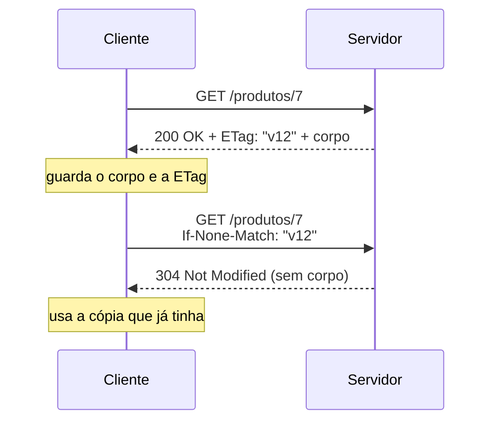

# Status Codes e Tratamento de Erros

O status code é a primeira coisa que quem consome a API olha, e muitas vezes a única. O código do front decide se mostra a tela de sucesso ou a mensagem de erro, o cliente HTTP decide se tenta de novo, o cache decide se guarda a resposta, o painel de monitoramento conta quantos 5xx apareceram no último minuto. Nenhum deles lê o corpo da resposta para tomar essas decisões. Por isso o código faz parte do contrato da API tanto quanto o formato do JSON.

A nota [HTTP, APIs e REST](/labs/web-dev/apis/01-http-rest/) tem uma tabela rápida com os códigos do dia a dia. Aqui o foco é o resto: os códigos menos comuns, as dúvidas que aparecem em entrevista e como montar um corpo de erro que o cliente consiga tratar.

## As cinco classes

O primeiro dígito diz a categoria da resposta:

| Classe | Significado          | Em uma frase                                       |
| ------ | -------------------- | -------------------------------------------------- |
| 1xx    | Informativo          | "Recebi, continue" (raro de ver em código de API)  |
| 2xx    | Sucesso              | "Deu certo"                                        |
| 3xx    | Redirecionamento     | "O que você quer está em outro lugar"              |
| 4xx    | Erro do cliente      | "O problema está no que você mandou"               |
| 5xx    | Erro do servidor     | "O problema é meu, não seu"                        |

A divisão entre 4xx e 5xx é a mais importante na prática. Um 4xx diz ao cliente que repetir a mesma requisição vai dar o mesmo erro, então ele precisa mudar alguma coisa (corrigir o body, fazer login, pedir permissão). Um 5xx diz que a requisição estava ok e o servidor falhou, então tentar de novo mais tarde pode funcionar.

A especificação também define uma regra útil: um cliente que recebe um código que não conhece deve tratá-lo como o código `x00` da classe. Se a API inventar um `499` e o cliente não souber o que é, ele trata como `400`. É por isso que dá para usar códigos novos sem quebrar clientes antigos, desde que a classe esteja certa.

A fonte oficial de todos os códigos de uso geral é a RFC 9110 (HTTP Semantics), seção 15, que substituiu as RFCs 7230 a 7235 em 2022.

## 2xx: sucesso

**200 OK** é o sucesso genérico com corpo. Serve para um `GET` que devolve o recurso, e para um `PUT` ou `PATCH` que devolve o recurso atualizado.

**201 Created** diz que um recurso novo foi criado. A resposta deve trazer o header `Location` apontando para a URL do recurso, assim o cliente sabe onde encontrá-lo sem adivinhar:

```http
HTTP/1.1 201 Created
Location: /usuarios/42
Content-Type: application/json

{ "id": 42, "nome": "Ana Silva" }
```

**202 Accepted** quer dizer "recebi o pedido, mas ainda não processei". É o código de operações assíncronas: gerar um relatório pesado, processar um vídeo, disparar uma importação. O HTTP não tem como mandar uma segunda resposta depois com o resultado, então o 202 não promete nada sobre o desfecho. O padrão é devolver um link para o cliente acompanhar o andamento:

```http
HTTP/1.1 202 Accepted
Location: /relatorios/jobs/9f3a

{ "status": "processando" }
```

O cliente consulta `/relatorios/jobs/9f3a` de tempos em tempos (ou recebe um webhook, ver [Estilos de Comunicação](/labs/web-dev/apis/04-estilos-de-comunicacao/)) até o job terminar.

**204 No Content** é sucesso sem corpo. Encaixa num `DELETE` bem-sucedido ou num `PUT` em que a API não devolve o recurso. Uma resposta 204 não pode ter body, e o cliente não deve tentar fazer parse de JSON nela (um `response.json()` no `fetch` sobre um 204 lança erro).

**205 Reset Content** pede ao cliente que limpe a "visão" que originou a requisição, tipo zerar um formulário depois de enviar para permitir um novo cadastro. Faz sentido em navegador, quase nunca em API JSON. Vale saber que existe porque aparece em listas de entrevista, mas não é algo que você vai usar no dia a dia.

## 3xx: redirecionamento

Redirecionamentos têm duas perguntas por trás: a mudança é temporária ou permanente? E o cliente pode trocar o método da requisição ao seguir o redirecionamento?

A segunda pergunta parece estranha, mas tem história. Os navegadores antigos, ao receber um 301 ou 302 depois de um `POST`, refaziam a requisição como `GET` no novo endereço, contrariando a especificação da época. Esse comportamento virou padrão de fato, e a RFC 9110 acabou aceitando: no 301 e no 302, o cliente **pode** trocar `POST` por `GET`. Como isso é ambíguo, criaram códigos novos com regras claras.

|                 | Pode trocar o método para GET | Mantém método e body |
| --------------- | ----------------------------- | -------------------- |
| **Temporário**  | 302 Found                     | 307 Temporary Redirect |
| **Permanente**  | 301 Moved Permanently         | 308 Permanent Redirect |

E tem o **303 See Other**, que é o único que manda explicitamente trocar para `GET`. Ele é usado depois de um `POST` para dizer "o resultado do que você fez está ali, vá buscar com GET". É o padrão POST-redirect-GET de formulários web, que evita que um F5 reenvie o formulário.

Para uma API, a regra prática fica assim: se você está redirecionando um endpoint que recebe `POST`, `PUT` ou `PATCH`, use 307 ou 308, senão o body pode se perder no caminho.

**304 Not Modified** é um caso à parte. Ele não redireciona para lugar nenhum, é a resposta a uma **requisição condicional**. O fluxo funciona assim:



A `ETag` é uma "impressão digital" da versão do recurso. Na segunda requisição o cliente pergunta "mudou desde a versão v12?". Se não mudou, o servidor responde 304 sem corpo e economiza a banda de mandar tudo de novo. O mesmo vale com datas, usando `Last-Modified` e `If-Modified-Since`. Como esses headers conversam com CDN e proxies está em [CDN](/labs/web-dev/escalabilidade/05-cdn/).

## 4xx: erro do cliente

**400 Bad Request** é o erro genérico do cliente. A RFC 9110 descreve como algo que o servidor percebe como erro de quem enviou: sintaxe malformada, mensagem com framing inválido, roteamento enganoso. Na prática de API: JSON que não faz parse, campo numérico com texto, parâmetro obrigatório da query ausente.

**401 Unauthorized** tem um nome infeliz. Apesar de dizer "não autorizado", o significado é **não autenticado**: o servidor não sabe quem você é, porque o token não veio, expirou ou é inválido. A especificação exige que a resposta traga o header `WWW-Authenticate` dizendo qual esquema de autenticação usar:

```http
HTTP/1.1 401 Unauthorized
WWW-Authenticate: Bearer realm="api", error="invalid_token"
```

**403 Forbidden** é o "não autorizado" de verdade: o servidor sabe quem você é e mesmo assim recusa, porque você não tem permissão para aquilo. Fazer login de novo não resolve.

**404 Not Found** diz que não existe nada naquela URL. Às vezes a API usa 404 também para recursos que existem mas o usuário não pode ver, para não revelar que eles existem (mais sobre isso nas dúvidas de entrevista, abaixo).

**405 Method Not Allowed** diz que a URL existe, mas não aceita aquele método, como um `DELETE /relatorios/10` numa API em que relatórios não podem ser apagados. A resposta deve trazer o header `Allow` com os métodos aceitos:

```http
HTTP/1.1 405 Method Not Allowed
Allow: GET, HEAD
```

**409 Conflict** indica que a requisição bate de frente com o estado atual do recurso. Exemplos: cadastrar um e-mail que já existe, tentar cancelar um pedido que já foi enviado, tentar mover um arquivo para uma pasta que foi apagada.

**412 Precondition Failed** aparece quando o cliente mandou uma condição que não bateu. O caso clássico é o controle otimista de concorrência: o cliente envia `If-Match: "v12"` num `PUT`, dizendo "só salve se o recurso ainda estiver na versão v12". Se outra pessoa salvou antes e a versão agora é v13, o servidor recusa com 412 em vez de sobrescrever a alteração alheia. O mesmo problema visto do lado do banco está em [Controle de Concorrência](/labs/web-dev/banco-de-dados/08-controle-de-concorrencia/).

**415 Unsupported Media Type** quer dizer que o `Content-Type` do body não é aceito, como mandar XML para uma API que só fala JSON.

**422 Unprocessable Content** (o nome antigo, "Unprocessable Entity", veio do WebDAV e ainda aparece muito) significa que a requisição está bem formada, o JSON fez parse, mas o conteúdo não passa nas regras: data de nascimento no futuro, quantidade negativa, CPF com dígito verificador errado.

**429 Too Many Requests** é a resposta do rate limiting: o cliente fez requisições demais num intervalo. Ela vem da RFC 6585 e deve trazer `Retry-After` dizendo quanto tempo esperar:

```http
HTTP/1.1 429 Too Many Requests
Retry-After: 30
```

Os algoritmos que decidem quando devolver 429 estão em [Rate Limiting](/labs/web-dev/escalabilidade/12-rate-limiting/).

## 5xx: erro do servidor

**500 Internal Server Error** é a falha genérica: uma exceção não tratada, um bug, um `NullPointerException`. O corpo de um 500 nunca deve trazer stack trace, mensagem de exceção do banco ou nome de tabela. Isso não ajuda o cliente e dá a um atacante um mapa de como o sistema funciona por dentro.

Os três próximos aparecem quando existe um intermediário (proxy reverso, load balancer, API gateway) entre o cliente e o serviço:

- **502 Bad Gateway**: o intermediário conseguiu falar com o serviço de trás (o "upstream"), mas recebeu uma resposta inválida, ou a conexão caiu no meio. É comum quando o processo do serviço morreu ou está reiniciando.
- **503 Service Unavailable**: o servidor está temporariamente sem condição de atender, por sobrecarga ou manutenção. Pode vir com `Retry-After`. Um circuit breaker aberto ou um health check falhando costumam virar 503.
- **504 Gateway Timeout**: o intermediário esperou o upstream e desistiu, porque a resposta não chegou dentro do timeout configurado.

**505 HTTP Version Not Supported** diz que o servidor não aceita a versão do protocolo usada na requisição. É raro na vida real.

E aqui entra uma decisão prática: em quais 5xx vale tentar de novo? Os casos de 502, 503 e 504 costumam ser transitórios, então um retry com backoff faz sentido, respeitando o `Retry-After` quando vier. Um 500 pode ser bug determinístico, que vai falhar igual em todas as tentativas. E em todos os casos, só repita automaticamente requisições idempotentes ou protegidas por idempotency key: um 504 não diz se o servidor processou ou não o pedido, ele só diz que a resposta não chegou a tempo. Retry, timeout e circuit breaker estão em [Timeout, Retry, Circuit Breaker e Bulkhead](/labs/web-dev/resiliencia/01-timeout-retry-circuit-breaker-e-bulkhead/), e repetir sem duplicar efeito está em [Idempotência](/labs/web-dev/resiliencia/02-idempotencia/).

## Dúvidas clássicas de entrevista

**401 ou 403?** A pergunta a fazer é: se o cliente fizer login (ou mandar um token válido), o resultado muda? Se sim, é 401. Se ele já está autenticado e continua sem poder, é 403.

**400 ou 422?** 400 quando nem dá para entender a requisição (JSON quebrado, tipo errado). 422 quando dá para entender, mas o conteúdo viola uma regra. Muita API usa 400 para tudo, e isso não é errado, a RFC permite. O importante é escolher um critério e aplicar igual em todos os endpoints.

**404 ou 403 para esconder um recurso?** Se um usuário tenta acessar `/pedidos/123` e o pedido existe mas é de outra pessoa, responder 403 confirma que o pedido 123 existe. Em recursos sensíveis, responder 404 evita esse vazamento. O GitHub faz isso com repositórios privados: quem não tem acesso recebe 404, não 403.

**200, 201 ou 204?** Criou recurso: 201 com `Location`. Apagou: 204 (ou 200 se devolver algo útil no corpo). Leu ou atualizou e devolveu o recurso: 200.

**301, 302, 307 ou 308?** Permanente ou temporário define o primeiro corte; manter o método define o segundo (ver a tabela na seção de 3xx). Para APIs que recebem body, 307 e 308.

**502, 503 ou 504?** 502: o upstream respondeu errado ou caiu. 503: o servidor está sem capacidade agora. 504: o upstream não respondeu a tempo.

**Por que não devolver sempre 200 com `"success": false` no corpo?** Porque tudo o que fica no caminho só entende o status. O cache pode guardar o "erro" como se fosse sucesso, o monitoramento não conta a falha, o retry do cliente HTTP não dispara, e o código de quem consome precisa abrir o corpo de cada resposta para saber se deu certo. Status certo é de graça e todo mundo entende.

## Formato de erro padronizado

O status diz a categoria do erro, mas o cliente quase sempre precisa de mais: qual campo está inválido, qual regra foi violada, uma mensagem para mostrar ao usuário. Se cada endpoint devolver o erro num formato diferente (`{ "erro": ... }` aqui, `{ "message": ... }` ali, uma string solta em outro lugar), o cliente precisa de um tratamento para cada um. A primeira regra é usar um formato só na API inteira.

Em vez de inventar esse formato, dá para usar um padrão: a **RFC 9457, Problem Details for HTTP APIs** (de 2023, que substituiu a RFC 7807). Ela define o media type `application/problem+json` e um conjunto de campos:

| Campo      | O que é                                                                                 |
| ---------- | --------------------------------------------------------------------------------------- |
| `type`     | URI que identifica o tipo do problema (pode apontar para uma página de documentação)    |
| `title`    | Resumo curto do tipo do problema, igual em todas as ocorrências                         |
| `status`   | O status HTTP, repetido no corpo por conveniência (precisa ser igual ao da resposta)    |
| `detail`   | Explicação desta ocorrência específica, pensada para ajudar o cliente a corrigir        |
| `instance` | URI que identifica esta ocorrência                                                      |

Além deles, a API pode adicionar campos próprios, as **extensões**. Um cliente que não conhece uma extensão simplesmente a ignora. Um erro de validação ficaria assim:

```http
HTTP/1.1 422 Unprocessable Content
Content-Type: application/problem+json

{
  "type": "https://api.exemplo.com/erros/validacao",
  "title": "Dados inválidos",
  "status": 422,
  "detail": "Dois campos não passaram na validação.",
  "instance": "/usuarios",
  "codigo": "VALIDACAO",
  "correlationId": "c0a8012e-7f3b-4d1a",
  "erros": [
    { "campo": "email", "mensagem": "Formato de e-mail inválido" },
    { "campo": "dataNascimento", "mensagem": "Não pode ser uma data futura" }
  ]
}
```

`codigo`, `correlationId` e `erros` são extensões. A lista de erros por campo deixa o front destacar cada campo do formulário; o código de negócio estável (`VALIDACAO`, `SALDO_INSUFICIENTE`) deixa o cliente decidir o que fazer sem depender do texto da mensagem, que pode mudar ou ser traduzido.

Spring (com `ProblemDetail`), ASP.NET Core e vários frameworks Node já têm suporte nativo, então adotar o padrão costuma ser mais barato do que manter um formato caseiro.

O cuidado é o mesmo do 500: a mensagem é para quem consome a API, não para quem a desenvolve. A própria RFC alerta para não expor detalhes de implementação, como stack dumps. O detalhe técnico vai para o log, com o mesmo `correlationId` que foi na resposta. Quando um cliente reclamar "deu erro", ele manda o id e você encontra a exceção completa no log em segundos. Como montar essa correlação está em [Logs, Metrics e Traces](/labs/web-dev/observabilidade/01-logs-metrics-e-traces/).

## Envelope de resposta: usar ou não

Muitos tutoriais ensinam a embrulhar toda resposta num envelope:

```json
{
  "success": true,
  "message": "Usuário encontrado com sucesso",
  "data": { "id": 10, "nome": "Ana Silva" }
}
```

O envelope é popular porque dá uma estrutura previsível. O problema é que `success` repete o que o status já diz, e `message` num sucesso raramente é lida por alguém. Pior: abre a porta para o `200` com `"success": false`, que quebra tudo o que foi falado nas dúvidas de entrevista.

O envelope faz sentido quando a resposta precisa carregar algo além do recurso, como os metadados de paginação de uma listagem (ver [Paginação](/labs/web-dev/apis/06-paginacao/)):

```json
{
  "data": [ { "id": 1 }, { "id": 2 } ],
  "pagination": { "page": 2, "limit": 10, "total": 150, "totalPages": 15 }
}
```

Uma combinação que funciona bem: no sucesso, o corpo é o próprio recurso (ou `data` + metadados, nas listagens); no erro, o corpo segue Problem Details; e o status HTTP é sempre o que diz se deu certo. Tanto faz qual convenção a API escolhe, contanto que ela seja a mesma em todos os endpoints. Uma API com três formatos de resposta é pior do que qualquer um dos três aplicado de forma consistente.

## Referências

- [Códigos de status de respostas HTTP](https://developer.mozilla.org/pt-BR/docs/Web/HTTP/Reference/Status) - MDN Web Docs, pt-BR
- [HTTP conditional requests](https://developer.mozilla.org/en-US/docs/Web/HTTP/Guides/Conditional_requests) - MDN Web Docs, en
- [RFC 9110 - HTTP Semantics, §15 Status Codes](https://www.rfc-editor.org/rfc/rfc9110.html#name-status-codes) - IETF, en
- [RFC 6585 - Additional HTTP Status Codes](https://www.rfc-editor.org/rfc/rfc6585.html) - IETF, en
- [RFC 9457 - Problem Details for HTTP APIs](https://www.rfc-editor.org/rfc/rfc9457.html) - IETF, en
