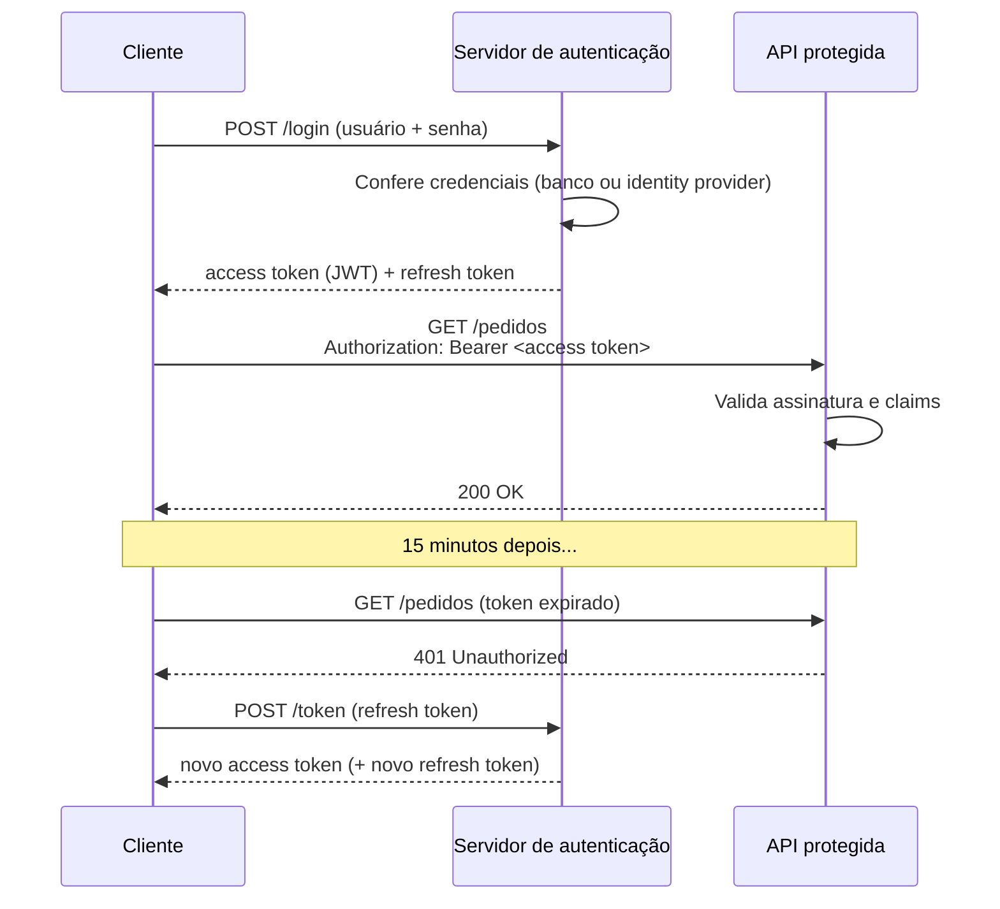
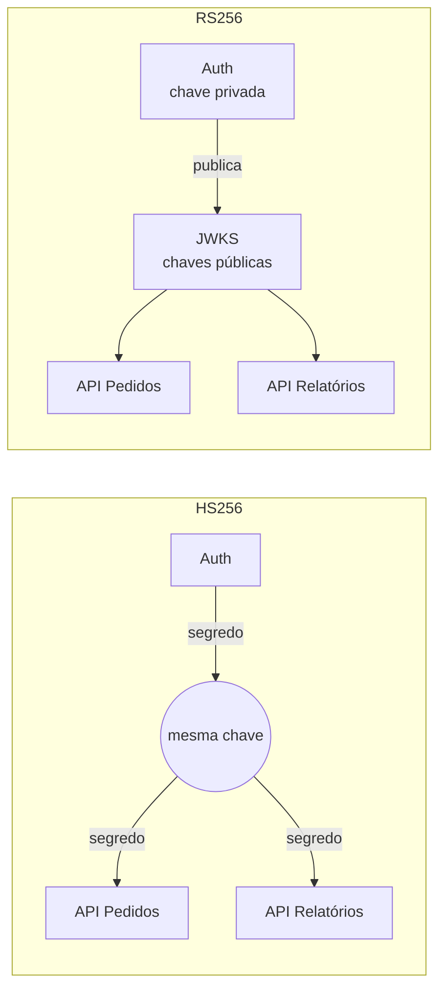
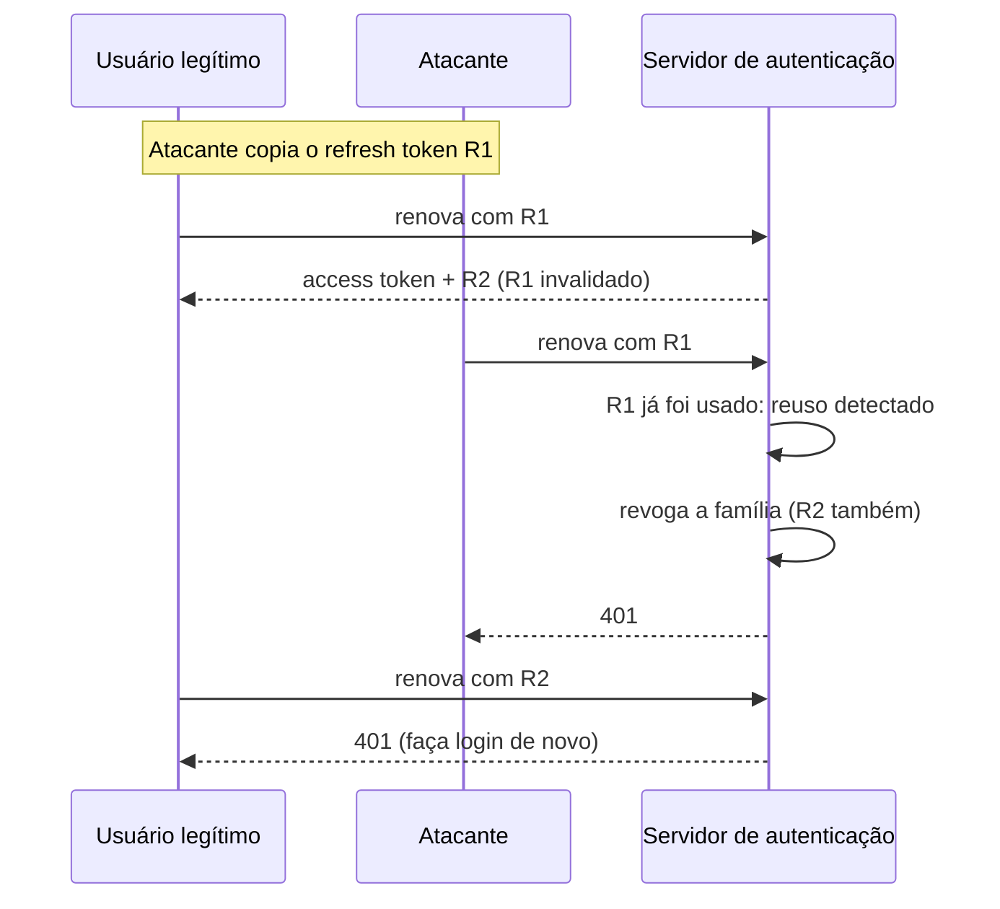

# JWT na Prática

O formato do JWT (`header.payload.signature`), o fato de o payload ser só codificado e não cifrado, e a ideia de autenticação stateless já foram vistos em [Segurança e Evolução de APIs](/labs/web-dev/apis/03-seguranca-e-evolucao-de-apis/). Saber ler um token é o começo. Os problemas de verdade aparecem na hora de usar: onde guardar, como validar, o que fazer quando ele é roubado e como renovar sem abrir brecha.

## Ciclo de vida de um JWT

Do login até a renovação, o caminho típico de um token é este:



### Emissão: o que vai dentro do token

Depois de conferir as credenciais, o servidor monta o payload com as **claims**, que são as afirmações que o token carrega. Algumas têm nome e significado definidos pela especificação (RFC 7519):

```json
{
  "iss": "https://auth.loja.com",
  "sub": "usuario-8812",
  "aud": "api-pedidos",
  "exp": 1792501200,
  "nbf": 1792500300,
  "iat": 1792500300,
  "jti": "9f1c2a7e-4b33-4d0e-8a61-2f7d1c9e0b55",
  "roles": ["cliente"]
}
```

| Claim | Significado                                                    |
| ----- | -------------------------------------------------------------- |
| `iss` | Quem emitiu o token (issuer)                                   |
| `sub` | De quem é o token (subject), normalmente o ID do usuário       |
| `aud` | Para quem o token foi feito (audience), qual API deve aceitá-lo |
| `exp` | Quando expira, em segundos desde 1970 (Unix timestamp)          |
| `nbf` | Antes desse momento, o token ainda não vale (not before)        |
| `iat` | Quando foi emitido (issued at)                                  |
| `jti` | Um ID único do token, útil para revogação                       |

`roles` não é padrão, é uma claim da própria aplicação. Você pode criar as suas, mas cada claim a mais aumenta o tamanho de **toda** requisição, porque o token vai inteiro no header. Coloque só o que a API precisa para decidir, não o perfil completo do usuário.

### Validação: assinatura não basta

Quando a API recebe o token, conferir a assinatura prova só que o token foi emitido por quem tem a chave e não foi alterado. Isso não diz se ele ainda vale nem se foi feito para esta API. A validação completa confere:

- **Assinatura**, com o algoritmo que a API espera (mais sobre isso em [Ataques conhecidos e defesas](#ataques-conhecidos-e-defesas));
- **`exp` e `nbf`**: o token está dentro da janela de validade. É comum aceitar uma folga pequena (30 a 60 segundos) para relógios de servidores levemente dessincronizados;
- **`iss`**: veio do emissor configurado, e não de qualquer servidor que assine tokens;
- **`aud`**: foi emitido para esta API. Sem essa checagem, um token feito para a API de relatórios internos seria aceito pela API de pagamentos, se as duas confiam no mesmo emissor.

Se qualquer item falhar, a resposta é `401 Unauthorized`. O mesmo checklist aparece na validação do ID token em [SSO, OAuth 2.0, OIDC e SAML](/labs/web-dev/apis/08-sso-oauth-oidc-saml/), onde também está a diferença entre ID token e access token.

Na prática quase ninguém escreve isso na mão, a biblioteca faz. O cuidado é **passar todas as opções**, porque várias bibliotecas só checam o que você pede:

```js
import jwt from "jsonwebtoken";

const payload = jwt.verify(token, publicKey, {
  algorithms: ["RS256"],          // só aceita este algoritmo
  issuer: "https://auth.loja.com",
  audience: "api-pedidos",
  clockTolerance: 30,             // segundos de folga para exp/nbf
});
```

## Assinatura: HS256 vs RS256

O algoritmo de assinatura define quem consegue **criar** tokens e quem consegue **verificar**.

**HS256** (HMAC com SHA-256) usa um único segredo compartilhado. A mesma chave assina e verifica. É simples e rápido, mas tem uma consequência séria: todo serviço que consegue verificar um token também consegue **fabricar** um. Se a API de pedidos tem o segredo para validar, um invasor que comprometer essa API pode emitir tokens de administrador à vontade.

**RS256** (RSA) e **ES256** (curva elíptica, com chaves e assinaturas menores) usam um par de chaves. Só o servidor de autenticação tem a chave privada e assina; as APIs recebem a chave pública, que só verifica. Comprometer uma API não dá poder de emitir tokens.



A regra prática: HS256 funciona bem quando quem emite e quem valida é o **mesmo** serviço (um monólito que gera e confere seus próprios tokens). Com vários serviços validando, use um algoritmo assimétrico.

### JWKS e rotação de chaves

Com chave assimétrica, o servidor de autenticação publica suas chaves públicas num endereço conhecido, o **JWKS** (JSON Web Key Set), geralmente algo como `https://auth.loja.com/.well-known/jwks.json`:

```json
{
  "keys": [
    { "kid": "2026-10", "kty": "RSA", "alg": "RS256", "use": "sig", "n": "0vx7ag...", "e": "AQAB" },
    { "kid": "2026-07", "kty": "RSA", "alg": "RS256", "use": "sig", "n": "xjlCRB...", "e": "AQAB" }
  ]
}
```

Cada token traz no header um `kid` (key ID) dizendo com qual chave foi assinado, e a API busca no JWKS a chave com aquele `kid`. Isso permite **trocar de chave sem derrubar ninguém**: publica-se a chave nova ao lado da antiga, passa-se a assinar com a nova, e a antiga só sai do JWKS depois que todos os tokens assinados com ela expiraram. As APIs fazem cache do JWKS e buscam de novo quando aparece um `kid` desconhecido.

## A família JOSE

JWT faz parte de um conjunto de especificações chamado **JOSE** (JSON Object Signing and Encryption). Os nomes aparecem bastante em documentação e é fácil se perder:

| Sigla | O que é                                                                 |
| ----- | ----------------------------------------------------------------------- |
| JWS   | JSON Web Signature: conteúdo **assinado** (íntegro, mas legível)        |
| JWE   | JSON Web Encryption: conteúdo **cifrado** (ninguém lê sem a chave)      |
| JWK   | JSON Web Key: uma chave criptográfica representada em JSON              |
| JWKS  | JSON Web Key Set: uma lista de JWKs, como a do exemplo acima            |

O JWT é o formato das claims; ele pode ser transportado como JWS ou como JWE. Quase todo JWT que você vai encontrar é um **JWS**, ou seja, assinado e não cifrado. Por isso a regra de nunca colocar dado sensível no payload (CPF, endereço, dados de cartão): qualquer um que pegue o token lê tudo em um site de decodificação. JWE existe para quando o conteúdo precisa ser sigiloso, mas é bem menos comum e mais complexo de operar.

## Onde guardar o token no cliente

No navegador, as duas opções mais usadas são `localStorage` e cookie. Nenhuma é perfeita; cada uma protege contra um tipo de ataque e fica exposta a outro.

**localStorage (ou sessionStorage)**: o JavaScript da página lê o token e coloca no header `Authorization`. O problema é que **qualquer** JavaScript da página consegue ler, inclusive um script injetado por um ataque de XSS (Cross-Site Scripting) ou uma dependência npm comprometida. O token sai do navegador e pode ser usado de qualquer lugar até expirar.

**Cookie com `HttpOnly`**: o JavaScript não consegue ler o cookie, então um XSS não consegue **roubar** o token. A configuração recomendada é:

```http
Set-Cookie: access_token=eyJhbGciOi...; HttpOnly; Secure; SameSite=Lax; Path=/; Max-Age=900
```

- `HttpOnly`: invisível para JavaScript;
- `Secure`: só trafega em HTTPS;
- `SameSite=Lax` (ou `Strict`): o navegador não manda o cookie em requisições disparadas por outros sites, o que bloqueia a maior parte dos ataques de CSRF.

O ponto que muita explicação pula: o navegador envia o cookie **automaticamente** em toda requisição para o seu domínio. Isso abre espaço para **CSRF** (Cross-Site Request Forgery), em que um site malicioso faz o navegador da vítima disparar uma requisição autenticada. `SameSite` resolve boa parte; para operações sensíveis, um token anti-CSRF complementa. E `HttpOnly` não deixa você imune a XSS: o script injetado não leva o token embora, mas ainda consegue fazer requisições pela página enquanto ela está aberta.

Resumindo o trade-off: cookie `HttpOnly` + `Secure` + `SameSite` é a opção mais defendida hoje para aplicações web, porque transforma "roubar o token" em "agir só enquanto a página está aberta". Mas ela pede cuidado com CSRF, que o localStorage não tem. Em apps mobile e chamadas servidor a servidor, a discussão muda: lá o token vai no header mesmo, guardado no armazenamento seguro do sistema (Keychain, Keystore) ou num cofre de segredos.

## Revogação: o lado ruim do stateless

A vantagem do JWT é a API não precisar consultar nada para validar. A desvantagem é exatamente a mesma: se a API não consulta nada, ela não tem como saber que o token foi cancelado.

Na prática, isso significa:

- um **token roubado vale até expirar**, mesmo que o usuário perceba e troque a senha;
- o **logout** apaga o token do navegador, mas uma cópia capturada antes continua funcionando;
- um **usuário que perdeu uma permissão** continua com ela no token. Se `roles: ["admin"]` foi emitido às 14h e o acesso foi retirado às 14h05, o token diz "admin" até expirar.

Não existe solução sem custo, mas existem formas de diminuir a janela:

- **Access tokens curtos.** Com 5 a 15 minutos de vida, um token roubado tem pouco tempo de uso, e uma mudança de permissão vale no máximo nesse prazo. O preço é renovar com mais frequência, e é para isso que existe o refresh token.
- **Denylist por `jti`.** Para os casos que não podem esperar (conta comprometida, desligamento de funcionário), guarde o `jti` dos tokens revogados num armazenamento rápido como o [Redis](/labs/web-dev/escalabilidade/09-cache-e-redis/), com expiração igual à do token. A API consulta a lista a cada requisição. Sim, isso traz de volta um pouco de estado, mas é uma consulta pequena e só a lista dos revogados, não de todas as sessões.
- **Decisões sensíveis no dono do dado.** A claim `roles` serve para filtrar o óbvio, mas "este usuário pode estornar este pagamento agora?" deve ser checado pelo serviço dono do recurso, com o estado atual do banco, e não confiando só no que estava no token. A divisão entre o que o gateway barra e o que o serviço decide está em [Segurança e Evolução de APIs](/labs/web-dev/apis/03-seguranca-e-evolucao-de-apis/).

## Refresh token com segurança

O refresh token resolve a renovação, mas vira um alvo melhor que o access token: ele vive mais (dias ou semanas) e gera tokens novos. Roubar um refresh token é ganhar acesso por muito mais tempo.

### Rotação e detecção de reutilização

A defesa recomendada pela RFC 9700 (boas práticas de segurança do OAuth 2.0) é a **rotação**: cada vez que o refresh token é usado, o servidor devolve um refresh token **novo** e invalida o anterior. Todos os tokens que nasceram do mesmo login formam uma "família".

O pulo do gato está no que acontece quando um refresh token **já usado** aparece de novo. Isso só acontece se duas partes têm uma cópia dele, ou seja, alguém roubou. O servidor não tem como saber qual dos dois é o legítimo, então revoga a família inteira e obriga um novo login:



O usuário legítimo perde a sessão, o que é chato, mas o atacante perde o acesso imediatamente, em vez de seguir renovando por semanas.

### Renovações concorrentes

A rotação tem um efeito colateral conhecido: falso positivo. Imagine o usuário com três abas abertas. O access token expira, e as três abas tentam renovar ao mesmo tempo com o mesmo refresh token. A primeira consegue; as outras duas parecem reutilização, e a sessão inteira cai. O mesmo acontece se a resposta da renovação se perde na rede e o cliente tenta de novo.

As soluções mais comuns:

- no cliente, garantir que só uma renovação aconteça por vez (as outras abas esperam o resultado, por exemplo coordenando via `BroadcastChannel` ou um lock);
- no servidor, um período de tolerância curto (alguns segundos) em que o refresh token anterior ainda é aceito, devolvendo o mesmo resultado.

## Ataques conhecidos e defesas

### `alg: none`

A especificação do JWT permite um "token sem assinatura", com `"alg": "none"` no header. Algumas bibliotecas antigas liam esse campo e, vendo `none`, simplesmente pulavam a verificação. O ataque era trivial: pegar um token qualquer, trocar o payload para `"roles": ["admin"]`, colocar `alg: none` e apagar a assinatura.

### Confusão de algoritmo (RS256 → HS256)

Mais sutil. A API usa RS256 e tem a chave **pública** configurada. O atacante monta um token com `"alg": "HS256"` e o assina via HMAC usando a própria chave pública como segredo (ela é pública, ele tem acesso). Uma biblioteca que confia no header pensa: "HS256, então uso a chave configurada como segredo HMAC", recalcula, e a assinatura bate.

### A defesa para os dois

As duas falhas têm a mesma raiz: **deixar o token escolher como será verificado**. A recomendação da RFC 8725 é que a API fixe o algoritmo esperado para cada chave e rejeite qualquer outro, como o `algorithms: ["RS256"]` do exemplo de validação. Junto com isso:

- valide **todas** as claims (`exp`, `nbf`, `iss`, `aud`), não só a assinatura;
- mantenha a biblioteca de JWT atualizada, porque é ali que esses bugs costumam ser corrigidos;
- use um segredo longo e aleatório se usar HS256 (ao menos 256 bits), porque um segredo fraco pode ser descoberto por força bruta offline a partir de um único token.

## Referências

- [Introduction to JSON Web Tokens](https://jwt.io/introduction) - jwt.io (Auth0), en
- [JSON Web Token Cheat Sheet](https://cheatsheetseries.owasp.org/cheatsheets/JSON_Web_Token_Cheat_Sheet.html) - OWASP, en
- [RFC 8725 - JSON Web Token Best Current Practices](https://datatracker.ietf.org/doc/html/rfc8725) - IETF, en
- [RFC 9700 - OAuth 2.0 Security Best Current Practice](https://datatracker.ietf.org/doc/html/rfc9700) - IETF, en
- [Cookies HTTP](https://developer.mozilla.org/pt-BR/docs/Web/HTTP/Cookies) - MDN, pt-BR
