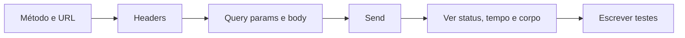

# Testes e Documentação de APIs

Uma API sem teste quebra em silêncio: alguém muda o nome de um campo, o build passa, e o app mobile descobre em produção. Uma API sem documentação tem outro problema, ela funciona, mas ninguém sabe como usar sem perguntar para quem escreveu.

Esta nota fica no lado prático: as ferramentas para chamar uma API, como automatizar as verificações e o que precisa estar na documentação. A pirâmide de testes e o contract testing estão em [Testes em Microsserviços](/labs/web-dev/engenharia-de-software/04-testes-em-microsservicos/), e a especificação OpenAPI, com as abordagens code-first e contract-first, em [Segurança e Evolução de APIs](/labs/web-dev/apis/03-seguranca-e-evolucao-de-apis/).

## Ferramentas para chamar uma API na mão

Antes de automatizar qualquer coisa, você precisa conseguir disparar uma requisição e olhar a resposta. As opções mais comuns:

| Ferramenta                  | O que é                                                                 | Bom para                                                          |
| --------------------------- | ----------------------------------------------------------------------- | ----------------------------------------------------------------- |
| curl                        | Cliente HTTP de linha de comando, já instalado em quase todo sistema    | Reproduzir um bug, colar num ticket, usar em scripts e servidores |
| Postman                     | Cliente gráfico com coleções, ambientes, scripts e execução em CI       | Explorar uma API, montar suítes de teste, compartilhar com o time |
| Insomnia                    | Cliente gráfico mais enxuto, com suporte a REST, GraphQL e gRPC         | O mesmo uso do Postman, com uma interface mais simples            |
| Swagger UI                  | Página gerada a partir da especificação OpenAPI, com botão "Try it out" | Testar direto da documentação, sem instalar nada                  |
| Thunder Client, REST Client | Extensões do VS Code                                                    | Testar sem sair do editor                                         |

A extensão REST Client (e o suporte nativo das IDEs da JetBrains) usa arquivos `.http`, que são texto puro e podem ser versionados junto com o código:

```http
### Buscar usuário
GET http://localhost:3000/usuarios/1
Authorization: Bearer {{token}}

### Criar usuário
POST http://localhost:3000/usuarios
Content-Type: application/json

{ "nome": "Ana Silva", "email": "ana@exemplo.com" }
```

Qual escolher? Para uma chamada rápida ou para mandar a alguém "roda isso aqui", curl. Para explorar uma API nova ou manter uma suíte de testes compartilhada, Postman ou Insomnia. Para deixar exemplos executáveis no repositório, arquivos `.http`.

## curl na prática

O curl vale a pena aprender porque está em todo lugar: no servidor de produção, no container, no pipeline de CI. Os comandos que resolvem a maioria dos casos:

```bash
# GET simples
curl https://api.exemplo.com/usuarios/1

# GET com headers (-H) e autenticação Bearer
curl -H "Authorization: Bearer $TOKEN" \
     -H "Accept: application/json" \
     https://api.exemplo.com/usuarios/1

# POST com JSON: -d envia o body (e muda o método para POST)
curl -X POST https://api.exemplo.com/usuarios \
     -H "Content-Type: application/json" \
     -d '{"nome": "Ana Silva", "email": "ana@exemplo.com"}'

# -i mostra status e headers da resposta junto com o corpo
curl -i https://api.exemplo.com/usuarios/1

# -I faz uma requisição HEAD (só headers)
curl -I https://api.exemplo.com/usuarios/1

# -v mostra tudo: conexão, TLS, headers enviados e recebidos
curl -v https://api.exemplo.com/usuarios/1
```

Repare no `$TOKEN`: o token vem de uma variável de ambiente, e não escrito no comando, para não ficar no histórico do shell nem vazar quando você cola o comando num ticket.

Um atalho útil: na aba Network do DevTools do navegador, clique com o botão direito numa requisição e escolha "Copy as cURL". Você recebe o comando completo, com todos os headers, pronto para reproduzir no terminal. O Postman faz o caminho contrário: importa um comando curl e vira uma requisição na coleção, e também exporta qualquer requisição como curl.

## Fluxo de teste no Postman

O fluxo básico de uma requisição no Postman segue a mesma anatomia de qualquer requisição HTTP:



O que diferencia o Postman de um curl com interface bonita são as **coleções** e os **ambientes**.

Uma coleção agrupa requisições em pastas, como "Usuários" e "Pedidos". Ela vira o roteiro de testes da API: dá para rodar a coleção inteira na ordem e ver quais requisições passaram.

Um ambiente é um conjunto de variáveis. Em vez de escrever `http://localhost:3000` em cada requisição, você escreve `{{baseUrl}}/usuarios` e define `baseUrl` em cada ambiente: `local`, `homologação`, `produção`. Trocar de ambiente num seletor troca o alvo de todas as requisições. O mesmo vale para `{{token}}`: credenciais ficam nas variáveis, e não fixas nas requisições, assim a coleção pode ser exportada e compartilhada sem levar segredo junto. O Postman separa o valor inicial (que é sincronizado e compartilhado) do valor atual (que fica só na sua máquina), então guarde tokens reais só no valor atual.

## Testes automatizados com scripts

Olhar a resposta a cada requisição não escala. O Postman permite escrever scripts em JavaScript que rodam depois que a resposta chega, na aba **Scripts > Post-response** (em versões antigas, a aba se chamava "Tests"). As asserções usam `pm.test` e `pm.expect`, com a sintaxe da biblioteca Chai:

```js
pm.test("Status é 200", function () {
  pm.response.to.have.status(200);
});

pm.test("Responde em menos de 500 ms", function () {
  pm.expect(pm.response.responseTime).to.be.below(500);
});

pm.test("Corpo tem nome e email", function () {
  const json = pm.response.json();
  pm.expect(json).to.have.property("nome");
  pm.expect(json.email).to.include("@");
});
```

Dá para validar o formato inteiro da resposta contra um JSON Schema, o que pega campos que sumiram ou mudaram de tipo:

```js
const schema = {
  type: "object",
  required: ["id", "nome", "email"],
  properties: {
    id: { type: "integer" },
    nome: { type: "string" },
    email: { type: "string" },
  },
};

pm.test("Resposta segue o schema", function () {
  pm.response.to.have.jsonSchema(schema);
});
```

Os scripts também permitem **encadear requisições**. O teste do `POST /usuarios` guarda o id criado numa variável, e as requisições seguintes da coleção usam `{{usuarioId}}`:

```js
// script de pós-resposta do POST /usuarios
pm.collectionVariables.set("usuarioId", pm.response.json().id);
```

```http
GET {{baseUrl}}/usuarios/{{usuarioId}}
DELETE {{baseUrl}}/usuarios/{{usuarioId}}
```

Com isso, a coleção vira um teste de fluxo completo: cria, lê, atualiza, apaga.

Para rodar fora da interface, por exemplo no pipeline de CI a cada pull request, existem o **Postman CLI** (a ferramenta oficial atual) e o **Newman** (o executor de linha de comando mais antigo, open source):

```bash
newman run colecao.json -e ambiente-homologacao.json
```

Se algum teste falhar, o comando termina com código de erro e o pipeline quebra. É assim que a coleção vira teste de regressão: a mudança que quebrou um campo é pega antes do merge.

## O que testar numa API

O erro mais comum é testar só o caminho feliz. Para cada endpoint, vale cobrir:

- **Casos positivos**: a requisição válida devolve o status e o corpo esperados.
- **Entrada inválida**: campo obrigatório faltando, tipo errado, valor fora da faixa. Deve dar 400 ou 422, com o erro no formato padrão da API.
- **Sem autenticação**: sem token ou com token expirado. Deve dar 401.
- **Sem permissão**: usuário autenticado tentando acessar o recurso de outro. Deve dar 403 ou 404. Esse teste pega o IDOR, o risco número um da lista da OWASP (ver [Segurança de APIs na Prática](/labs/web-dev/apis/09-seguranca-de-apis-na-pratica/)).
- **Recurso inexistente**: id que não existe. Deve dar 404.

Além do status, confira os headers que fazem parte do contrato: `Location` num 201, `Content-Type` correto, `Retry-After` num 429. O que cada código significa está em [Status Codes e Tratamento de Erros](/labs/web-dev/apis/02-status-codes-e-tratamento-de-erros/).

Algumas propriedades merecem teste específico. Repetir o mesmo `PUT` ou `DELETE` tem que deixar o sistema no mesmo estado, e um `POST` com a mesma idempotency key não pode criar dois registros (ver [Idempotência](/labs/web-dev/resiliencia/02-idempotencia/)). Os limites também: página maior que o máximo permitido, body gigante, rajada de requisições até o rate limit.

Coleções do Postman testam a API de fora, como caixa-preta, contra um ambiente rodando. Elas não substituem os testes de integração escritos no próprio código, que sobem a aplicação (ou parte dela) dentro do teste e fazem requisições HTTP de verdade: **supertest** em Node, **REST Assured** ou **MockMvc** em Java, o `TestClient` do FastAPI em Python. Esses rodam no build, junto com os testes unitários, e conseguem preparar o banco do jeito que cada caso precisa. Um arranjo comum: testes de integração no código cobrem a lógica de cada endpoint, e uma coleção pequena roda contra homologação depois do deploy, como smoke test.

## O que documentar

Uma boa documentação responde, sem precisar perguntar a ninguém, tudo o que alguém precisa para fazer a primeira chamada funcionar e para tratar os erros:

- **Base URL e ambientes**: `https://api.exemplo.com/v1` em produção, `https://sandbox.api.exemplo.com/v1` para testes.
- **Autenticação**: como obter a credencial (cadastro, fluxo OAuth) e como enviá-la (`Authorization: Bearer ...`).
- **Endpoints**: método, caminho e uma descrição do que cada um faz.
- **Requisição**: path params, query params, headers obrigatórios e o schema do body, com quais campos são obrigatórios e seus formatos.
- **Resposta**: cada status code que o endpoint pode devolver e o corpo de cada um.
- **Erros**: o formato padrão de erro e a lista de códigos de negócio (`SALDO_INSUFICIENTE`, `EMAIL_JA_CADASTRADO`).
- **Exemplos prontos para copiar**: requisição e resposta reais, incluindo o comando curl.
- **Regras transversais**: rate limits, como funciona a paginação, a política de versionamento e um changelog do que mudou.

Os exemplos são a parte mais lida. Muita gente pula a descrição dos campos, copia o curl, troca o token e vai ajustando a partir do erro.

## OpenAPI e Swagger hoje

Os nomes confundem por razões históricas. A especificação nasceu como **Swagger Specification**; em 2016 ela foi doada à OpenAPI Initiative, da Linux Foundation, e passou a se chamar **OpenAPI Specification**. "Swagger" ficou como o nome das ferramentas da SmartBear em volta dela: Swagger UI, Swagger Editor, Swagger Codegen. Então o arquivo é OpenAPI, e a página interativa gerada a partir dele é o Swagger UI.

As versões que você vai encontrar:

- **2.0**: ainda chamada de Swagger 2.0, presente em muito projeto antigo.
- **3.0**: reorganizou a estrutura (por exemplo, `components` no lugar de `definitions`).
- **3.1**: alinhou o Schema Object ao JSON Schema 2020-12, então o mesmo schema serve para validação fora da documentação.
- **3.2**: lançada em setembro de 2025, compatível com a 3.1, trouxe suporte a streaming (SSE, JSON Lines), ao método `QUERY` e a tags hierárquicas.

Os modelos ficam definidos uma vez em `components/schemas` e são referenciados com `$ref` em quantos endpoints precisarem:

```yaml
openapi: 3.1.0
info:
  title: API de Usuários
  version: 1.0.0
paths:
  /usuarios:
    get:
      summary: Lista usuários
      responses:
        "200":
          description: Lista de usuários
          content:
            application/json:
              schema:
                type: array
                items:
                  $ref: "#/components/schemas/Usuario"
components:
  schemas:
    Usuario:
      type: object
      required: [id, nome, email]
      properties:
        id: { type: integer }
        nome: { type: string }
        email: { type: string, format: email }
```

O valor de ter a especificação está no que ela permite gerar sem esforço extra:

- documentação navegável (Swagger UI, Redoc);
- clientes HTTP tipados em várias linguagens e esqueletos de servidor (OpenAPI Generator);
- servidores de mock, para o front começar antes de o back existir;
- validação automática das requisições e respostas contra os schemas;
- importação direta no Postman e no Insomnia, já com todas as requisições montadas.

O risco de qualquer documentação é ficar para trás do código. Existem dois jeitos de evitar isso: gerar a especificação a partir do código (code-first), ou escrever a especificação primeiro e validar no CI que a implementação respeita o contrato (contract-first), com ferramentas que comparam as respostas reais com os schemas e quebram o build quando divergem. O que não funciona é manter a documentação à mão numa wiki separada.

## Referências

- [Write scripts to test API response data in Postman](https://learning.postman.com/docs/tests-and-scripts/write-scripts/test-scripts/) - Postman, en
- [curl - manual](https://curl.se/docs/manpage.html) - curl, en
- [OpenAPI Specification v3.2.0](https://spec.openapis.org/oas/v3.2.0.html) - OpenAPI Initiative, en
- [Swagger UI](https://swagger.io/tools/swagger-ui/) - SmartBear, en
