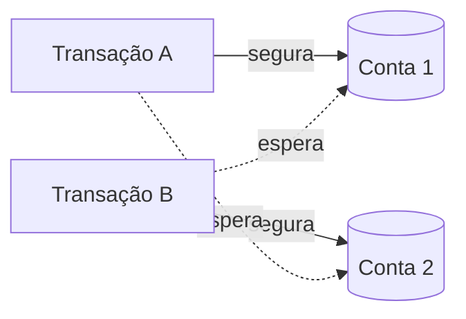

# Controle de Concorrência e Race Conditions

A nota de [ACID](/labs/web-dev/banco-de-dados/04-acid/) explica que o **I** (Isolamento) garante que transações concorrentes não se atrapalhem, e que o banco oferece **níveis de isolamento** para isso. Só que escolher um nível de isolamento não resolve tudo sozinho: mesmo com o nível certo configurado, a forma como a aplicação lê, calcula e escreve um dado pode continuar gerando bugs de concorrência. Esta nota é sobre esse problema na prática: o que é uma **race condition**, por que ela aparece mesmo em código aparentemente simples, e quais estratégias existem para evitá-la.

## O que é uma race condition

Uma race condition (condição de corrida) acontece quando o resultado de um programa depende da ordem em que duas ou mais execuções concorrentes acontecem, e essa ordem pode gerar um resultado incorreto. Ela ocorre quando quatro condições se juntam:

1. Existem dois ou mais processos, threads ou instâncias rodando.
2. Eles acessam um recurso compartilhado.
3. Pelo menos uma dessas execuções modifica esse recurso.
4. A operação de ler e atualizar esse recurso não é tratada como uma unidade indivisível.

Recurso compartilhado pode ser qualquer coisa que mais de uma execução consiga ler e escrever ao mesmo tempo:

- Uma linha numa tabela de banco de dados
- Uma variável global
- Um singleton
- Um objeto compartilhado em memória
- Um saldo ou estoque
- Um cache compartilhado

Vale reforçar um ponto importante: **leituras concorrentes, sozinhas, não causam race condition**. O problema aparece quando existe a sequência **ler → calcular → escrever** acontecendo em paralelo, porque uma execução pode calcular em cima de um valor que já ficou desatualizado no meio do caminho.

### Exemplo do saldo

Considere um saldo inicial de R$ 50, e dois processos tentando atualizá-lo ao mesmo tempo:

```text
Saldo inicial: R$ 50

Processo A: quer somar R$ 30
Processo B: quer somar R$ 20

Linha do tempo:

  A lê saldo = 50
  B lê saldo = 50          <- B ainda não viu a mudança de A, porque A nem escreveu ainda
  A calcula 50 + 30 = 80
  B calcula 50 + 20 = 70
  A salva 80
  B salva 70                <- sobrescreve o resultado de A

Saldo final: R$ 70 (errado)
Saldo correto seria: R$ 100
```

O problema é que o processo B nunca leu o resultado de A, ele leu o mesmo saldo antigo (R$ 50) e simplesmente sobrescreveu o que A tinha salvado. Esse tipo de bug tem nome: **lost update** (atualização perdida). A alteração de A não desapareceu por um erro visível, ela só foi silenciosamente substituída.

## Aplicações "single-threaded" também sofrem

É tentador achar que esse problema só existe em programação multithread, mas isso não é verdade. Mesmo uma aplicação que processa uma requisição por vez, sem threads concorrentes de verdade, pode sofrer race condition quando:

- A aplicação roda em várias instâncias ao mesmo tempo (ex: 3 réplicas atrás de um load balancer, veja [Escalabilidade horizontal](/labs/web-dev/escalabilidade/01-escalabilidade/))
- O serviço está distribuído em máquinas diferentes
- O runtime usa múltiplos processos-trabalhadores (ex: cluster do Node.js)
- Existem callbacks ou Promises concorrentes dentro do mesmo processo
- Uma operação fica esperando uma API externa ou o banco de dados responder, e nesse meio tempo outra requisição chegou
- O sistema foi escalado horizontalmente

O ponto chave é: mesmo que cada instância, sozinha, processe uma coisa de cada vez, duas instâncias diferentes podem alterar o mesmo registro ao mesmo tempo sem nenhuma delas saber da outra. Por isso, o controle de concorrência não pode viver só na memória de um processo, ele precisa acontecer numa camada compartilhada e confiável entre todas as instâncias, e essa camada normalmente é o banco de dados.

## Estratégias para evitar race conditions

### 1. Execução sequencial

A solução mais simples é impedir que as operações aconteçam ao mesmo tempo:

```javascript
await venderUvas();
await venderAzeitonas();
```

**Como funciona:** a segunda operação só começa depois que a primeira termina por completo (leu, calculou e salvou). Como não existe sobreposição, a segunda leitura já enxerga o resultado atualizado pela primeira.

**Vantagens:** fácil de implementar, adequada para aplicações simples, reduz a complexidade de ter que pensar em concorrência.

**Desvantagens:** elimina o paralelismo, aumenta o tempo total de processamento, vira um gargalo conforme a carga cresce, e não resolve nada quando existem múltiplas instâncias do serviço rodando ao mesmo tempo (cada instância continua tendo sua própria fila sequencial, sem saber da fila das outras). Não é uma estratégia geral para sistemas distribuídos ou de alta escala.

### 2. Atualização atômica

Em vez da aplicação fazer o cálculo:

```text
saldo = lerSaldo()
saldo = saldo + valor
salvarSaldo(saldo)
```

ela delega o cálculo para o próprio banco, numa única instrução:

```sql
UPDATE account
SET balance = balance + :amount
WHERE id = :accountId;
```

**Como funciona:** o banco executa a leitura e a escrita como uma operação atômica só sua, sem expor esse "meio do caminho" para a aplicação. Cada `UPDATE` sempre usa o valor mais atual da coluna no momento em que ele roda, então duas operações concorrentes de `+30` e `+20` chegam corretamente em `R$ 100`, mesmo sem nenhum lock explícito.

**Vantagens:** simples, eficiente, permite que as operações rodem em paralelo de verdade, aproveita o controle de concorrência que o próprio banco já tem internamente, geralmente com melhor desempenho do que travar a aplicação inteira.

**Limitações:** funciona bem quando a regra é uma operação simples (incrementar, decrementar, somar, subtrair, atualizar um contador), mas não é suficiente quando é preciso ler o estado atual, aplicar várias validações, rodar regras de negócio complexas, e só depois decidir o que persistir.

Por exemplo, garantir que o saldo nunca fique negativo não é só questão de somar um número, é preciso validar antes. A saída é incorporar a validação na própria cláusula `WHERE`:

```sql
UPDATE account
SET balance = balance - 30
WHERE id = 123
  AND balance >= 30;
```

Se o saldo for menor que 30, nenhuma linha é atualizada, e a aplicação precisa checar quantas linhas foram afetadas para saber se a operação realmente aconteceu.

### 3. Mutex (exclusão mútua)

Mutex vem de **mutual exclusion**, exclusão mútua: um mecanismo que garante que só uma execução por vez entre numa determinada seção do código.

```text
adquirir lock
ler saldo
calcular novo saldo
salvar saldo
liberar lock
```

Se duas operações tentam rodar ao mesmo tempo, a primeira adquire o lock e segue normalmente; a segunda fica esperando até o lock ser liberado, e só então lê o valor já atualizado pela primeira.

```javascript
await mutex.lock();

try {
  const balance = await loadBalance();
  const newBalance = balance + amount;
  await saveBalance(newBalance);
} finally {
  mutex.unlock();
}
```

O trecho protegido pelo mutex é chamado de **seção crítica**.

**Cuidados importantes:**

- O `unlock` precisa acontecer mesmo quando algo dá erro no meio do caminho, por isso o padrão `try/finally` (nunca só `try`).
- Locks mantidos por muito tempo viram gargalo.
- É preciso tomar cuidado com deadlocks e esperas indefinidas.
- Evite deixar uma chamada externa lenta (ex: uma API de terceiros) dentro da seção crítica, isso trava todo mundo esperando por algo fora do seu controle.
- Um mutex em memória só protege o processo atual. Se existirem várias réplicas da aplicação (o cenário descrito na seção anterior), cada uma terá seu próprio mutex local, e eles não vão se enxergar entre si. Um mutex local sozinho não resolve concorrência entre instâncias diferentes.

### 4. Locks no banco de dados

Quando o mutex em memória não é suficiente (por causa de múltiplas instâncias), o lock pode ser movido para dentro do banco, que é a camada compartilhada entre todas elas.

#### Lock pessimista

Parte do princípio de que conflitos são prováveis, então bloqueia o registro **antes** de mexer nele:

```sql
BEGIN;

SELECT balance
FROM account
WHERE id = 123
FOR UPDATE;

UPDATE account
SET balance = balance + 30
WHERE id = 123;

COMMIT;
```

Enquanto essa transação estiver aberta, qualquer outra transação que tentar travar a mesma linha (com outro `FOR UPDATE`) precisa esperar. Retomando o exemplo do saldo:

```text
1. Processo A trava a linha
2. Processo A le R$ 50
3. Processo A calcula e salva R$ 80
4. Processo A libera o lock (COMMIT)
5. Processo B trava a linha
6. Processo B lê R$ 80 (já atualizado) e aplica sua própria alteração
```

Repare que agora B lê o valor já atualizado por A, porque B só consegue travar a linha depois que A libera. O lost update desaparece.

**Vantagens:** funciona entre múltiplas instâncias, porque o banco é a fonte compartilhada da verdade; protege de fato contra alterações concorrentes vindas de qualquer lugar.

**Desvantagens:** pode gerar contenção (fila de espera pelo lock), aumenta o tempo de resposta sob carga, pode causar deadlocks se locks forem adquiridos em ordens diferentes por transações diferentes, mantém recursos bloqueados durante toda a transação. Em JPA/Hibernate, essa estratégia costuma aparecer como `PESSIMISTIC_WRITE`.

#### Lock otimista

Parte do princípio oposto: conflitos são raros, então não vale a pena bloquear nada durante a leitura. Em vez disso, a aplicação verifica, na hora de salvar, se o registro mudou desde que foi lido. Isso costuma ser feito com uma coluna de versão:

```text
id  | balance | version
123 | 50      | 7
```

```sql
UPDATE account
SET balance = 80,
    version = 8
WHERE id = 123
  AND version = 7;
```

Se outra transação já tiver alterado essa conta (e a versão já não for mais 7), o `WHERE` não bate com nenhuma linha, e o `UPDATE` não altera nada:

```text
1. Processo A lê a versão 7
2. Processo B também lê a versão 7
3. A salva usando WHERE version = 7, e muda a versão para 8   -> sucesso
4. B tenta salvar usando WHERE version = 7
5. A atualização de B falha, porque a versão atual já é 8
6. B precisa reler os dados, recalcular, e tentar de novo (ou retornar um conflito pro usuário)
```

Diferente do lock pessimista, o lock otimista não bloqueia ninguém enquanto a leitura acontece, ele só detecta o conflito na hora de escrever, e devolve a responsabilidade de decidir o que fazer (tentar de novo, avisar o usuário) para a aplicação. Em JPA/Hibernate, essa estratégia normalmente é implementada com a anotação `@Version`.

#### MVCC: o banco já faz algo parecido com lock otimista, sozinho

O lock otimista da seção anterior é implementado à mão, com uma coluna `version` que a aplicação gerencia. A maioria dos bancos relacionais modernos (PostgreSQL, MySQL/InnoDB, Oracle) já faz algo na mesma linha por baixo dos panos, para toda leitura, sem a aplicação precisar pedir: o **MVCC** (Multiversion Concurrency Control, controle de concorrência por multiversão).

Em vez de travar uma linha para ler ela, o banco mantém **várias versões** da mesma linha ao mesmo tempo. Um `UPDATE` não sobrescreve o dado no lugar, ele cria uma versão nova e marca a antiga como obsoleta. Cada transação enxerga a versão que existia no momento em que ela começou (chamado de **snapshot**), então leitura nunca bloqueia escrita, e escrita nunca bloqueia leitura, elas simplesmente enxergam fotografias diferentes do mesmo dado.

```text
Linha "conta 123", saldo = 50 (versão 1)

Transação A começa às 10:00:00 -> enxerga snapshot com saldo = 50
Transação B começa às 10:00:01 -> enxerga o mesmo snapshot, saldo = 50
Transação B faz UPDATE, cria a versão 2 (saldo = 80), e dá COMMIT
Transação A continua enxergando saldo = 50 (a versão 1, do snapshot dela)
                                             até ela terminar e começar outra
```

É esse mecanismo que faz o nível de isolamento **Repeatable Read** funcionar sem precisar travar a tabela inteira: no PostgreSQL, MySQL e na maioria dos bancos modernos, `Repeatable Read` é implementado via MVCC (também chamado de **snapshot isolation**), não via lock. As versões antigas (as "tuplas mortas" no jargão do Postgres) ficam ocupando espaço até um processo de limpeza (o `autovacuum` no Postgres) liberar elas.

**O detalhe que a tabela de fenômenos da nota de [ACID](/labs/web-dev/banco-de-dados/04-acid/) não mostra:** mesmo com snapshot isolation evitando dirty read, non-repeatable read e phantom read, ainda sobra um problema chamado **write skew**. Ele acontece quando duas transações leem o mesmo dado, cada uma decide agir com base no que leu, e as duas escritas juntas violam uma regra que nenhuma delas quebraria sozinha.

O exemplo clássico (dos hospitais): a regra é "sempre precisa ter pelo menos um médico de plantão". Dois médicos, Ana e Bruno, estão de plantão. Os dois, ao mesmo tempo, checam quantos médicos estão de plantão antes de pedir folga:

```text
10:00:00 - Ana lê: "2 médicos de plantão (eu e o Bruno)" -> ok, posso pedir folga
10:00:00 - Bruno lê: "2 médicos de plantão (eu e a Ana)" -> ok, posso pedir folga
10:00:01 - Ana marca folga
10:00:01 - Bruno marca folga

Resultado: 0 médicos de plantão, a regra foi violada
```

Nenhuma das duas leituras estava errada no momento em que aconteceu, e nenhuma das duas escritas conflita diretamente com a outra (são linhas diferentes: a folga da Ana, a folga do Bruno). É por isso que `Repeatable Read`/snapshot isolation não pega esse caso: não existe um conflito clássico de "duas transações escrevendo a mesma linha" para detectar. Só o nível `Serializable` (que o PostgreSQL implementa rastreando dependências de leitura e escrita entre transações, sem precisar travar nada) rejeita esse cenário, forçando uma das duas transações a tentar de novo.

Isso reforça, com um exemplo concreto, a mesma tabela de trade-off já vista em ACID: quanto mais alto o nível de isolamento, mais anomalias ele evita, mas mais caro fica.

#### Lock distribuído

Quando o recurso compartilhado não vive dentro do banco de dados (por exemplo, um arquivo, uma fila, ou um passo de um processo que precisa rodar só uma vez entre várias instâncias), é preciso um mecanismo de lock que funcione entre máquinas diferentes, coordenado por um serviço externo (Redis, ZooKeeper, etcd, por exemplo). A ideia é a mesma do mutex (só uma execução por vez na seção crítica), mas implementada numa infraestrutura compartilhada em vez de memória local, e com tratamento extra para o caso de uma instância travar o lock e nunca liberar (normalmente resolvido com um tempo de expiração automática do lock).

## Deadlock

Locks resolvem a race condition, mas trazem um problema novo. **Deadlock** é quando duas transações ficam esperando uma pela outra: cada uma segura um lock que a outra precisa, e nenhuma das duas consegue continuar. É como dois carros que entram ao mesmo tempo numa ponte de mão única, um de cada lado 🚗🚗

### Exemplo: transferências em sentidos opostos

Duas transferências acontecem ao mesmo tempo: a transação A move R$ 10 da conta 1 para a conta 2, e a transação B move R$ 20 da conta 2 para a conta 1. Cada uma começa travando a conta de origem:

```sql
-- Transação A                                -- Transação B
BEGIN;                                         BEGIN;
UPDATE account SET balance = balance - 10      UPDATE account SET balance = balance - 20
WHERE id = 1;  -- trava a conta 1              WHERE id = 2;  -- trava a conta 2

UPDATE account SET balance = balance + 10      UPDATE account SET balance = balance + 20
WHERE id = 2;  -- espera B soltar a conta 2    WHERE id = 1;  -- espera A soltar a conta 1
```



A espera B, B espera A, e o ciclo está fechado. Repare que nenhuma das duas fez nada de errado sozinha. O problema é a **ordem** em que os locks foram pedidos.

### As quatro condições

Em 1971, Edward Coffman descreveu quatro condições que precisam acontecer **todas juntas** para existir deadlock:

1. **Exclusão mútua**: o recurso só pode ser usado por um de cada vez (é a definição de um lock exclusivo).
2. **Segurar e esperar**: quem já tem um lock pede outro sem soltar o primeiro.
3. **Sem preempção**: ninguém tira o lock de quem está com ele à força, só o dono solta.
4. **Espera circular**: existe um ciclo, A espera B, que espera A (ou A espera B, que espera C, que espera A).

Basta quebrar uma delas para o deadlock deixar de ser possível. Na prática, a mais fácil de quebrar é a quarta.

### Como o banco reage

Bancos relacionais como PostgreSQL e MySQL (InnoDB) **detectam** o deadlock sozinhos. No PostgreSQL, quando uma transação passa mais que `deadlock_timeout` (1 segundo por padrão) esperando um lock, o banco verifica se existe um ciclo de espera. Se existe, ele aborta uma das transações para liberar a outra:

```text
ERROR:  deadlock detected
DETAIL:  Process 4821 waits for ShareLock on transaction 9012; blocked by process 4822.
         Process 4822 waits for ShareLock on transaction 9011; blocked by process 4821.
```

O código desse erro é `40P01`. A documentação do PostgreSQL avisa que não dá para prever qual das duas transações vai ser abortada, então a aplicação precisa estar pronta para receber esse erro em qualquer uma delas.

Fora do banco a história é outra. Um mutex na aplicação ou um lock distribuído sem expiração não tem ninguém olhando o ciclo: as threads ficam presas para sempre, sem erro e sem log, até alguém reiniciar o processo.

### Como prevenir

- **Ordem global de aquisição**: todo código que trava mais de um registro trava sempre na mesma ordem, por exemplo, do menor `id` para o maior. No exemplo das transferências, as duas transações travariam primeiro a conta 1 e depois a conta 2, então B esperaria A terminar em vez de formar um ciclo:

  ```sql
  SELECT id FROM account
  WHERE id IN (1, 2)
  ORDER BY id
  FOR UPDATE;
  ```

- **Transações curtas**: quanto menos tempo um lock fica preso, menor a janela para outra transação pedir o mesmo recurso. Nada de chamada HTTP para outro serviço no meio de uma transação aberta.
- **`lock_timeout`**: limita quanto tempo uma transação espera por um lock antes de desistir com erro (`SET lock_timeout = '2s';`). Não evita o deadlock, mas evita esperas longas em geral.
- **Retry da transação abortada**: como o banco resolve o deadlock abortando uma transação, tratar o erro `40P01` repetindo a transação inteira (com backoff) costuma ser suficiente quando o deadlock é raro. Se ele é frequente, o problema é a ordem dos locks e o retry só esconde isso.
- **Lock otimista**: sem lock segurado durante a transação, não há ciclo de espera. O custo passa a ser tratar conflitos de versão.

Deadlock é um dos modos de falha catalogados em [Modos de Falha Comuns](/labs/web-dev/resiliencia/04-modos-de-falha/).

## Comparação das estratégias

| Estratégia          | Como evita o conflito                                     | Melhor uso                                                                                                 | Principal limitação                               |
| ------------------- | --------------------------------------------------------- | ---------------------------------------------------------------------------------------------------------- | ------------------------------------------------- |
| Execução sequencial | Remove o paralelismo                                      | Aplicações simples, uma única instância                                                                    | Baixa escalabilidade                              |
| Atualização atômica | Executa a alteração direto no banco, numa instrução só    | Incrementos e decrementos simples                                                                          | Insuficiente para regras de negócio complexas     |
| Mutex               | Permite uma execução por vez dentro do processo           | Estado compartilhado dentro de uma única instância                                                         | Não funciona sozinho entre réplicas diferentes    |
| Lock pessimista     | Bloqueia a linha no banco antes de alterar                | Conflitos frequentes, regras que dependem do estado atual                                                  | Contenção e risco de deadlock                     |
| Lock otimista       | Detecta alteração por número de versão, na hora de salvar | Conflitos pouco frequentes                                                                                 | Exige lógica de retry / tratamento de conflito    |
| Lock distribuído    | Coordena instâncias via um serviço externo compartilhado  | Recursos compartilhados fora do banco                                                                      | Exige infraestrutura extra e tratamento de falhas |
| MVCC (snapshot isolation) | O banco versiona a linha automaticamente, leitura nunca bloqueia escrita | Nível de isolamento Repeatable Read na maioria dos bancos modernos | Não evita write skew, só Serializable evita |
| Ledger              | Registra eventos em vez de sobrescrever um valor único    | Dinheiro, auditoria, rastreabilidade (veja [Ledger Pattern](/labs/web-dev/banco-de-dados/09-ledger-pattern/)) | Maior complexidade arquitetural                   |

## Escolhendo uma estratégia na prática

A escolha certa depende da regra de negócio, não só da tecnologia disponível:

- Se a operação é um incremento ou decremento simples (contador de visualizações, estoque básico): **atualização atômica** já resolve.
- Se a decisão depende de ler o estado atual e validar antes de escrever, e conflitos são esperados com frequência: **lock pessimista**.
- Se conflitos são raros e você prefere não pagar o custo de bloquear o recurso o tempo todo: **lock otimista**, com retry no caso raro de conflito.
- Se o recurso compartilhado não está no banco, ou envolve coordenar múltiplos serviços: **lock distribuído**.
- Se o domínio é financeiro e exige histórico, auditoria e reconciliação: considere trocar a abordagem inteira por um **Ledger** em vez de proteger um saldo mutável.

Um exemplo de aplicação dessas ideias com `@Transactional`, `@Version` e locks em Java/Spring:

```java
@Entity
class Account {

    @Id
    private Long id;

    private BigDecimal balance;

    @Version
    private Long version;
}
```

```java
@Transactional
public void credit(Long accountId, BigDecimal amount) {
    Account account = repository.findById(accountId)
        .orElseThrow();

    account.setBalance(account.getBalance().add(amount));
}
```

Vale um cuidado aqui: `@Transactional` sozinho garante atomicidade da transação (tudo ou nada), mas **não elimina** o lost update por si só. Sem `@Version` (lock otimista), `@Lock(LockModeType.PESSIMISTIC_WRITE)` (lock pessimista) ou uma atualização atômica no `UPDATE` gerado, duas transações concorrentes ainda podem ler o mesmo valor antigo e uma sobrescrever a outra.

## Referências

- [PostgreSQL e o Controle de Concorrência por Multiversão (MVCC)](https://blog.4linux.com.br/postgresql-e-o-controle-de-concorrencia-por-multiversao-mvcc/) - Almeida Robson (Blog 4Linux), pt-BR
- [13.2. Transaction Isolation - PostgreSQL Documentation](https://www.postgresql.org/docs/current/transaction-iso.html) - PostgreSQL, en
- [13.3. Explicit Locking (Deadlocks) - PostgreSQL Documentation](https://www.postgresql.org/docs/current/explicit-locking.html#LOCKING-DEADLOCKS) - PostgreSQL, en
