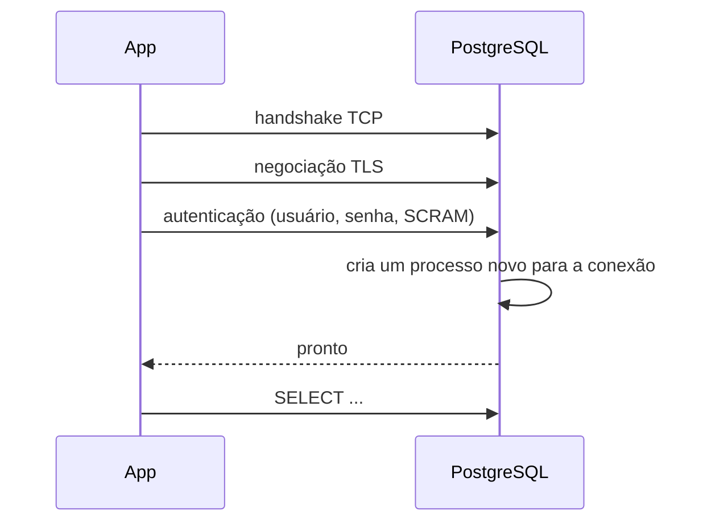
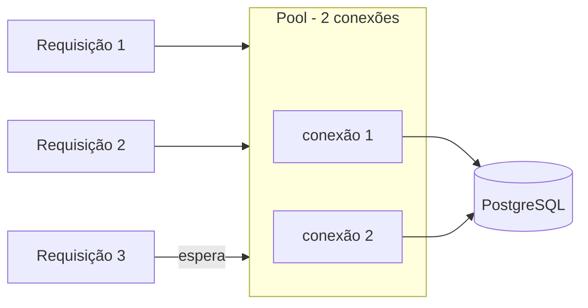
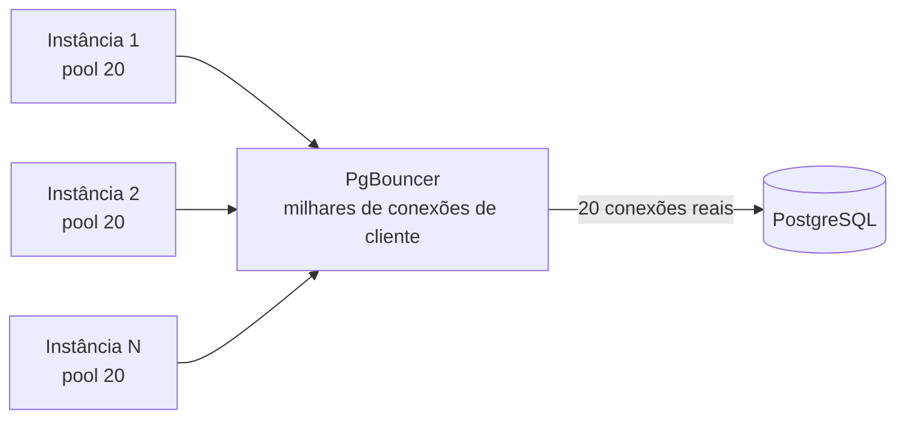

# Connection Pooling

Uma API que abre uma conexão nova com o banco a cada requisição funciona bem no seu notebook e cai no primeiro pico de tráfego. O problema não é a query, é o que acontece antes dela: abrir conexão é caro, e o banco aceita um número limitado delas. Connection pooling é a técnica de manter conexões abertas e reaproveitá-las, e configurar isso direito evita uma das falhas mais comuns em produção: o erro `too many connections`.

## Por que conexão com o banco é cara

Antes de rodar o primeiro `SELECT`, a aplicação e o banco passam por uma série de etapas:



Numa rede local isso leva alguns milissegundos. Parece pouco, até você multiplicar por milhares de requisições por segundo e perceber que a aplicação passa mais tempo conectando do que consultando.

No PostgreSQL, a última etapa pesa mais: cada conexão vira um **processo** do sistema operacional, com memória própria. A nota [PostgreSQL vs MySQL](/labs/web-dev/banco-de-dados/12-postgres-vs-mysql/) compara esse modelo com o de threads do MySQL. Na prática, isso significa duas coisas:

- O banco tem um teto, configurado em `max_connections`. O padrão é **100**, e alguns slots ficam reservados para superusuário.
- Conexão parada também custa. Um processo ocioso continua ocupando memória e um slot do limite. Mil conexões abertas "só por garantia" deixam menos RAM para cache de dados e ordenações.

```sql
SHOW max_connections;   -- 100 numa instalação padrão
```

Aumentar o `max_connections` para 2000 não resolve: cada processo extra disputa CPU e memória com os outros, e o banco fica mais lento para todo mundo.

## O que é um pool de conexões

Um pool é um conjunto de conexões que a aplicação abre uma vez e mantém abertas. Quando uma requisição precisa do banco, ela pega uma conexão emprestada, usa e devolve. A conexão não é fechada, só volta para a fila e fica esperando a próxima requisição.



Se todas as conexões estiverem ocupadas, a requisição seguinte espera numa fila até alguém devolver uma. É aqui que mora a maioria dos problemas, como mostram as seções abaixo.

Quase toda linguagem tem um pool pronto, e muitas vezes ele já vem embutido no driver ou no ORM:

| Ecossistema         | Pool                                                   |
| ------------------- | ------------------------------------------------------ |
| Java / Spring Boot  | HikariCP (padrão do Spring Boot)                       |
| Node.js             | `Pool` do `pg` (node-postgres), Prisma, Knex           |
| Python              | SQLAlchemy (`QueuePool`), `psycopg_pool`               |
| Go                  | `database/sql` já é um pool; `pgxpool` no driver `pgx` |

Exemplo com node-postgres:

```js
import pg from "pg";

const pool = new pg.Pool({
  max: 10,                       // no máximo 10 conexões abertas
  idleTimeoutMillis: 30_000,     // fecha conexão ociosa depois de 30 s
  connectionTimeoutMillis: 2_000 // desiste se não conseguir conexão em 2 s
});

// pool.query pega uma conexão, roda e devolve sozinho
const { rows } = await pool.query("SELECT * FROM pedidos WHERE id = $1", [42]);
```

O pool é criado **uma vez**, quando a aplicação sobe, e compartilhado por todas as requisições. Criar um pool novo dentro do handler da rota é o mesmo que não ter pool.

## Dimensionando o pool

A intuição diz que mais conexões dão mais vazão. Não dão. O banco tem um número limitado de núcleos de CPU e um disco. Com 8 núcleos, no máximo 8 queries rodam de fato ao mesmo tempo, e as outras ficam esperando a vez, só que agora disputando memória e trocando de contexto. A wiki do HikariCP mostra testes em que **reduzir** o pool de milhares para algumas dezenas de conexões baixou o tempo de resposta de forma drástica.

Como ponto de partida, o HikariCP sugere:

```text
conexões = (núcleos de CPU do banco x 2) + número de discos
```

Para um banco com 4 núcleos e SSD, isso dá algo em torno de 10. Trate como chute inicial e ajuste medindo: se as requisições esperam muito por conexão e o banco está com CPU sobrando, aumente; se a CPU do banco está no talo, mais conexões só pioram.

### A conta que todo mundo esquece

O pool é **por instância** da aplicação. O total que chega no banco é:

```text
instâncias da aplicação x tamanho do pool  <=  max_connections (menos uma folga)
```

Com 8 instâncias e pool de 10, são 80 conexões: cabe num `max_connections` de 100, com folga para migrations, ferramentas de administração e réplicas. Agora o autoscaling sobe para 15 instâncias num pico, e você tem 150 conexões tentando abrir num banco que aceita 100. As instâncias novas começam a falhar justamente quando mais se precisava delas. A nota [Stateless, Particionamento e Sharding](/labs/web-dev/escalabilidade/02-stateless-e-particionamento/) cita esse gargalo; a solução costuma ser um pooler externo, que aparece mais abaixo.

Funções serverless (Lambda, Cloud Functions, edge) pioram o cenário: cada execução concorrente pode ser uma instância nova com o próprio pool. Cem execuções simultâneas com `max: 5` são 500 conexões.

## Fail fast quando o pool esgota

Quando o pool esgota, cada requisição nova entra na fila. Se a fila não tiver limite de tempo, as requisições ficam presas, consomem memória e threads, e o cliente recebe um timeout de 30 segundos em vez de um erro rápido. Pior: retries do cliente aumentam a fila. É um caminho clássico para uma falha em cascata (veja [Modos de Falha](/labs/web-dev/resiliencia/04-modos-de-falha/)).

Configure um **timeout de aquisição** curto: `connectionTimeoutMillis` no node-postgres, `connectionTimeout` no HikariCP (o padrão de 30 s é longo demais para uma API). Se não conseguir conexão em 1 ou 2 segundos, falhe e devolva um `503`. O cliente recebe a resposta rápido, e o sistema não acumula trabalho que não vai conseguir fazer.

O que mais esgota pool não é tráfego, é conexão segurada por tempo demais. Duas regras resolvem quase tudo:

- **Transação curta.** Abra, faça o que precisa no banco e feche. Cada milissegundo dentro da transação é uma conexão fora do pool.
- **Nada de chamada de rede dentro de transação.** Chamar a API de pagamento, mandar e-mail ou publicar numa fila com a transação aberta prende a conexão (e os locks, veja [Controle de Concorrência](/labs/web-dev/banco-de-dados/08-controle-de-concorrencia/)) pelo tempo que o serviço externo levar. Se ele demorar 10 segundos, a conexão fica 10 segundos parada.

```js
// ruim: a conexão fica presa enquanto o gateway responde
await client.query("BEGIN");
await client.query("UPDATE pedidos SET status = 'pagando' WHERE id = $1", [id]);
await gatewayDePagamento.cobrar(pedido);           // chamada de rede de 3 s
await client.query("COMMIT");

// melhor: a chamada externa fica fora da transação
await gatewayDePagamento.cobrar(pedido);
await pool.query("UPDATE pedidos SET status = 'pago' WHERE id = $1", [id]);
```

Garantir consistência entre a chamada externa e o banco sem segurar a transação é assunto do [Outbox Pattern](/labs/web-dev/transacoes-distribuidas/05-outbox-pattern/).

### Vazamento de conexão

Vazamento é pegar uma conexão do pool e nunca devolver, normalmente porque uma exceção pulou o código que liberava. Cada vazamento tira uma conexão do pool para sempre, até o pool zerar e a aplicação parar.

```js
const client = await pool.connect();
try {
  await client.query("BEGIN");
  // ...
  await client.query("COMMIT");
} catch (err) {
  await client.query("ROLLBACK");
  throw err;
} finally {
  client.release(); // sempre devolve, com ou sem erro
}
```

O HikariCP tem o `leakDetectionThreshold`, que loga um alerta com o stack trace de quem pegou uma conexão e não devolveu depois de X segundos. Ligue em homologação.

## Pooler externo: PgBouncer

O pool na aplicação resolve o custo de abrir conexão, mas não resolve a conta "instâncias x pool". Quando há muitas instâncias, serverless ou vários serviços falando com o mesmo banco, a saída é colocar um **pooler** entre eles e o banco. O mais usado no PostgreSQL é o **PgBouncer**.



O PgBouncer aceita milhares de conexões de clientes, que são baratas para ele, e as multiplexa sobre poucas conexões reais com o banco. Serviços gerenciados oferecem algo equivalente (RDS Proxy na AWS, o pooler do Supabase, PgBouncer embutido no Azure Database for PostgreSQL).

Ele tem três modos, e escolher o modo errado causa bugs estranhos:

| Modo        | Quando a conexão real volta para o pool | Multiplexação | Compatibilidade                    |
| ----------- | --------------------------------------- | ------------- | ---------------------------------- |
| session     | Quando o cliente desconecta             | Baixa         | Tudo funciona                      |
| transaction | Quando a transação termina              | Alta          | Recursos de sessão quebram         |
| statement   | Ao fim de cada comando                  | Máxima        | Proíbe transação com vários passos |

O modo **transaction** é o que se usa na prática, porque é ele que dá ganho real. O preço é que duas transações seguidas do mesmo cliente podem cair em conexões reais diferentes, então qualquer coisa que dependa de "estado da sessão" deixa de funcionar:

- `SET` de parâmetros de sessão (ex: `SET search_path`, `SET statement_timeout`). Use `SET LOCAL`, que vale só dentro da transação.
- `LISTEN`/`NOTIFY`
- Advisory locks de sessão (`pg_advisory_lock`). Os de transação (`pg_advisory_xact_lock`) funcionam.
- `PREPARE`/`DEALLOCATE` em SQL e tabelas temporárias que sobrevivem à transação

Prepared statements no nível do protocolo, que muitos drivers usam por baixo dos panos, funcionam no modo transaction nas versões recentes do PgBouncer desde que `max_prepared_statements` seja configurado com um valor maior que zero. Se o seu driver começar a dar erro do tipo `prepared statement "s1" does not exist`, comece olhando essa configuração.

O modo statement é bem específico (foi pensado para o PL/Proxy) e raramente aparece em aplicação comum.

## O que monitorar

Pool mal dimensionado se manifesta em métricas antes de virar incidente. Os poolers e pools expõem estes números, e vale ter um painel com eles (a categoria *saturation* da nota de [Logs, Métricas e Traces](/labs/web-dev/observabilidade/01-logs-metrics-e-traces/)):

- Conexões ativas e ociosas no pool. Pool sempre 100% ativo é sinal de que está pequeno ou de transações longas.
- Requisições esperando por conexão e o tempo dessa espera. É a métrica que mais cedo denuncia problema.
- Timeouts de aquisição. Cada um é um usuário que recebeu erro.

Do lado do banco, a visão `pg_stat_activity` mostra cada conexão e o que ela está fazendo:

```sql
SELECT state, count(*)
FROM pg_stat_activity
WHERE backend_type = 'client backend'
GROUP BY state;
```

| `state`                 | Significado                                                       |
| ----------------------- | ----------------------------------------------------------------- |
| `active`                | Executando uma query agora                                        |
| `idle`                  | Aberta, sem fazer nada (normal num pool)                          |
| `idle in transaction`   | Abriu uma transação e parou no meio, segurando conexão e locks    |

O `idle in transaction` é o vilão: quase sempre é código que fez `BEGIN`, foi fazer outra coisa (uma chamada HTTP, por exemplo) e ainda não deu `COMMIT`. O parâmetro `idle_in_transaction_session_timeout` faz o PostgreSQL derrubar essas sessões depois de um tempo, o que é uma boa rede de proteção.

## Referências

- [Connections and Authentication](https://www.postgresql.org/docs/current/runtime-config-connection.html) - PostgreSQL Docs, en
- [About Pool Sizing](https://github.com/brettwooldridge/HikariCP/wiki/About-Pool-Sizing) - HikariCP Wiki (Brett Wooldridge), en
- [PgBouncer features](https://www.pgbouncer.org/features.html) - PgBouncer, en
- [Pooling](https://node-postgres.com/features/pooling) - node-postgres, en
