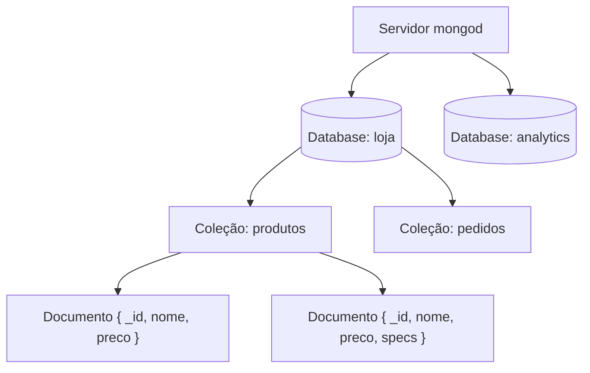

# MongoDB: fundamentos e modelo de documentos

## O que é o MongoDB

O MongoDB é um banco de dados **orientado a documentos**, a categoria "document" apresentada na nota de [NoSQL](/labs/web-dev/banco-de-dados/11-nosql/). Em vez de linhas em tabelas com colunas fixas, ele guarda cada registro como um documento parecido com um objeto JSON, com campos aninhados, listas e formatos que podem variar de um documento para outro.

Como ele guarda esses documentos no disco (a storage engine WiredTiger, o cache em memória e o journal) já está explicado em [Postgres vs MongoDB vs Cassandra](/labs/web-dev/banco-de-dados/13-postgres-vs-mongodb-vs-cassandra/). Esta nota e as seguintes da série focam no lado de quem usa o banco: como os dados são organizados, consultados, modelados, indexados e distribuídos.

O que o MongoDB oferece além de "guardar JSON":

- **Consultas ad-hoc**: dá para filtrar por qualquer campo, inclusive dentro de documentos aninhados e arrays, sem definir antes quais consultas vão existir.
- **Índices** secundários em qualquer campo, inclusive compostos, em arrays, de texto e geoespaciais (veja [MongoDB: índices](/labs/web-dev/banco-de-dados/22-mongodb-indices/)).
- **Aggregation pipeline** para transformar e resumir dados dentro do banco, o equivalente a `GROUP BY` e `JOIN` (veja [MongoDB: aggregation pipeline](/labs/web-dev/banco-de-dados/23-mongodb-aggregation-pipeline/)).
- **Replicação** com failover automático e **sharding** para escalar horizontalmente (veja [MongoDB: replicação, sharding e transações](/labs/web-dev/banco-de-dados/24-mongodb-replicacao-sharding-e-transacoes/)).
- **GridFS**, uma convenção para guardar arquivos maiores que o limite de um documento, quebrando-os em pedaços.

Um pouco de história ajuda a entender algumas decisões do produto. A empresa 10gen foi fundada em 2007 e lançou o MongoDB 1.0 em 2009, escrito em C++. Em 2013 a 10gen passou a se chamar MongoDB Inc. O serviço gerenciado em nuvem, o **Atlas**, chegou em 2016. Em outubro de 2018 a licença do servidor mudou de AGPL para **SSPL** (Server Side Public License), que permite uso livre na sua aplicação mas impõe condições a quem quiser oferecer o próprio MongoDB como serviço. Por isso a OSI não reconhece a SSPL como licença open source, e o "Community Server" é mais bem descrito como "gratuito com código disponível".

## Hierarquia: database, coleção e documento

Os dados ficam organizados em três níveis dentro de um servidor:



- **Database**: um agrupamento de coleções. Um servidor pode ter vários databases.
- **Coleção** (collection): um grupo de documentos, mais ou menos o papel de uma tabela.
- **Documento**: um registro, um conjunto de pares campo/valor.

A analogia com o relacional (database ~ schema, coleção ~ tabela, documento ~ linha) é útil no primeiro dia, mas engana em dois pontos. Primeiro, uma coleção não tem colunas declaradas: dois documentos da mesma coleção podem ter campos completamente diferentes. Segundo, um documento não é uma linha "achatada", ele pode carregar dentro de si o que no relacional estaria em outras tabelas.

```js
// Um documento da coleção "produtos"
{
  _id: ObjectId("66a1f2c9e8d7f4b5c6d7e8f9"),
  nome: "Notebook",
  preco: Decimal128("5499.90"),
  tags: ["eletronicos", "trabalho"],          // array
  specs: { ram: "16GB", armazenamento: "512GB SSD" }  // documento embutido
}

// Outro documento da mesma coleção, com formato diferente
{
  _id: ObjectId("66a1f2c9e8d7f4b5c6d7e8fa"),
  nome: "Caneca",
  preco: Decimal128("39.90"),
  cor: "azul"
}
```

Database e coleção são criados de forma preguiçosa: `use loja` não cria nada no disco, e a coleção passa a existir na primeira vez que um documento é inserido nela (ou quando você chama `db.createCollection()` explicitamente, útil para passar opções como validação).

## BSON e JSON

O MongoDB não guarda JSON em texto. Ele guarda **BSON** (Binary JSON), uma representação binária do mesmo modelo de documento. Você escreve e lê objetos com cara de JSON, e o driver converte de e para BSON no caminho.

Por que não usar JSON direto? Dois motivos:

1. **Tipos**: JSON só conhece string, número, booleano, null, array e objeto. Isso não basta para um banco. BSON acrescenta datas, inteiros de 32 e 64 bits, decimal de alta precisão, dados binários, ObjectId, expressões regulares, entre outros.
2. **Travessia**: cada elemento BSON carrega o tipo e o tamanho na frente. O banco consegue pular um campo inteiro sem ler o conteúdo dele, o que acelera achar `specs.ram` dentro de um documento grande.

Um mito comum (que aparece em muito material introdutório) é que BSON é sempre menor que JSON. Não é: guardar tipos e tamanhos tem custo, e um documento BSON pode ocupar mais bytes que o JSON equivalente. A vantagem é velocidade de leitura e riqueza de tipos, não compactação.

Quando um documento sai do banco em formato texto (exportação com `mongoexport`, logs, APIs), ele usa o **Extended JSON**, uma convenção que preserva os tipos BSON dentro de JSON válido:

```json
{
  "_id": { "$oid": "66a1f2c9e8d7f4b5c6d7e8f9" },
  "criadoEm": { "$date": "2026-01-15T10:00:00Z" },
  "preco": { "$numberDecimal": "5499.90" }
}
```

## Tipos de dados

Os tipos que você vai usar quase sempre:

| Tipo         | Exemplo no mongosh                                | Observação                                                |
| ------------ | ------------------------------------------------- | --------------------------------------------------------- |
| String       | `"Ana"`                                           | Sempre UTF-8; comparação diferencia maiúsculas por padrão |
| Boolean      | `true`                                            |                                                           |
| Null         | `null`                                            | Diferente de campo ausente (veja a nota de CRUD)          |
| Array        | `["a", "b"]`                                      | Pode misturar tipos e conter documentos                   |
| Object       | `{ cidade: "Recife" }`                            | Documento embutido                                        |
| Int32        | `42` ou `Int32(42)`                               | Inteiro de 32 bits                                        |
| Long (Int64) | `Long("9007199254740993")`                        | Inteiro de 64 bits                                        |
| Double       | `3.14` ou `Double(1)`                             | Ponto flutuante binário                                   |
| Decimal128   | `Decimal128("19.90")`                             | Decimal exato, 34 dígitos significativos                  |
| Date         | `new Date()` ou `ISODate("2026-01-15T10:00:00Z")` | Milissegundos desde 1970 em UTC                           |
| ObjectId     | `ObjectId()`                                      | Identificador de 12 bytes                                 |

Os números merecem atenção, porque aqui mora um erro frequente: não é verdade que o MongoDB tem um tipo "number" único. BSON tem quatro tipos numéricos diferentes, e o tipo gravado depende de quem escreve. No `mongosh`, um literal inteiro que cabe em 32 bits vira `Int32`, e o resto vira `Double`. No antigo shell `mongo`, tudo virava `Double`. Drivers seguem as regras da linguagem (no Node.js, por exemplo, números do JavaScript são doubles, mas o driver grava inteiros pequenos como Int32).

Para dinheiro, use `Decimal128`. `Double` é uma aproximação binária: `0.1 + 0.2` não dá exatamente `0.3`, e isso aparece rapidinho num carrinho de compras.

```js
db.pedidos.insertOne({
  total: Decimal128("129.90"), // valor monetário exato
  itens: 3, // Int32
  peso: 1.75, // Double
  criadoEm: new Date(), // Date em UTC
});
```

Datas são guardadas como um inteiro de 64 bits com os milissegundos desde 1º de janeiro de 1970, **sempre em UTC**. O fuso horário é responsabilidade da aplicação na hora de exibir. Atenção a uma pegadinha do shell: `Date()` chamado sem `new` devolve uma **string**, não uma data.

Para consultar pelo tipo de um campo, existe o operador `$type`, que aceita o nome do tipo ou o alias `"number"` (que casa com qualquer um dos quatro numéricos):

```js
// Documentos em que "preco" foi gravado como double por engano
db.produtos.find({ preco: { $type: "double" } });

// Qualquer tipo numérico
db.produtos.find({ preco: { $type: "number" } });
```

## O campo \_id e o ObjectId

Todo documento precisa de um campo `_id` único dentro da coleção, e ele funciona como chave primária. Se você não informar um, o driver (ou o servidor) gera um **ObjectId** automaticamente. O `_id` não pode ser alterado depois que o documento existe, e a coleção sempre tem um índice único nele.

O ObjectId tem 12 bytes divididos em três partes:

- 4 bytes de **timestamp** (segundos desde a epoch, momento da criação)
- 5 bytes **aleatórios**, gerados uma vez por processo
- 3 bytes de **contador** incremental, iniciado em um valor aleatório

Como o timestamp vem na frente, ObjectIds ficam **aproximadamente** em ordem de criação. "Aproximadamente" porque a resolução é de um segundo e clientes diferentes podem ter relógios diferentes, então não use o `_id` como fonte de verdade para ordem exata de eventos. Dá para extrair a data de criação:

```js
const id = ObjectId("66a1f2c9e8d7f4b5c6d7e8f9");
id.getTimestamp(); // ISODate("2024-07-25T...")
```

O ObjectId é gerado no cliente sem precisar consultar o banco, o que é ótimo para sistemas distribuídos (nada de sequência central). Mesmo assim, você pode usar seu próprio `_id` quando existir um identificador natural e estável, como um código de produto ou um e-mail que nunca muda. Só evite usar algo que pode mudar, porque trocar o `_id` exige apagar e reinserir o documento.

## Limites que importam desde o começo

Dois limites influenciam a modelagem desde o primeiro dia:

- Um documento BSON tem no máximo **16 MB**.
- Um documento pode ter no máximo **100 níveis** de aninhamento (cada objeto ou array conta um nível).

16 MB parece muito para um JSON, e é, até alguém modelar "todos os comentários de um post" como um array dentro do post. Arrays que crescem sem limite são o caminho clássico para bater no teto. A nota [MongoDB: modelagem de dados](/labs/web-dev/banco-de-dados/21-mongodb-modelagem-de-dados/) mostra como decidir entre embutir e referenciar justamente para não cair nisso. Para arquivos grandes de verdade (vídeos, PDFs), a saída é GridFS ou, mais comum hoje, um storage de objetos como S3 com só a referência no documento.

## Schema flexível não é ausência de schema

"Schemaless" é um apelido que engana. Os dados sempre têm um formato esperado, o que muda é **quem** garante esse formato. No relacional, o banco recusa uma linha que não bate com o `CREATE TABLE`. No MongoDB, por padrão, o banco aceita qualquer documento, e o schema passa a viver no código da aplicação (em validações, DTOs, ou num ODM como o Mongoose).

Isso é ótimo para evoluir rápido (adicionar um campo novo não exige migração) e perigoso quando vários serviços escrevem na mesma coleção sem combinar nada. Para colocar regras no próprio banco existe a **validação de schema** com `$jsonSchema`:

```js
db.createCollection("usuarios", {
  validator: {
    $jsonSchema: {
      bsonType: "object",
      required: ["nome", "email"],
      properties: {
        nome: { bsonType: "string", description: "obrigatório, texto" },
        email: { bsonType: "string", pattern: "^.+@.+$" },
        idade: { bsonType: "int", minimum: 0 },
      },
    },
  },
  validationLevel: "strict", // valida todo insert e update
  validationAction: "error", // rejeita o documento inválido
});
```

Para uma coleção que já existe, a mesma regra é aplicada com `db.runCommand({ collMod: "usuarios", validator: { ... } })`.

Duas opções controlam o rigor:

- `validationLevel`: `"strict"` (padrão) valida todos os inserts e updates; `"moderate"` só valida updates em documentos que já eram válidos, útil para ligar validação numa coleção com dados antigos bagunçados.
- `validationAction`: `"error"` (padrão) rejeita a escrita; `"warn"` aceita e só registra um aviso no log, bom para observar o impacto antes de endurecer a regra.

O meio-termo comum em produção: deixar campos opcionais livres, mas validar os obrigatórios e os tipos que, se vierem errados, quebram consultas e índices.

## Ferramentas do ecossistema

**`mongod`** é o processo do servidor, que escuta por padrão na porta **27017**. Num cluster com sharding aparece também o **`mongos`**, o roteador que recebe as consultas e as encaminha aos shards certos.

**`mongosh`** é o shell oficial, um REPL de JavaScript/Node.js para conversar com o banco. Ele substituiu o shell legado `mongo`, que foi deprecado no MongoDB 5.0 e **removido no 6.0**. Muito tutorial antigo ainda manda digitar `mongo`; hoje esse binário nem vem mais na instalação, e o `mongosh` é baixado separadamente. Os comandos básicos:

```js
// Conectar (local, porta padrão)
// $ mongosh "mongodb://localhost:27017"

show dbs                         // lista os databases
use loja                         // muda para o database "loja" (cria quando gravar algo)
db                               // mostra o database atual
show collections                 // lista as coleções
db.createCollection("produtos")  // cria a coleção explicitamente
db.produtos.insertOne({ nome: "Caneca" })
db.produtos.find()
```

**MongoDB Compass** é a interface gráfica oficial: navegar pelos dados, montar filtros visualmente, ver índices, analisar planos de execução e montar aggregation pipelines estágio por estágio. Ótima para explorar, mas não substitui saber escrever a consulta.

**MongoDB Atlas** é o MongoDB como serviço (DBaaS) nos principais provedores de nuvem. Ele cuida de replica set, backups, monitoramento, escala e atualizações, e tem um plano gratuito para estudo. A string de conexão do Atlas usa o formato `mongodb+srv://`, que consulta registros DNS para descobrir todos os membros do cluster sem precisar listá-los um a um:

```text
mongodb+srv://<usuario>:<senha>@cluster0.abcde.mongodb.net/?retryWrites=true&w=majority
```

**Drivers oficiais** existem para as principais linguagens (Node.js, Python com PyMongo, Java, C#, Go, entre outras). A API segue os mesmos nomes do shell (`insertOne`, `find`, `updateMany`...), com os ajustes de convenção de cada linguagem (no PyMongo vira `insert_one`, `update_many`). Um exemplo em Node.js:

```js
import { MongoClient } from "mongodb";

// A URI vem de variável de ambiente, nunca fica escrita no código
const client = new MongoClient(process.env.MONGODB_URI);

async function main() {
  await client.connect();
  await client.db("admin").command({ ping: 1 }); // confirma que a conexão funciona

  const produtos = client.db("loja").collection("produtos");
  const caneca = await produtos.findOne({ nome: "Caneca" });
  console.log(caneca);
}

main().finally(() => client.close());
```

O `MongoClient` mantém um pool de conexões e deve ser criado **uma vez** por aplicação e reaproveitado, não aberto e fechado a cada requisição. Um detalhe que pega iniciante: criar o cliente não garante que o banco está acessível (no PyMongo, por exemplo, a conexão só é feita na primeira operação), por isso o `ping` no começo é um jeito simples de falhar cedo se a URI estiver errada.

## Referências

- [Documentos](https://www.mongodb.com/pt-br/docs/manual/core/document/) - documentação oficial do MongoDB, português
- [Tipos BSON](https://www.mongodb.com/pt-br/docs/manual/reference/bson-types/) - documentação oficial do MongoDB, português
- [Data Types in mongosh](https://www.mongodb.com/docs/mongodb-shell/reference/data-types/) - documentação oficial do MongoDB, inglês
- [Validação de schema](https://www.mongodb.com/pt-br/docs/manual/core/schema-validation/) - documentação oficial do MongoDB, português
- [Alterações de compatibilidade no MongoDB 6.0](https://www.mongodb.com/pt-br/docs/v6.0/release-notes/6.0-compatibility/) - documentação oficial do MongoDB, português
