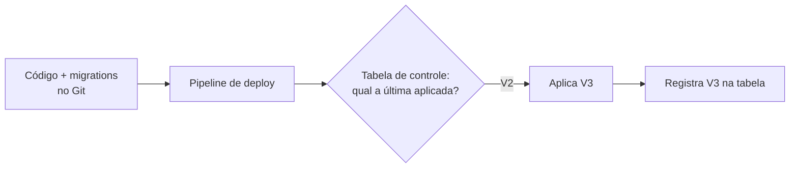
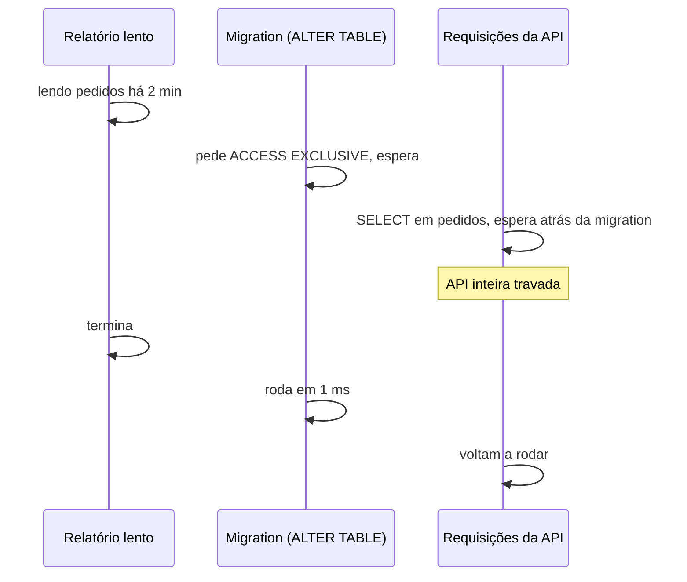
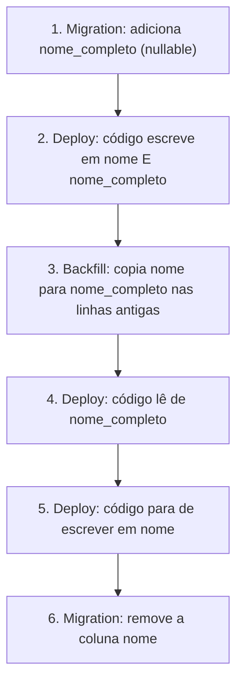

# Migrations de Schema

O schema do banco muda junto com a aplicação: uma coluna nova para a feature da sprint, um índice para a query que ficou lenta, uma tabela que deixou de ser usada. Migrations são o jeito de fazer essas mudanças de forma versionada e repetível. E, num sistema que não pode parar, são também um dos jeitos mais fáceis de derrubar produção com um único `ALTER TABLE`.

## Migrations como versionamento do banco

A regra número um: **ninguém altera o schema de produção à mão**. Um `ALTER TABLE` rodado direto no console, sem registro, cria um banco que não bate com o de homologação, com o do colega e com o que o código espera. Quando algo quebrar, ninguém sabe o que mudou nem quando.

Uma migration é um arquivo com uma mudança de schema, numerado e guardado no repositório junto com o código. A ferramenta de migrations mantém no próprio banco uma **tabela de controle** com as migrations já aplicadas, e ao rodar ela aplica só as que faltam, na ordem.

```text
db/migrations/
  V1__cria_tabela_clientes.sql
  V2__cria_tabela_pedidos.sql
  V3__adiciona_coluna_cupom_em_pedidos.sql
```



É o mesmo princípio do Git aplicado ao banco: o estado do schema em qualquer ambiente é o resultado de aplicar a mesma sequência de passos. Um banco novo, de teste ou de um desenvolvedor que acabou de entrar, sobe do zero rodando as migrations.

Ferramentas comuns:

| Ferramenta                    | Como as migrations são escritas    | Tabela de controle         |
| ----------------------------- | ---------------------------------- | -------------------------- |
| Flyway                        | SQL puro (ou Java), `V1__nome.sql` | `flyway_schema_history`    |
| Liquibase                     | XML, YAML, JSON ou SQL             | `DATABASECHANGELOG`        |
| Prisma Migrate                | Gerado a partir do `schema.prisma` | `_prisma_migrations`       |
| TypeORM, Django, Rails, Knex  | Código da linguagem ou gerado      | Tabela própria de cada uma |

Migration já aplicada em produção não se edita. Se ela estava errada, escreva uma nova que corrija. Várias ferramentas guardam um checksum do arquivo e recusam rodar se ele mudou.

## Por que uma migration pode derrubar o sistema

Muitos `ALTER TABLE` no PostgreSQL pedem o lock mais forte que existe, o `ACCESS EXCLUSIVE`, que bloqueia **inclusive leituras** na tabela (os tipos de lock estão em [Controle de Concorrência](/labs/web-dev/banco-de-dados/08-controle-de-concorrencia/)). Se a operação for rápida, ninguém percebe. O problema aparece em dois cenários.

### A fila de locks

Imagine uma query de relatório lenta lendo a tabela `pedidos` há 2 minutos. A migration chega e pede `ACCESS EXCLUSIVE`. Ela não consegue, porque o relatório está lendo, então entra na fila e espera. Até aqui, nada demais.

O detalhe é que **todas as queries que chegam depois** da migration, inclusive `SELECT`s simples, também entram na fila, atrás dela. A tabela `pedidos` fica inacessível pelo tempo que o relatório ainda levar, mesmo que a migration em si leve 1 milissegundo.



A defesa é o `lock_timeout`: se a migration não conseguir o lock em pouco tempo, ela desiste com erro em vez de travar todo mundo. Você tenta de novo alguns segundos depois.

```sql
SET lock_timeout = '3s';
SET statement_timeout = '15min';  -- limite para a operação em si

ALTER TABLE pedidos ADD COLUMN cupom text;
```

Configure isso em toda migration de produção. A maioria das ferramentas permite rodar esses `SET` no início de cada execução.

### Operações que reescrevem a tabela

O segundo cenário é a operação ser lenta de verdade. Algumas mudanças só alteram o catálogo (os metadados) e são instantâneas. Outras obrigam o banco a ler e reescrever a tabela inteira, segurando o lock o tempo todo. Numa tabela de 200 milhões de linhas, isso é indisponibilidade de vários minutos.

| Operação                                            | No PostgreSQL atual                                        |
| --------------------------------------------------- | ---------------------------------------------------------- |
| `ADD COLUMN` sem default ou com default constante   | Só catálogo, instantâneo (desde a versão 11)               |
| `ADD COLUMN` com default volátil (`random()`, etc.) | Reescreve a tabela                                         |
| `ALTER COLUMN ... TYPE` (ex: `int` para `bigint`)   | Normalmente reescreve a tabela e os índices                |
| `SET NOT NULL` direto                               | Varre a tabela inteira com lock exclusivo                  |
| `CREATE INDEX` sem `CONCURRENTLY`                   | Bloqueia escritas durante toda a criação                   |
| `DROP COLUMN`                                       | Só catálogo, mas quebra o código que ainda usa a coluna    |

Antes de rodar algo numa tabela grande, confirme na documentação de `ALTER TABLE` da sua versão em qual categoria a operação cai, e teste num banco com volume parecido com o de produção.

## Expand/contract: mudar sem downtime

Mesmo que a migration seja instantânea, existe outro problema: durante um deploy, **duas versões da aplicação rodam ao mesmo tempo**. Num rolling deploy ou blue-green (veja [Padrões de Deployment](/labs/web-dev/entrega-continua/05-padroes-de-deployment/)), parte das instâncias ainda roda o código antigo enquanto as novas sobem. E o banco é um só, compartilhado pelas duas.

Se a migration renomeia `nome` para `nome_completo`, as instâncias antigas quebram no mesmo instante, porque ainda fazem `SELECT nome`. Se o deploy precisar de rollback, o código antigo volta e também quebra.

O padrão **expand/contract** (também chamado de *parallel change*) resolve isso separando a mudança em fases, de forma que o schema seja compatível com as duas versões do código em todo momento:

1. **Expand**: adicione o novo sem remover o antigo. Coluna nova, tabela nova, índice novo. O código antigo nem percebe.
2. **Migrate**: faça o código passar a usar o novo, e copie os dados existentes.
3. **Contract**: quando nenhuma versão do código usa mais o antigo, remova-o.

Renomear uma coluna, que parece uma linha de SQL, vira uma sequência de deploys:



Dá trabalho, e é por isso que vale pensar duas vezes antes de renomear algo em produção. Mas cada passo é pequeno e reversível, e em nenhum momento o sistema fica fora do ar.

## Passo a passo: coluna nova obrigatória

Um caso muito comum: adicionar `cliente_id NOT NULL` numa tabela que já tem milhões de linhas. Fazer tudo de uma vez (`ADD COLUMN ... NOT NULL`) falha, porque as linhas antigas não têm valor, ou, se você usar um default, nem sempre é o valor certo. O caminho seguro tem quatro passos.

**1. Adicione a coluna como nullable.** Só catálogo, instantâneo.

```sql
ALTER TABLE pedidos ADD COLUMN cliente_id bigint;
```

**2. Faça deploy do código que preenche a coluna.** A partir daqui, toda linha nova já nasce com `cliente_id`.

**3. Faça o backfill em lotes.** Preencha as linhas antigas aos poucos. Um único `UPDATE` em 50 milhões de linhas gera uma transação gigante, segura locks de linha por muito tempo, sobrecarrega as réplicas e infla a tabela. Em lotes, cada transação é curta:

```sql
UPDATE pedidos p
SET cliente_id = c.id
FROM clientes c
WHERE p.email_cliente = c.email
  AND p.cliente_id IS NULL
  AND p.id IN (
    SELECT id FROM pedidos
    WHERE cliente_id IS NULL
    ORDER BY id
    LIMIT 5000
  );
-- repita (num script ou job) até afetar 0 linhas, com uma pausa entre os lotes
```

**4. Torne a coluna obrigatória sem travar a tabela.** `SET NOT NULL` direto varre a tabela inteira com lock exclusivo. A saída é separar em "declarar a regra" e "verificar as linhas antigas".

A partir do **PostgreSQL 18**, dá para criar a constraint `NOT NULL` como `NOT VALID`:

```sql
-- instantâneo: vale para linhas novas, não verifica as antigas
ALTER TABLE pedidos ADD CONSTRAINT pedidos_cliente_id_not_null
  NOT NULL cliente_id NOT VALID;

-- varre a tabela, mas com um lock fraco (SHARE UPDATE EXCLUSIVE):
-- leituras e escritas continuam funcionando
ALTER TABLE pedidos VALIDATE CONSTRAINT pedidos_cliente_id_not_null;
```

Nas versões anteriores, o mesmo efeito vem com uma `CHECK`. Desde o PostgreSQL 12, o `SET NOT NULL` aproveita uma `CHECK` já validada e pula a varredura:

```sql
ALTER TABLE pedidos ADD CONSTRAINT pedidos_cliente_id_check
  CHECK (cliente_id IS NOT NULL) NOT VALID;
ALTER TABLE pedidos VALIDATE CONSTRAINT pedidos_cliente_id_check;
ALTER TABLE pedidos ALTER COLUMN cliente_id SET NOT NULL;  -- rápido
ALTER TABLE pedidos DROP CONSTRAINT pedidos_cliente_id_check;
```

O mesmo truque do `NOT VALID` + `VALIDATE` serve para chaves estrangeiras (`ADD CONSTRAINT ... FOREIGN KEY ... NOT VALID`).

## Índices sem travar escrita

Um `CREATE INDEX` comum bloqueia `INSERT`, `UPDATE` e `DELETE` na tabela até terminar. Em tabela grande, isso pode levar muitos minutos. A versão concorrente constrói o índice sem bloquear escritas:

```sql
CREATE INDEX CONCURRENTLY idx_pedidos_cliente_id ON pedidos (cliente_id);
```

Ela tem três pegadinhas:

- Não roda dentro de uma transação. Muitas ferramentas envolvem cada migration num `BEGIN`/`COMMIT` por padrão, e o comando falha. No Flyway, por exemplo, é preciso marcar a migration para rodar fora de transação.
- É mais lenta, porque varre a tabela duas vezes e espera transações em andamento terminarem.
- Se falhar no meio (por exemplo, um índice `UNIQUE` que encontra duplicata), o índice fica criado mas marcado como **inválido**: não é usado nas consultas e continua custando em toda escrita. Apague com `DROP INDEX CONCURRENTLY` e tente de novo.

O mesmo vale para remover: `DROP INDEX CONCURRENTLY`. Quando escolher e como ler o efeito de um índice, veja [Índices e Planos de Execução](/labs/web-dev/banco-de-dados/14-indices-e-planos-de-execucao/).

## Boas práticas

- **Uma mudança por migration.** Uma migration que cria três tabelas, altera duas e cria cinco índices é difícil de revisar e, se falhar no meio, deixa o banco num estado intermediário.
- **Teste com volume real.** Uma migration que roda em 50 ms no banco de desenvolvimento com 200 linhas pode levar 40 minutos em produção. Um banco de homologação com uma cópia (anonimizada) dos dados de produção pega esse tipo de surpresa.
- **Separe migration de dado da migration de schema.** Backfills e correções de dados são lentos e devem rodar em lotes, num job à parte, não dentro da mesma migration que altera a estrutura.
- **Prefira seguir em frente a desfazer.** Ferramentas oferecem migrations reversas ("down"), mas desfazer um `DROP COLUMN` não traz os dados de volta. Na prática, quando uma migration dá problema em produção, o mais comum é escrever uma migration nova que corrija. Com expand/contract, cada passo já é compatível com a versão anterior do código, o que torna o rollback da aplicação seguro sem mexer no banco.
- **Revise migration como código.** Um `ALTER TABLE` numa tabela grande merece a mesma atenção, no pull request, que uma mudança na lógica de pagamento.

## Referências

- [Evolutionary Database Design](https://martinfowler.com/articles/evodb.html) - Martin Fowler e Pramod Sadalage, en
- [ParallelChange](https://martinfowler.com/bliki/ParallelChange.html) - Martin Fowler, en
- [ALTER TABLE](https://www.postgresql.org/docs/current/sql-altertable.html) - PostgreSQL Docs, en
- [Waiting for PostgreSQL 18 - Allow NOT NULL constraints to be added as NOT VALID](https://www.depesz.com/2025/05/01/waiting-for-postgresql-18-allow-not-null-constraints-to-be-added-as-not-valid/) - depesz, en
- [CREATE INDEX](https://www.postgresql.org/docs/current/sql-createindex.html) - PostgreSQL Docs, en
