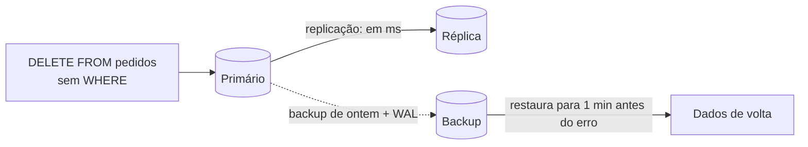
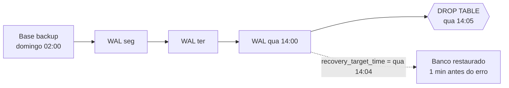

# Backup e Recuperação

Quase todo time diz que tem backup. Bem menos times já restauraram um backup de verdade e mediram quanto tempo levou. A diferença entre os dois grupos só aparece no pior dia possível: alguém roda um `DELETE` sem `WHERE`, um disco corrompe, uma migration apaga a coluna errada. E aí descobre-se se o backup existe só no papel ou se funciona de fato.

## Backup só vale se a restauração funciona

As metas que guiam qualquer estratégia de backup são o **RPO** (quantos dados você aceita perder) e o **RTO** (quanto tempo o sistema pode ficar fora do ar). As duas estão explicadas na nota de [Disponibilidade](/labs/web-dev/resiliencia/03-disponibilidade/), junto com as estratégias de disaster recovery. No banco, elas viram perguntas bem concretas:

- Se o backup roda uma vez por dia às 3h e o problema acontece às 18h, você perde 15 horas de dados. Esse é o seu RPO real.
- Se restaurar 2 TB de dump leva 9 horas, esse é o seu RTO real, não importa o que está escrito no documento.

### Réplica não é backup

Uma confusão comum: "temos uma réplica, então estamos cobertos". A réplica protege contra a **máquina** morrer (veja [Replicação](/labs/web-dev/escalabilidade/03-replicacao-de-banco-de-dados/)). Ela não protege contra **erro**. Um `DROP TABLE pedidos` executado no primário chega à réplica em milissegundos, e agora você tem duas cópias sem a tabela.



Backup é uma cópia **do passado**, que o erro de agora não alcança. Por isso as duas coisas se complementam: réplica para disponibilidade, backup para recuperação.

## Backup lógico: `pg_dump`

O `pg_dump` gera um arquivo com os comandos (ou um formato binário próprio) para recriar o banco: `CREATE TABLE`, os dados e os índices. É o backup mais simples de entender e de levar para outro lugar.

```bash
# formato custom (-Fc): comprimido e permite restaurar só partes
pg_dump -Fc -d loja -f loja_2026-11-18.dump

# restaurar num banco vazio, com 4 processos em paralelo
pg_restore -d loja_restaurada -j 4 loja_2026-11-18.dump

# restaurar só uma tabela
pg_restore -d loja_restaurada -t pedidos loja_2026-11-18.dump
```

O `pg_dump` lê o banco dentro de uma transação, então o arquivo é consistente: é uma foto do banco num instante, mesmo que haja escritas acontecendo durante o dump. Ele não copia usuários e permissões globais, que ficam por conta do `pg_dumpall --globals-only`.

Onde ele serve bem:

- Bancos pequenos e médios, até algumas dezenas de GB.
- Levar dados para outra versão do PostgreSQL ou outro servidor.
- Recuperar uma tabela específica que alguém apagou.

Onde ele para de servir:

- **RPO.** O dump é uma foto. Tudo o que aconteceu depois dela se perde.
- **RTO.** Restaurar é rodar todos os `INSERT`s e recriar todos os índices. Em bancos grandes, isso leva horas.
- **Carga.** O dump lê o banco inteiro, o que pesa em produção. É comum rodar numa réplica.

## Backup físico e WAL

Para bancos grandes e RPO de minutos, a estratégia é outra: copiar os arquivos de dados do servidor e guardar continuamente o **WAL**.

O WAL (Write-Ahead Log) é o diário do PostgreSQL. Antes de alterar qualquer dado, o banco escreve no WAL o que vai mudar. É ele que garante a durabilidade da nota de [ACID](/labs/web-dev/banco-de-dados/04-acid/) e que alimenta a replicação. Se você tem uma cópia dos arquivos de dados de domingo e todo o WAL de domingo até agora, dá para "reproduzir" as mudanças e chegar a qualquer instante entre os dois pontos.



As peças são:

1. **Base backup**: uma cópia física dos arquivos do servidor, feita com o banco rodando. A ferramenta padrão é o `pg_basebackup`. A partir do PostgreSQL 17, ele também faz **backups incrementais** (`--incremental`), que copiam só os blocos que mudaram desde o anterior, e o `pg_combinebackup` junta tudo na hora de restaurar.
2. **WAL archiving**: o servidor copia cada segmento de WAL completo para um lugar seguro, fora da máquina. Liga-se com `archive_mode = on` e um `archive_command` (ou `archive_library`). O `archive_timeout` força a troca de segmento de tempos em tempos, para limitar quanto WAL fica sem arquivar num banco com pouca escrita.
3. **Point-in-time recovery (PITR)**: para restaurar, você parte do base backup, aponta de onde ler o WAL arquivado e diz até quando reproduzir:

```ini
# postgresql.conf do servidor que vai ser restaurado
restore_command = 'cp /mnt/arquivo-wal/%f %p'
recovery_target_time = '2026-11-18 14:04:00'
```

Cria-se um arquivo vazio `recovery.signal` na pasta de dados e o servidor é iniciado. Ele reaplica o WAL até o instante pedido e para. É assim que se desfaz um `DROP TABLE` das 14:05 voltando para as 14:04.

Alguns cuidados que a documentação destaca: o PITR restaura o **cluster inteiro** (não dá para voltar só uma tabela; para isso, restaure num servidor à parte e copie a tabela com `pg_dump`), e os arquivos de configuração (`postgresql.conf`, `pg_hba.conf`) não estão no WAL e precisam de backup próprio.

Montar isso na mão com `archive_command` é possível, mas pouca gente faz. Na prática, se usa uma ferramenta que cuida de agendamento, compressão, retenção, verificação e envio para S3: **pgBackRest**, **Barman** ou **WAL-G**. Em bancos gerenciados (RDS, Cloud SQL, Azure), backup automático com PITR já vem pronto. Mesmo assim, confira a retenção configurada (às vezes é de só 7 dias) e lembre que o backup apagado junto com a instância não ajuda.

| Tipo                    | RPO típico                   | RTO em banco grande         | Bom para                                     |
| ----------------------- | ---------------------------- | --------------------------- | -------------------------------------------- |
| `pg_dump` diário        | Até 24 h                     | Horas (recria tudo)         | Bancos pequenos, migração, restaurar tabela  |
| Base backup + WAL/PITR  | Minutos ou segundos          | Menor (copia arquivos)      | Produção, desfazer erro humano               |
| Snapshot de disco       | Intervalo entre snapshots    | Rápido, se na mesma região  | Complemento, não substituto                  |

## Caso real: GitLab (2017)

Em 31 de janeiro de 2017, o GitLab.com perdeu dados de produção num incidente que virou estudo de caso, em grande parte porque a empresa publicou um postmortem detalhado.

O incidente começou com uma réplica que ficou para trás durante um pico de carga. O primário já tinha descartado o WAL de que ela precisava, e como não havia WAL archiving, a réplica teve que ser reconstruída à mão. No meio dessa tentativa, um engenheiro rodou o comando para limpar a pasta de dados no servidor **errado**: o primário. Cerca de 300 GB apagados.

Aí o time foi atrás dos backups e descobriu que nenhum mecanismo funcionava:

- **Replicação**: a réplica estava sendo reconstruída justamente porque tinha quebrado, então não servia para failover.
- **`pg_dump` diário para o S3**: o script usava o `pg_dump` da versão 9.2 contra um banco 9.6. Ele falhava em toda execução, e o bucket estava vazio. Os e-mails de alerta da falha eram rejeitados por falta de configuração de DMARC, e ninguém ficou sabendo.
- **Snapshots de disco do Azure**: ativados nos servidores de arquivos, não nos de banco.
- **Snapshots LVM**: existiam para copiar dados para staging, não como backup. Um snapshot de cerca de 6 horas antes do incidente acabou sendo a salvação, e copiá-lo em discos lentos levou umas 18 horas.

O resultado foi a perda de aproximadamente 6 horas de dados do banco, o que o postmortem estima em cerca de 5.000 projetos, 5.000 comentários e 700 contas de usuário. Os repositórios Git não foram afetados.

As lições servem para qualquer time:

- Ter cinco mecanismos de backup não ajuda se nenhum foi testado. Backup que nunca foi restaurado é hipótese, não backup.
- Alerta que não chega em ninguém é igual a não ter alerta.
- Alguém precisa ser **dono** do processo de backup e recuperação.
- Com WAL archiving e PITR, a réplica teria se recuperado sozinha e o erro humano poderia ser desfeito voltando alguns minutos.

## Testar e monitorar

O teste de restauração é o que transforma backup em recuperação. O plano geral de disaster recovery e os *game days* estão em [Disponibilidade](/labs/web-dev/resiliencia/03-disponibilidade/). No banco, o mínimo é:

- **Restauração automatizada e periódica.** Um job semanal sobe um servidor descartável, restaura o último backup, roda algumas consultas de verificação (a tabela de pedidos existe? o pedido mais recente é de quando?) e destrói o servidor. Se falhar, alguém é avisado.
- **Medir o RTO real.** Esse mesmo job registra quanto tempo a restauração levou. Se o banco cresceu e o tempo passou de 1 hora para 5, você descobre antes do incidente.
- **Alertar falha e ausência.** Alerte quando o job de backup falhar e também quando nenhum backup novo aparecer no prazo. O caso GitLab mostra por que a segunda parte importa: a falha existia, o aviso é que não chegava.
- **Monitorar o arquivamento do WAL.** A visão `pg_stat_archiver` mostra o último segmento arquivado e o número de falhas. WAL que não arquiva também se acumula no disco do primário até encher.
- **Cópia fora do alcance.** Guarde os backups em outra região e, de preferência, em outra conta, com retenção e proteção contra exclusão (como S3 Object Lock). Uma credencial vazada ou um script errado que apaga produção não deveria conseguir apagar os backups também.
- **Retenção pensada.** Quanto tempo voltar? Um bug que corrompe dados aos poucos pode levar semanas para ser notado, e 7 dias de retenção não alcançam.

## Referências

- [Backup and Restore](https://www.postgresql.org/docs/current/backup.html) - PostgreSQL Docs, en
- [Continuous Archiving and Point-in-Time Recovery (PITR)](https://www.postgresql.org/docs/current/continuous-archiving.html) - PostgreSQL Docs, en
- [Postmortem of database outage of January 31](https://about.gitlab.com/blog/postmortem-of-database-outage-of-january-31/) - GitLab, en
- [pgBackRest User Guide](https://pgbackrest.org/user-guide.html) - pgBackRest, en
