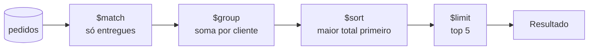

# MongoDB: aggregation pipeline

## O que é o aggregation pipeline

O `find` (veja [MongoDB: CRUD e consultas](/labs/web-dev/banco-de-dados/20-mongodb-crud-e-consultas/)) filtra e devolve documentos como eles estão guardados. Quando você precisa **calcular** algo a partir deles (total vendido por produto, média de nota por turma, pedidos com os dados do cliente juntos), a ferramenta é o **aggregation pipeline**.

A ideia é a de uma linha de montagem: os documentos da coleção entram no primeiro **estágio**, que faz uma transformação e passa o resultado para o próximo, e assim por diante. Cada estágio recebe documentos e devolve documentos, então dá para encaixá-los na ordem que você quiser.



A sintaxe é um array de estágios passado para `aggregate`:

```js
db.pedidos.aggregate([
  { $match: { status: "entregue" } },
  { $group: { _id: "$clienteId", total: { $sum: "$valor" } } },
  { $sort: { total: -1 } },
  { $limit: 5 },
]);
```

Repare no `"$clienteId"` com cifrão **dentro da string**: no pipeline, `"$campo"` significa "o valor do campo `campo` deste documento", enquanto `"campo"` sem cifrão é só um texto literal.

Para quem vem do SQL, o mapeamento ajuda a se localizar:

| SQL                                  | Aggregation pipeline            |
| ------------------------------------ | ------------------------------- |
| `WHERE`                              | `$match`                        |
| `GROUP BY` + funções de agregação    | `$group` com acumuladores       |
| `HAVING`                             | `$match` **depois** do `$group` |
| `SELECT` (escolher/calcular colunas) | `$project`, `$addFields`/`$set` |
| `ORDER BY`                           | `$sort`                         |
| `LIMIT` / `OFFSET`                   | `$limit` / `$skip`              |
| `LEFT OUTER JOIN`                    | `$lookup`                       |
| `INSERT INTO ... SELECT`             | `$out` / `$merge`               |

A diferença prática é que no SQL você escreve uma consulta declarativa e o otimizador decide a ordem; no pipeline você escreve a **ordem** explicitamente (o otimizador ainda faz alguns ajustes, mas a ordem que você escolhe pesa bastante).

## Estágios essenciais

Os exemplos usam esta coleção de pedidos:

```js
db.pedidos.insertMany([
  {
    _id: 1,
    clienteId: "c1",
    status: "entregue",
    valor: 120,
    itens: [
      { produto: "caneca", qtd: 2 },
      { produto: "camiseta", qtd: 1 },
    ],
    criadoEm: ISODate("2026-03-02"),
  },
  {
    _id: 2,
    clienteId: "c2",
    status: "entregue",
    valor: 300,
    itens: [{ produto: "camiseta", qtd: 3 }],
    criadoEm: ISODate("2026-03-05"),
  },
  {
    _id: 3,
    clienteId: "c1",
    status: "cancelado",
    valor: 80,
    itens: [{ produto: "caneca", qtd: 1 }],
    criadoEm: ISODate("2026-03-07"),
  },
  {
    _id: 4,
    clienteId: "c3",
    status: "entregue",
    valor: 45,
    itens: [{ produto: "adesivo", qtd: 5 }],
    criadoEm: ISODate("2026-04-01"),
  },
]);
```

### $match

Filtra documentos, com a mesma sintaxe de filtro do `find`:

```js
{ $match: { status: "entregue", valor: { $gte: 100 } } }
```

Quando é o primeiro estágio, o `$match` usa índices exatamente como um `find`. Por isso a regra número um do pipeline: **filtre o mais cedo possível**. Cada documento descartado no começo é um documento a menos para todos os estágios seguintes processarem.

### $group e acumuladores

Agrupa documentos por uma chave, definida em `_id`, e calcula valores para cada grupo com **acumuladores**:

```js
db.pedidos.aggregate([
  { $match: { status: "entregue" } },
  {
    $group: {
      _id: "$clienteId", // a chave do grupo
      totalGasto: { $sum: "$valor" }, // soma de um campo
      pedidos: { $sum: 1 }, // soma 1 por documento = contagem
      ticketMedio: { $avg: "$valor" },
      maiorPedido: { $max: "$valor" },
      primeiro: { $min: "$criadoEm" },
      ids: { $push: "$_id" }, // array com todos os valores
    },
  },
]);
// { _id: "c1", totalGasto: 120, pedidos: 1, ticketMedio: 120, maiorPedido: 120, primeiro: ISODate("2026-03-02"), ids: [1] }
// { _id: "c2", totalGasto: 300, pedidos: 1, ... }
// { _id: "c3", totalGasto: 45,  pedidos: 1, ... }
```

Os acumuladores mais usados:

| Acumulador             | O que faz                                                                  |
| ---------------------- | -------------------------------------------------------------------------- |
| `$sum`                 | soma (com `1`, conta documentos)                                           |
| `$count`               | conta documentos do grupo (`{ $count: {} }`, a partir do 5.0)              |
| `$avg`, `$min`, `$max` | média, mínimo, máximo                                                      |
| `$push`                | junta os valores num array (com repetição)                                 |
| `$addToSet`            | junta os valores num array sem repetição                                   |
| `$first`, `$last`      | valor do primeiro/último documento do grupo (dependem de um `$sort` antes) |

Algumas variações úteis da chave:

```js
{ $group: { _id: null, faturamento: { $sum: "$valor" } } }      // um grupo só: total geral
{ $group: { _id: { cliente: "$clienteId", status: "$status" }, n: { $sum: 1 } } }  // chave composta
{ $group: { _id: { $month: "$criadoEm" }, total: { $sum: "$valor" } } }            // por mês
```

E o equivalente ao `HAVING`: um `$match` depois do grupo, filtrando pelos campos calculados.

```js
{
  $match: {
    totalGasto: {
      $gt: 100;
    }
  }
}
```

### $project, $addFields e $set

`$project` define o formato de saída: quais campos ficam, quais saem e quais são calculados. Funciona como a projeção do `find`, com o poder extra de criar campos novos usando expressões.

```js
{ $project: {
    _id: 0,
    clienteId: 1,
    valor: 1,
    valorComFrete: { $add: ["$valor", 15] },
    mes: { $dateToString: { format: "%Y-%m", date: "$criadoEm" } },
    qtdItens: { $size: "$itens" }
} }
```

`$addFields` (e seu sinônimo `$set`, desde o 4.2) faz parte do mesmo trabalho, mas **mantém todos os campos existentes** e só acrescenta ou sobrescreve os que você indicar. Use `$project` quando quiser enxugar o documento e `$addFields`/`$set` quando só quiser acrescentar algo. Para só remover campos, existe `$unset`.

```js
{
  $set: {
    valorComFrete: {
      $add: ["$valor", 15];
    }
  }
}
{
  $unset: ["itens", "criadoEm"];
}
```

### $sort, $limit e $skip

Funcionam como os métodos do cursor, só que como estágios, e na ordem em que aparecem:

```js
{ $sort: { totalGasto: -1, _id: 1 } },   // decrescente por total, desempate por _id
{ $skip: 10 },
{ $limit: 5 }
```

Um `$sort` seguido de `$limit` é otimizado automaticamente: o banco não ordena tudo, só mantém os N maiores enquanto lê (top-k). Um `$sort` no começo do pipeline, logo após o `$match`, pode usar índice; depois de um `$group`, os documentos são novos e a ordenação é sempre em memória.

### $unwind

`$unwind` "desmonta" um array: para cada elemento, gera uma cópia do documento com aquele elemento no lugar do array. É o caminho para agregar **por item** de um array.

```js
db.pedidos.aggregate([{ $match: { _id: 1 } }, { $unwind: "$itens" }]);
// { _id: 1, clienteId: "c1", ..., itens: { produto: "caneca",   qtd: 2 } }
// { _id: 1, clienteId: "c1", ..., itens: { produto: "camiseta", qtd: 1 } }
```

Com isso, "quantas unidades de cada produto foram vendidas" fica simples:

```js
db.pedidos.aggregate([
  { $match: { status: "entregue" } },
  { $unwind: "$itens" },
  { $group: { _id: "$itens.produto", unidades: { $sum: "$itens.qtd" } } },
  { $sort: { unidades: -1 } },
]);
// { _id: "adesivo", unidades: 5 }, { _id: "camiseta", unidades: 4 }, { _id: "caneca", unidades: 2 }
```

Por padrão, documentos com array vazio ou sem o campo **somem** no `$unwind`. Se eles precisam continuar no resultado, use `{ $unwind: { path: "$itens", preserveNullAndEmptyArrays: true } }`. E cuidado com o volume: um pedido com 500 itens vira 500 documentos no pipeline.

### $lookup

`$lookup` traz documentos de **outra coleção** para dentro de cada documento, como um `LEFT OUTER JOIN`: o resultado vem num array (vazio se não houver correspondência). É o que permite juntar dados referenciados, como discutido em [MongoDB: modelagem de dados](/labs/web-dev/banco-de-dados/21-mongodb-modelagem-de-dados/).

A forma simples compara um campo local com um campo da outra coleção:

```js
db.pedidos.aggregate([
  { $match: { status: "entregue" } },
  {
    $lookup: {
      from: "clientes", // coleção de onde vêm os dados
      localField: "clienteId", // campo neste documento
      foreignField: "_id", // campo na outra coleção
      as: "cliente", // nome do array de saída
    },
  },
  { $unwind: "$cliente" }, // transforma o array de 1 elemento num subdocumento
]);
```

A forma com **pipeline** permite filtrar e moldar os documentos trazidos, útil quando a outra coleção é grande e você só quer parte dela. No exemplo abaixo, rodando em `db.clientes.aggregate([...])`, cada cliente recebe os três últimos pedidos entregues (combinar `localField`/`foreignField` com `pipeline` é possível desde o 5.0):

```js
{ $lookup: {
    from: "pedidos",
    localField: "_id",
    foreignField: "clienteId",
    pipeline: [
      { $match: { status: "entregue" } },
      { $sort: { criadoEm: -1 } },
      { $limit: 3 },
      { $project: { _id: 1, valor: 1 } }
    ],
    as: "ultimosPedidos"
} }
```

Para o `$lookup` não ficar lento, o campo `foreignField` precisa de **índice** na coleção de destino: sem ele, cada documento de entrada provoca uma varredura completa da outra coleção. E se quase toda leitura do sistema depende de `$lookup`, vale reavaliar se o dado não deveria estar embutido.

### $count e $facet

`$count` conta os documentos que chegaram até ele e devolve um único documento:

```js
db.pedidos.aggregate([
  { $match: { status: "entregue" } },
  { $count: "totalEntregues" },
]);
// { totalEntregues: 3 }
```

`$facet` roda **vários sub-pipelines sobre a mesma entrada** e devolve tudo num documento só. É o estágio de telas de busca com filtros laterais, onde você quer os resultados, o total e as contagens por categoria numa ida só ao banco:

```js
db.produtos.aggregate([
  { $match: { ativo: true } },
  {
    $facet: {
      resultados: [{ $sort: { preco: 1 } }, { $limit: 20 }],
      total: [{ $count: "n" }],
      porCategoria: [{ $group: { _id: "$categoria", n: { $sum: 1 } } }],
    },
  },
]);
```

O resultado do `$facet` é um único documento, sujeito ao limite de 16 MB, então ele não serve para devolver coleções inteiras.

## Exemplo completo passo a passo

Pergunta: **quais são os 5 clientes que mais gastaram em pedidos entregues, com o número de pedidos de cada um?**

```js
db.pedidos.aggregate([
  { $match: { status: "entregue" } }, // 1
  {
    $group: {
      // 2
      _id: "$clienteId",
      totalGasto: { $sum: "$valor" },
      pedidos: { $sum: 1 },
    },
  },
  { $project: { _id: 0, clienteId: "$_id", totalGasto: 1, pedidos: 1 } }, // 3
  { $sort: { totalGasto: -1 } }, // 4
  { $limit: 5 }, // 5
]);
```

Acompanhando os documentos com a coleção de exemplo:

1. **`$match`** descarta o pedido 3 (cancelado). Seguem os pedidos 1, 2 e 4, inteiros.
2. **`$group`** junta por cliente. Saem três documentos novos, com outro formato: `{ _id: "c1", totalGasto: 120, pedidos: 1 }`, `{ _id: "c2", totalGasto: 300, pedidos: 1 }`, `{ _id: "c3", totalGasto: 45, pedidos: 1 }`. Os campos originais (`itens`, `criadoEm`) não existem mais a partir daqui.
3. **`$project`** renomeia `_id` para `clienteId` e tira o `_id`: `{ clienteId: "c1", totalGasto: 120, pedidos: 1 }`.
4. **`$sort`** ordena: c2 (300), c1 (120), c3 (45).
5. **`$limit`** corta em 5 (aqui não muda nada, são só três).

Uma dica para montar pipelines: construa estágio por estágio, rodando a cada adição para ver o formato que sai. Isso evita a confusão mais comum, que é referenciar depois de um `$group` um campo que não existe mais. O Compass tem um editor de aggregation que mostra a saída de cada estágio, ótimo para isso.

## Gravando o resultado: $out e $merge

Por padrão, o pipeline devolve o resultado para quem chamou. Dois estágios permitem **gravá-lo numa coleção**, útil para relatórios pré-calculados e views materializadas. Os dois precisam ser o **último estágio**.

`$out` substitui a coleção de destino inteira pelo resultado:

```js
db.pedidos.aggregate([
  { $group: { _id: "$clienteId", totalGasto: { $sum: "$valor" } } },
  { $out: "resumo_clientes" },
]);
```

`$merge` (desde o 4.2) é mais flexível: combina o resultado com o que já existe no destino, documento a documento, escolhendo o que fazer quando há correspondência ou não. Serve para atualizar um resumo de forma incremental, processando só os dados novos:

```js
db.pedidos.aggregate([
  { $match: { criadoEm: { $gte: ISODate("2026-04-01") } } },
  {
    $group: {
      _id: { $dateToString: { format: "%Y-%m-%d", date: "$criadoEm" } },
      total: { $sum: "$valor" },
    },
  },
  {
    $merge: {
      into: "vendas_diarias",
      on: "_id",
      whenMatched: "replace",
      whenNotMatched: "insert",
    },
  },
]);
```

## Desempenho do pipeline

**Filtre e ordene cedo.** `$match` e `$sort` no início do pipeline usam índices (as mesmas regras de [MongoDB: índices](/labs/web-dev/banco-de-dados/22-mongodb-indices/)). Depois de um `$group`, `$unwind` ou `$project` que muda os campos, o índice não ajuda mais, porque os documentos já não são os da coleção.

**Deixe o otimizador trabalhar, mas não conte só com ele.** O MongoDB reordena alguns estágios sozinho: move um `$match` para antes de um `$project` quando o filtro não depende dos campos calculados, junta `$sort` + `$limit` em top-k, junta `$match` consecutivos, e também identifica quais campos o pipeline realmente usa para não carregar o resto. Ele não faz mágica com um `$lookup` ou `$unwind` colocado antes de um filtro que poderia vir primeiro.

**Memória.** Cada estágio tem um limite de **100 MB** de memória. Estágios que acumulam muito (`$group` com milhões de chaves, `$sort` sem índice) podem passar disso. Desde o MongoDB 6.0, o parâmetro `allowDiskUseByDefault` vem ligado, então esses estágios gravam arquivos temporários em disco em vez de falhar. Funciona, mas é bem mais lento; se acontece numa consulta frequente, é sinal para filtrar antes ou pré-calcular com `$merge`. Dá para controlar por consulta com `{ allowDiskUse: false }` como opção do `aggregate`.

**Meça com explain.** Muito material cita um estágio `$explain`, que não existe. O plano de um pipeline se vê assim:

```js
db.pedidos
  .explain("executionStats")
  .aggregate([
    { $match: { status: "entregue" } },
    { $group: { _id: "$clienteId", total: { $sum: "$valor" } } },
  ]);
```

Na saída, confira se o primeiro estágio usou `IXSCAN` (e não `COLLSCAN`) e quantos documentos foram examinados.

**Fuja das alternativas deprecadas.** Em código antigo você vai encontrar `mapReduce` (deprecado desde o 5.0) e os operadores `$function` e `$accumulator`, que executam JavaScript dentro do servidor (deprecados no 8.0). Tudo isso é mais lento que estágios e operadores nativos, e quase sempre tem equivalente no pipeline.

## Referências

- [Agregação](https://www.mongodb.com/pt-br/docs/manual/aggregation/) - documentação oficial do MongoDB, português
- [$lookup](https://www.mongodb.com/pt-br/docs/manual/reference/operator/aggregation/lookup/) - documentação oficial do MongoDB, português
- [Aggregation Pipeline Optimization](https://www.mongodb.com/docs/manual/core/aggregation-pipeline-optimization/) - documentação oficial do MongoDB, inglês
- [SQL to Aggregation Mapping Chart](https://www.mongodb.com/docs/manual/reference/sql-aggregation-comparison/) - documentação oficial do MongoDB, inglês
