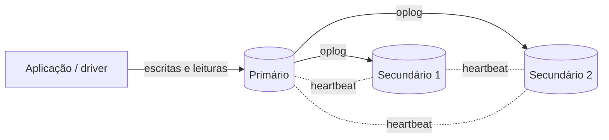
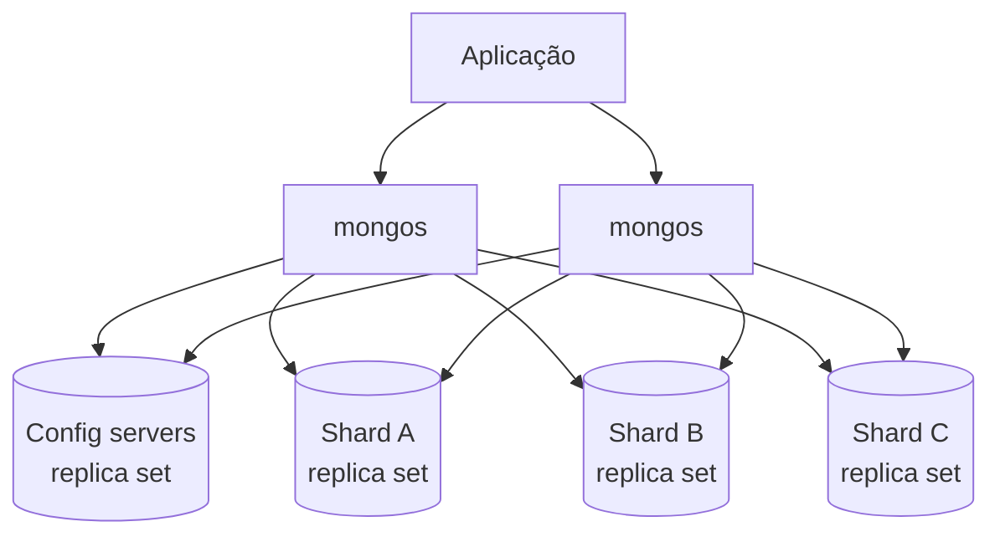

# MongoDB: replicação, sharding e transações

Replicação, sharding e transações são temas genéricos de banco de dados e de sistemas distribuídos, e o lab já os cobre de forma independente de tecnologia. Esta nota mostra como o MongoDB implementa cada um, com os nomes, comandos e configurações que você vai encontrar no dia a dia.

## Replica set

O que é replicação, por que ela existe e quais são os modelos (primário/réplica, multi-primário) está em [Replicação e Escalabilidade do Banco de Dados](/labs/web-dev/escalabilidade/03-replicacao-de-banco-de-dados/). No MongoDB, a replicação é feita por um **replica set**: um grupo de processos `mongod` que mantêm cópias dos mesmos dados.



Cada membro tem um papel:

- **Primário**: o único que aceita escritas. Por padrão, também atende as leituras.
- **Secundários**: copiam as operações do primário e mantêm um conjunto de dados idêntico (com algum atraso). Um deles vira primário se o atual cair.
- **Árbitro** (opcional): não guarda dados, só vota nas eleições. Existe para desempatar quando você só tem dois nós com dados, mas a documentação desaconselha em produção, porque ele não ajuda a confirmar escritas com `majority` e deixa o cluster mais frágil. Prefira três nós com dados.

O mínimo recomendado é **três membros votantes**. O motivo vem do consenso: para eleger um primário é preciso maioria, e com três membros o cluster continua funcionando se um cair (dois de três ainda são maioria). Com dois, a queda de qualquer um deixa o outro sem maioria, e ele não vira primário. A lógica de maioria e eleição é a do Raft, explicada em [Consenso: Paxos e Raft](/labs/web-dev/sistemas-distribuidos/02-consenso-paxos-e-raft/); o protocolo do MongoDB é baseado nele.

Limites: até **50 membros** por replica set, dos quais no máximo **7 votam**. Membros a mais entram com `votes: 0` e `priority: 0`, normalmente para leitura em outra região ou para backup.

Para montar um replica set local de estudo, suba três `mongod` com o mesmo `--replSet` e inicie a configuração no `mongosh` de um deles:

```js
// $ mongod --replSet rs0 --port 27017 --dbpath ./data1
// $ mongod --replSet rs0 --port 27018 --dbpath ./data2
// $ mongod --replSet rs0 --port 27019 --dbpath ./data3

rs.initiate({
  _id: "rs0",
  members: [
    { _id: 0, host: "localhost:27017", priority: 2 }, // preferido para ser primário
    { _id: 1, host: "localhost:27018", priority: 1 },
    { _id: 2, host: "localhost:27019", priority: 1 },
  ],
});

rs.status(); // estado de cada membro: PRIMARY, SECONDARY, lag, saúde
rs.conf(); // configuração atual
```

A aplicação se conecta informando o replica set na URI (`mongodb://host1,host2,host3/?replicaSet=rs0`), e o driver descobre sozinho quem é o primário e acompanha as trocas.

## Oplog

O **oplog** (operations log) é uma coleção especial e limitada (`local.oplog.rs`) onde o primário registra cada operação de escrita. Os secundários leem o oplog do primário continuamente e aplicam as mesmas operações nos seus dados.

Um detalhe de design: as entradas do oplog são **idempotentes**, ou seja, aplicar a mesma entrada uma ou várias vezes dá o mesmo resultado. Um `$inc: { estoque: -1 }` não vai para o oplog como "subtraia 1", e sim como "defina estoque = 41". Assim, se um secundário reaplicar uma entrada depois de uma falha, o dado não fica errado. É a mesma ideia de [Idempotência](/labs/web-dev/resiliencia/02-idempotencia/), aplicada dentro do banco.

O oplog tem tamanho limitado e as entradas mais antigas são descartadas. Se um secundário ficar parado tempo demais e o primário já tiver descartado as entradas que ele ainda não leu, o secundário não consegue alcançar e precisa de uma **sincronização inicial** completa (copiar todos os dados de novo). Por isso o tamanho do oplog (a "janela" em horas que ele cobre) é algo a monitorar.

O tempo entre a escrita no primário e a aplicação no secundário é o **replication lag**. Ler de um secundário significa aceitar esse atraso: você pode não ver o que acabou de escrever, o problema de read-after-write descrito em [Consistência e Replicação](/labs/web-dev/sistemas-distribuidos/01-consistencia-e-replicacao/).

## Eleição e failover

Os membros trocam **heartbeats** a cada 2 segundos. Se os secundários ficam sem contato com o primário por mais que `electionTimeoutMillis` (padrão de **10 segundos**), um deles convoca uma eleição. O processo geral de eleição de líder está em [Eleição de Líder](/labs/web-dev/sistemas-distribuidos/03-eleicao-de-lider/); no MongoDB, as regras práticas são:

- Só pode vencer quem tem os dados mais recentes entre os membros visíveis (o **optime** mais alto).
- Membros com **prioridade** maior convocam eleição mais cedo e tendem a ganhar; membros com `priority: 0` nunca viram primário.
- Vence o primeiro a receber votos da **maioria**.

A documentação indica que, com configuração padrão, a mediana do tempo até haver um novo primário não passa de **cerca de 12 segundos**, contando detecção e eleição. Durante esse período **não há escritas**: o replica set não tem primário. Então o failover é automático, mas não é "sem interrupção", como alguns materiais dizem. A aplicação vê erros por alguns segundos.

Para suavizar isso, os drivers atuais vêm com **retryable writes** ligado por padrão (`retryWrites=true` na URI): se uma escrita falhar por troca de primário ou erro de rede, o driver descobre o novo primário e tenta **uma vez** de novo, sem risco de duplicar a operação, porque o servidor reconhece a tentativa repetida. Leituras têm um mecanismo equivalente (retryable reads). Mesmo assim, a aplicação precisa tolerar falhas que passem desse retry único.

Quando o antigo primário volta, ele entra como secundário. Se ele tinha escritas que não chegaram a nenhum secundário antes de cair, essas escritas sofrem **rollback**: são desfeitas e guardadas em arquivos à parte. É exatamente o problema que o write concern `majority` evita.

## Write concern, read concern e read preference

Três configurações controlam o equilíbrio entre consistência, durabilidade e latência. São elas que tornam o MongoDB "CP/EC ajustável" na classificação de [Teorema de PACELC](/labs/web-dev/banco-de-dados/06-teorema-de-pacelc/).

**Write concern** define quantos membros precisam confirmar uma escrita antes de o banco responder "ok":

```js
db.pedidos.insertOne(
  { clienteId: 42, total: Decimal128("99.90") },
  { writeConcern: { w: "majority", j: true, wtimeout: 5000 } },
);
```

- `w: 1`: só o primário confirma. Mais rápido, mas se o primário cair antes de replicar, a escrita pode sofrer rollback.
- `w: "majority"`: a maioria dos membros votantes confirma. A escrita sobrevive a qualquer failover. É o **padrão desde o MongoDB 5.0** (na maioria das topologias).
- `j: true`: exige que a escrita esteja no journal em disco (veja o journal em [Postgres vs MongoDB vs Cassandra](/labs/web-dev/banco-de-dados/13-postgres-vs-mongodb-vs-cassandra/)).
- `wtimeout`: quanto esperar pela confirmação antes de devolver erro (a escrita não é desfeita, só a espera termina).

**Read concern** define que garantia o dado lido precisa ter:

- `local` (padrão): o dado mais recente do nó consultado, mesmo que ainda possa sofrer rollback.
- `majority`: só dados já confirmados pela maioria, que nunca serão desfeitos.
- `linearizable`: lê do primário garantindo que reflete todas as escritas confirmadas com `majority` antes da leitura. Mais forte e mais lento.
- `snapshot`: usado em transações, lê de um retrato consistente dos dados num ponto do tempo.

**Read preference** define **de qual membro** ler:

```js
db.produtos.find({ categoria: "livros" }).readPref("secondaryPreferred");
// ou na URI: mongodb://.../?replicaSet=rs0&readPreference=secondaryPreferred
```

- `primary` (padrão): sempre do primário. Consistente.
- `primaryPreferred`: do primário; se não houver, de um secundário.
- `secondary` / `secondaryPreferred`: de secundários, aliviando o primário, mas com possível lag.
- `nearest`: do membro com menor latência de rede, bom para clusters espalhados por regiões.

Ler de secundários não é um jeito gratuito de escalar leitura: você troca consistência por capacidade. Funciona bem para relatórios, dashboards e catálogos; é uma má ideia logo depois de o usuário salvar algo que ele espera ver na tela seguinte. Se o primário não aguenta a leitura, normalmente o caminho é índice, cache ou sharding antes de espalhar leitura em secundários.

## Sharding

Particionamento e sharding como técnica genérica (por intervalo, por hash, o problema de rebalancear) estão em [Stateless, Particionamento e Sharding](/labs/web-dev/escalabilidade/02-stateless-e-particionamento/). Replicação resolve disponibilidade, mas cada secundário guarda **todos** os dados e só o primário escreve. Quando os dados ou o volume de escrita não cabem mais numa máquina, o MongoDB distribui a coleção entre vários **shards**.



Um cluster sharded tem três componentes:

- **Shards**: cada um guarda uma parte dos dados e é, ele próprio, um **replica set**. Ou seja, um cluster sharded usa replicação dentro de cada shard.
- **`mongos`**: o roteador. A aplicação se conecta ao `mongos` (nunca direto a um shard), e ele decide para qual shard mandar cada operação. Costuma haver vários, para não serem ponto único de falha.
- **Config servers**: guardam os metadados do cluster, principalmente qual intervalo de dados está em qual shard. Também formam um replica set (normalmente de três membros).

Uma correção importante a materiais desatualizados: sharding **está disponível no MongoDB Community Server**, não é recurso exclusivo da edição Enterprise. Num mesmo database podem conviver coleções sharded e não sharded; as não sharded ficam inteiras num shard só.

## Shard key e estratégias

A **shard key** é o campo (ou conjunto de campos) usado para decidir em qual shard cada documento fica. Ela é a decisão mais importante do sharding, porque define se a carga se espalha ou se concentra num shard só.

```js
sh.enableSharding("loja"); // necessário em versões mais antigas; nas recentes é implícito

// Sharding por intervalo (ranged)
sh.shardCollection("loja.pedidos", { clienteId: 1, criadoEm: 1 });

// Sharding por hash (hashed)
sh.shardCollection("loja.eventos", { dispositivoId: "hashed" });
```

São duas estratégias (alguns materiais listam três, contando a mesma duas vezes com nomes diferentes):

- **Ranged**: documentos com valores próximos da shard key ficam juntos. Consultas por intervalo ("pedidos do cliente 42 em março") vão para um shard só. O risco é concentração: com uma chave que só cresce, como data ou ObjectId, toda escrita nova cai no mesmo shard, o do fim do intervalo.
- **Hashed**: o MongoDB usa o hash do valor (o índice hashed de [MongoDB: índices](/labs/web-dev/banco-de-dados/22-mongodb-indices/)). Distribui bem, mesmo com chaves crescentes, mas consultas por intervalo viram consultas a todos os shards.

**Zones** são um recurso à parte, não uma terceira estratégia: permitem amarrar intervalos da shard key a shards específicos, por exemplo para que dados de clientes europeus fiquem fisicamente em servidores na Europa.

Uma boa shard key tem:

- **Cardinalidade alta**: muitos valores distintos. Uma chave como `pais` com 5 valores só permite dividir em 5 pedaços, por mais shards que você tenha.
- **Frequência equilibrada**: nenhum valor concentra boa parte dos documentos. Se 60% dos pedidos são de um mesmo cliente gigante, `clienteId` sozinho cria um shard sobrecarregado.
- **Crescimento não monotônico** (ou hash): para que inserts não caiam sempre no mesmo lugar.
- **Presença nas consultas mais frequentes**: quando o filtro inclui a shard key, o `mongos` manda a consulta direto para o shard certo (**consulta direcionada**). Quando não inclui, ele precisa perguntar a todos os shards e juntar as respostas (**scatter-gather**), o que fica mais caro conforme o cluster cresce.

Os dados de uma coleção sharded são divididos em intervalos contíguos da shard key, historicamente chamados de **chunks** (a documentação recente fala em "ranges"). Um processo em background, o **balancer**, move esses intervalos entre shards para manter a distribuição equilibrada, inclusive quando você adiciona um shard novo. Migrar dados consome disco, rede e CPU, por isso escolher bem a chave desde o começo evita muito trabalho.

E se a escolha foi ruim? Antes do MongoDB 4.4 a shard key era praticamente definitiva. O 4.4 passou a permitir refinar uma chave existente acrescentando campos ao fim dela, e desde o **5.0** o `reshardCollection` permite trocá-la por completo com a coleção no ar. Funciona, mas é uma operação pesada, que reescreve a coleção inteira.

```js
db.adminCommand({
  reshardCollection: "loja.pedidos",
  key: { clienteId: "hashed" },
});
```

## Replicação vs sharding

Os dois são confundidos com frequência, mas resolvem problemas diferentes:

|                      | Replicação (replica set)                 | Sharding                                           |
| -------------------- | ---------------------------------------- | -------------------------------------------------- |
| Problema que resolve | Disponibilidade e durabilidade           | Capacidade (dados e escrita além de uma máquina)   |
| Cada nó guarda       | Todos os dados                           | Uma parte dos dados                                |
| Escala escrita?      | Não, só o primário escreve               | Sim, cada shard tem seu primário                   |
| Escala leitura?      | Um pouco, lendo de secundários (com lag) | Sim, a carga se divide entre shards                |
| Complexidade         | Baixa a moderada                         | Alta (shard key, mongos, config servers, balancer) |

Em produção, um replica set é o ponto de partida mínimo, mesmo para sistemas pequenos (o Atlas, por exemplo, sempre cria um). Sharding é para quando um replica set bem indexado, numa máquina maior, já não dá conta, e não precisa vir antes disso. Um cluster sharded usa os dois ao mesmo tempo: os dados são divididos em shards, e cada shard é replicado.

## Transações multi-documento

As propriedades ACID e o que cada letra garante estão em [ACID](/labs/web-dev/banco-de-dados/04-acid/). No MongoDB, a primeira coisa a saber é que **escrita em um único documento sempre foi atômica**, inclusive quando altera vários campos, subdocumentos e arrays de uma vez. Com um bom modelo (veja [MongoDB: modelagem de dados](/labs/web-dev/banco-de-dados/21-mongodb-modelagem-de-dados/)), a maior parte das operações cabe num documento e não precisa de transação.

Quando a operação precisa alterar **vários documentos** ou várias coleções juntas, tudo ou nada, existem as transações multi-documento:

- em **replica sets**, desde o MongoDB **4.0**
- em **clusters sharded** (transações distribuídas entre shards), desde o **4.2**

Elas não funcionam num `mongod` isolado (standalone); para estudar localmente, suba um replica set, mesmo que de um membro só.

O jeito recomendado de usar é a API `withTransaction`, que executa a função, faz commit e **repete automaticamente** a transação em caso de erros transitórios (como conflito de escrita ou troca de primário):

```js
const session = db.getMongo().startSession();

try {
  session.withTransaction(
    () => {
      const contas = session.getDatabase("banco").contas;

      const r = contas.updateOne(
        { _id: "ana", saldo: { $gte: 100 } },
        { $inc: { saldo: -100 } },
      );
      if (r.modifiedCount === 0) throw new Error("Saldo insuficiente");

      contas.updateOne({ _id: "bruno" }, { $inc: { saldo: 100 } });
    },
    {
      readConcern: { level: "snapshot" },
      writeConcern: { w: "majority" },
    },
  );
} finally {
  session.endSession();
}
```

Se qualquer operação lançar erro, nada é gravado: a Ana não perde os 100 sem o Bruno recebê-los. Dentro da transação, as leituras veem um retrato consistente dos dados (`snapshot`), e as escritas só ficam visíveis para os outros depois do commit.

O custo é real, e é por isso que a documentação oficial insiste que transação **não substitui um bom design de schema**:

- Transações seguram recursos (locks e versões antigas dos dados no cache) enquanto estão abertas. Por padrão, uma transação que passa de **60 segundos** é abortada automaticamente (`transactionLifetimeLimitSeconds`).
- A recomendação é não modificar mais de **1.000 documentos** numa transação; cargas maiores devem ser quebradas em lotes.
- Duas transações que tentam escrever no mesmo documento geram **conflito de escrita**: uma delas é abortada e precisa ser repetida (o `withTransaction` faz isso por você).
- Em cluster sharded, uma transação que toca vários shards usa um protocolo de commit em duas fases entre eles (a ideia de [Two-Phase Commit](/labs/web-dev/transacoes-distribuidas/02-two-phase-commit/)), o que aumenta a latência.

Uma regra prática: se você está usando transação em quase toda escrita, o problema provavelmente é o modelo. Se ela aparece em poucas operações críticas (transferência, reserva de estoque entre coleções), é exatamente para isso que ela existe.

Transações do MongoDB valem **dentro do banco**. Manter consistência entre o MongoDB e outro sistema (outro serviço, um broker de mensagens) é outro problema, tratado com padrões como [Saga](/labs/web-dev/transacoes-distribuidas/03-saga/) e [Outbox](/labs/web-dev/transacoes-distribuidas/05-outbox-pattern/).

## Referências

- [Replicação](https://www.mongodb.com/pt-br/docs/manual/replication/) - documentação oficial do MongoDB, português
- [Replica Set Elections](https://www.mongodb.com/docs/manual/core/replica-set-elections/) - documentação oficial do MongoDB, inglês
- [Write Concern](https://www.mongodb.com/docs/manual/reference/write-concern/) - documentação oficial do MongoDB, inglês
- [Sharding](https://www.mongodb.com/pt-br/docs/manual/sharding/) - documentação oficial do MongoDB, português
- [Transações](https://www.mongodb.com/pt-br/docs/manual/core/transactions/) - documentação oficial do MongoDB, português
