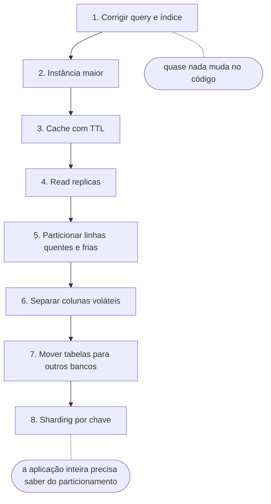
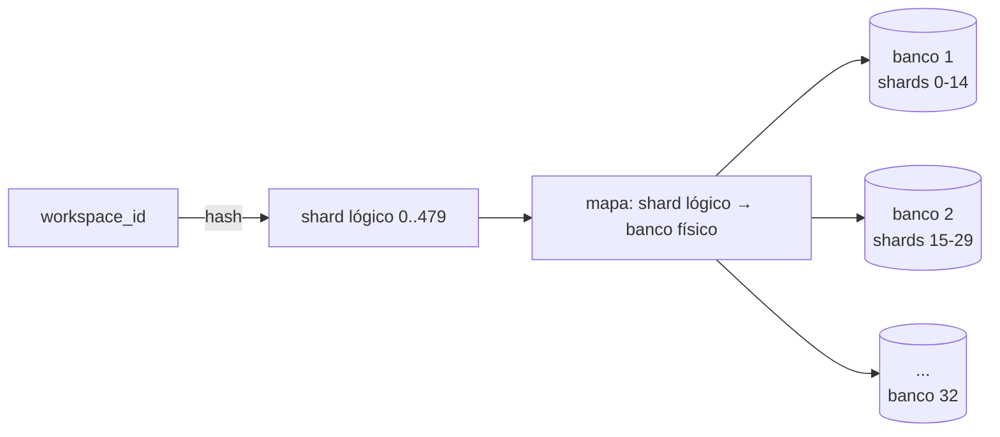

# Escalando o Banco de Dados Passo a Passo

As notas anteriores apresentaram as ferramentas de escala de banco uma a uma: [sharding](/labs/web-dev/escalabilidade/02-stateless-e-particionamento/), [replicação, partitioning e federation](/labs/web-dev/escalabilidade/03-replicacao-de-banco-de-dados/). Esta junta tudo numa sequência e responde uma pergunta prática: quando o banco começa a sofrer, **em que ordem** tentar cada coisa?

## A escada: do que não mexe no código ao que reescreve a aplicação

Um jeito útil de ordenar as técnicas é pelo **quanto cada uma obriga a mudar o código da aplicação**. Custo de infraestrutura importa, mas o que costuma doer mais é a mudança espalhada pelo código: toda query que passa a precisar saber em qual banco ler, todo `JOIN` que deixa de funcionar, toda transação que deixa de ser atômica. Quanto mais alto o degrau, maior essa conta.



A regra de uso é simples: só suba um degrau quando o anterior não der mais conta, e só depois de **medir** qual é o gargalo de verdade. CPU alta por causa de uma query sem índice não se resolve com réplica, e escrita saturada não se resolve com cache.

A nota [Técnicas para Melhorar a Performance do Banco de Dados](/labs/web-dev/banco-de-dados/17-tecnicas-de-melhoria-de-performance/) tem uma lista parecida, mas olha para **performance de consulta** (o que deixa uma leitura mais rápida). Aqui o foco é **capacidade**: o que fazer quando o banco inteiro está chegando no limite, e quanto cada passo custa para quem mantém a aplicação.

## Degraus que quase não tocam a aplicação

**1. Corrigir a query e o índice.** Antes de pensar em máquina, rode `EXPLAIN ANALYZE` nas consultas mais pesadas e procure sequential scan em tabela grande, estimativa de linhas muito errada ou ordenação indo para disco. Um índice faltando derruba um banco sozinho, e criar o índice certo não muda uma linha de código. O passo a passo está em [Índices e Planos de Execução](/labs/web-dev/banco-de-dados/14-indices-e-planos-de-execucao/) e [Diagnóstico de Queries Lentas](/labs/web-dev/banco-de-dados/18-diagnostico-de-queries-lentas/).

**2. Escalar verticalmente.** Mais CPU, mais RAM, disco mais rápido. Para a aplicação é invisível: a string de conexão continua a mesma. O problema é que tem teto (a maior instância do provedor) e o preço cresce mais rápido que a capacidade, como explicado em [Escalabilidade](/labs/web-dev/escalabilidade/01-escalabilidade/). O Figma, por exemplo, rodava em 2020 um único Postgres na maior instância física da AWS, e foi justamente chegar perto desse teto que forçou os passos seguintes.

**3. Cache com TTL.** Dado muito lido e pouco alterado (catálogo de produtos, configurações, perfil público) pode ficar num Redis com tempo de expiração, e o banco só é consultado quando o cache não tem a resposta. Já exige algum código (o padrão cache-aside), mas fica concentrado na camada de acesso a dados. Estratégias, invalidação e cache stampede estão em [Cache e Redis](/labs/web-dev/escalabilidade/10-cache-e-redis/).

## Degraus que pedem ajustes pontuais

**4. Read replicas.** Cópias do banco que atendem só leitura. A aplicação passa a ter duas conexões (uma para o primary, outra para as réplicas) e precisa decidir para onde mandar cada consulta. O ajuste mais chato é o **replication lag**: depois que o usuário salva algo, a leitura logo em seguida precisa ir para o primary, senão ele vê o dado antigo. Detalhes em [Replicação e Escalabilidade do Banco de Dados](/labs/web-dev/escalabilidade/03-replicacao-de-banco-de-dados/).

**5. Particionar linhas quentes e frias.** Numa tabela de reservas, as do mês atual são lidas e alteradas o tempo todo, as de três anos atrás quase nunca. Particionar a tabela por mês, dentro da mesma instância, faz as consultas com filtro de data tocarem só a partição certa e transforma "apagar dados antigos" em remover uma partição. Para a aplicação, a tabela continua tendo o mesmo nome; o cuidado é garantir que as queries filtrem pela coluna de particionamento. O exemplo em SQL está em [Técnicas para Melhorar a Performance](/labs/web-dev/banco-de-dados/17-tecnicas-de-melhoria-de-performance/).

## Separar colunas voláteis das estáveis

Imagine uma tabela `usuarios` com 30 colunas: nome, e-mail, bio, endereço, preferências... e `ultimo_acesso_em`, que é atualizada a cada request. 29 colunas quase nunca mudam, uma muda o tempo todo.

No PostgreSQL isso sai caro por causa do **MVCC** (o mecanismo que deixa leituras e escritas acontecerem ao mesmo tempo sem uma bloquear a outra). Um `UPDATE` não altera a linha no lugar: ele grava uma **versão nova da linha inteira** e marca a antiga como morta, para o `VACUUM` limpar depois. Atualizar um timestamp de 8 bytes reescreve a linha toda, com as 30 colunas. E, em geral, cada índice da tabela também ganha uma entrada nova apontando para essa versão, mesmo que nenhuma coluna indexada tenha mudado.

O Postgres tem uma otimização para isso, os **HOT updates** (heap-only tuples). Quando a coluna alterada **não está em nenhum índice** e a versão nova **cabe na mesma página** da antiga, o banco pula a atualização dos índices. Para deixar espaço livre nas páginas, dá para baixar o `fillfactor` da tabela (o padrão é 100, ou seja, página cheia):

```sql
ALTER TABLE usuarios SET (fillfactor = 80);
```

Antes de mexer no schema, meça. A view `pg_stat_user_tables` mostra quantos updates aconteceram e quantos foram HOT:

```sql
SELECT relname, n_tup_upd, n_tup_hot_upd,
       round(100.0 * n_tup_hot_upd / nullif(n_tup_upd, 0), 1) AS pct_hot
FROM pg_stat_user_tables
WHERE relname = 'usuarios';
```

Se o percentual de HOT for alto, o custo já está controlado. Se for baixo (porque `ultimo_acesso_em` é indexada, por exemplo) e essa tabela aparece no topo de I/O de escrita, a saída é tirar as colunas voláteis da linha larga e colocá-las numa tabela própria, numa relação 1:1:

```sql
CREATE TABLE usuarios_atividade (
  usuario_id       BIGINT PRIMARY KEY REFERENCES usuarios(id),
  ultimo_acesso_em TIMESTAMPTZ NOT NULL,
  total_logins     INTEGER NOT NULL DEFAULT 0
);
```

Agora cada acesso reescreve uma linha estreita de três colunas, com um índice só, e a tabela `usuarios` quase não gera versões mortas. O preço: a tela que mostra "nome + último acesso" passa a precisar de um `JOIN`, e o código que cria um usuário precisa criar as duas linhas. É uma mudança de schema pequena, mas toca todas as queries que liam aquelas colunas.

## Mover tabelas para bancos separados

O próximo degrau é tirar grupos inteiros de tabelas do banco principal e colocá-los em instâncias próprias: tudo de arquivos num banco, tudo de organizações e cobrança em outro. Cada banco passa a ter sua CPU, sua memória e seu limite de escrita. Na nota de replicação isso aparece como **federation**.

Um aviso sobre nome: **particionamento vertical** é usado para as duas coisas desta nota. A documentação da Microsoft chama de vertical a separação de **colunas** (seção anterior) e de **funcional** a separação de tabelas por domínio. Já o Figma, no blog de engenharia, chama de vertical justamente a separação de **tabelas** entre bancos. Quando ler o termo por aí, confira pelo contexto de qual dos dois se trata.

Aqui a aplicação sente bem mais:

- Não existe mais `JOIN` entre tabelas que foram para bancos diferentes. A junção vira duas consultas e um "merge" no código.
- Não existe mais transação atômica entre esses grupos. Se uma operação precisa gravar nos dois bancos, entra o mundo de [Consistência Transacional](/labs/web-dev/transacoes-distribuidas/01-consistencia-transacional/).
- Chave estrangeira entre bancos também some: a integridade passa a ser responsabilidade do código.

E tem um limite que o Figma descreve bem: **a menor unidade que dá para mover é uma tabela**. Quando uma única tabela cresce para vários terabytes e bilhões de linhas, nenhuma mudança de lugar resolve, ela continua sendo grande demais para a máquina em que estiver.

## Sharding por chave

É o último degrau: dividir as **linhas** de uma mesma tabela entre vários bancos, usando uma chave (id do usuário, id da organização, id do workspace) para decidir onde cada linha mora. Estratégias de chave e o custo de perder `JOIN` e transação entre shards estão em [Stateless, Particionamento e Sharding](/labs/web-dev/escalabilidade/02-stateless-e-particionamento/).

Dois detalhes práticos que aparecem em quase todo sharding de verdade:

**Shards lógicos vs. físicos.** Em vez de criar 4 shards para 4 máquinas, cria-se um número grande de **shards lógicos** (centenas) e distribui-se esses shards entre poucas **máquinas físicas**. Quando for preciso mais capacidade, não é necessário recalcular em qual shard cada linha fica (a chave continua apontando para o mesmo shard lógico): basta mover alguns shards lógicos inteiros para máquinas novas e atualizar o mapa.



**Roteamento.** Alguém precisa saber, para cada consulta, qual banco atender. Pode ser uma função no código da aplicação ou um serviço intermediário que entende SQL. Consulta que não informa a chave de sharding vira um "scatter-gather": vai para todos os shards e junta o resultado, o que é lento e deve ser exceção.

## Casos reais: Figma e Notion

### Figma

O banco do Figma cresceu quase 100 vezes a partir de 2020. A sequência que o time de banco de dados descreve segue a escada quase degrau por degrau:

1. Em 2020, um único Postgres na maior instância da AWS.
2. Até o fim de 2022: cache, read replicas, PgBouncer para pooling de conexões e cerca de uma dúzia de bancos com tabelas separadas por domínio (o "particionamento vertical" deles).
3. Algumas tabelas sozinhas chegaram a vários terabytes. O `VACUUM` começou a afetar a confiabilidade e as tabelas com mais escrita iam passar do limite de IOPS do RDS. Mover tabela não resolvia mais.
4. Sharding horizontal, começando no fim de 2022. A primeira tabela shardeada foi para produção em setembro de 2023, uns nove meses depois.

Dois detalhes do caminho deles são bons de copiar. Primeiro, fizeram **sharding lógico antes do físico**: criaram views no banco ainda único que se comportavam como se a tabela já estivesse shardeada, e liberaram isso aos poucos para a aplicação, com rollback por configuração. Só depois de a aplicação estar falando "shardeado" é que os dados foram de fato copiados para vários bancos. Segundo, criaram o **DBProxy**, um serviço em Go entre a aplicação e o PgBouncer que interpreta a query, extrai a chave de sharding e decide para qual banco mandar. Tabelas que compartilham a mesma chave ficam juntas num grupo (que eles chamam de **colo**), e dentro dele `JOIN` e transação continuam funcionando desde que restritos a uma única chave.

### Notion

O Notion tinha um monolito Postgres em 2021, com picos de CPU e, pior, um `VACUUM` que não conseguia mais acompanhar as versões mortas, abrindo risco de transaction ID wraparound (quando isso acontece, o Postgres para de aceitar escrita para se proteger). Escalar verticalmente não era visto como solução de longo prazo.

A chave escolhida foi o **id do workspace**: cada bloco pertence a exatamente um workspace, e quem usa o Notion normalmente trabalha em um workspace por vez, então quase nenhuma consulta precisa cruzar shards. A arquitetura ficou com **480 shards lógicos em 32 bancos físicos**, 15 shards por banco, cada shard lógico sendo um schema do Postgres com sua cópia das tabelas `block`, `collection`, `space` etc. O roteamento fica no código da aplicação, que mapeia workspace para shard lógico e shard lógico para banco.

Por que 480? Porque é divisível por muitos números (2, 3, 4, 5, 6, 8, 10, 12, 15, 16, 20, 24, 30, 32, 40, 48, 60, 80, 96, 120, 160, 240), o que deixa adicionar máquinas em passos pequenos mantendo a distribuição igual. Com 512, só daria para crescer dobrando. E a escolha se pagou: em 2023 o Notion fez um resharding de 32 para **96 bancos**, ficando 5 shards por banco, sem mudar a quantidade de shards lógicos nem a forma de calcular para qual shard cada workspace vai.

### O que os dois casos têm em comum

- Nenhum dos dois começou por sharding. Ambos esgotaram instância maior, réplicas e separação por domínio antes.
- O gatilho não foi "o banco está lento", foi um limite físico concreto: `VACUUM` sem dar conta, IOPS, tamanho de tabela.
- A chave de sharding foi escolhida a partir do padrão de acesso do produto (workspace, arquivo, organização), para que a maioria das operações caiba num shard só.
- Os dois planejaram o crescimento seguinte desde o primeiro dia: muitos shards lógicos (Notion) e uma camada de roteamento que esconde a topologia da aplicação (Figma).

## Referências

- [Recomendações de particionamento de dados](https://learn.microsoft.com/pt-br/azure/well-architected/design-guides/partition-data) - Microsoft Learn, pt-BR
- [Padrão de Sharding](https://learn.microsoft.com/pt-br/azure/architecture/patterns/sharding) - Microsoft Learn, pt-BR
- [Heap-Only Tuples (HOT)](https://www.postgresql.org/docs/current/storage-hot.html) - PostgreSQL Global Development Group, en
- [How Figma's databases team lived to tell the scale](https://www.figma.com/blog/how-figmas-databases-team-lived-to-tell-the-scale/) - Figma Engineering, en
- [Herding elephants: lessons learned from sharding Postgres at Notion](https://www.notion.com/blog/sharding-postgres-at-notion) - Notion Engineering, en
- [The Great Re-shard](https://www.notion.com/blog/the-great-re-shard) - Notion Engineering, en
