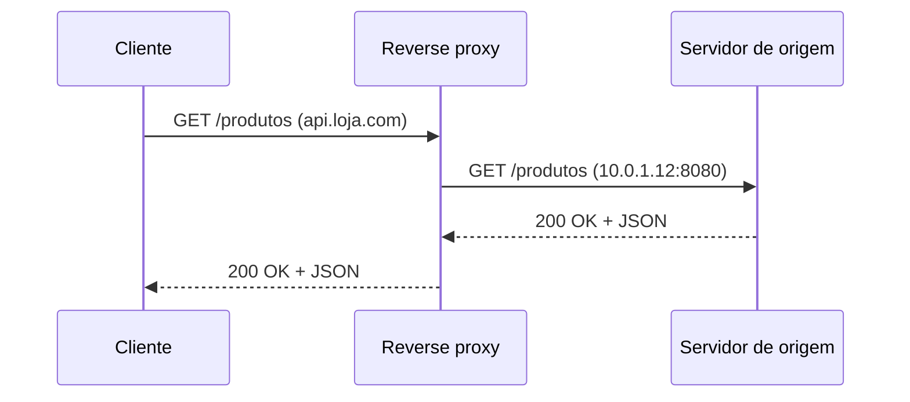
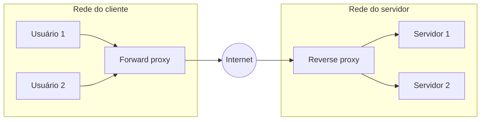
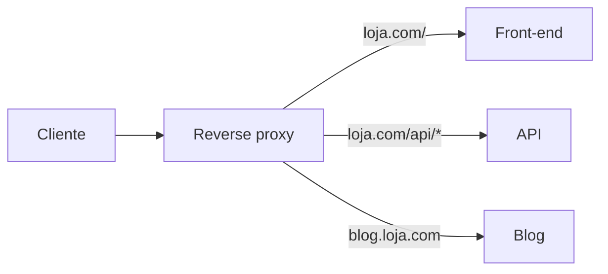

# Reverse Proxy

## O que é um reverse proxy

Um **reverse proxy** (proxy reverso) é um servidor que fica na frente dos seus servidores de aplicação e atende o cliente no lugar deles. O cliente manda a requisição para o proxy, o proxy repassa para um servidor de trás (chamado de **servidor de origem**, ou *upstream*), recebe a resposta e devolve pro cliente como se ele mesmo tivesse respondido.

Do ponto de vista de quem está do lado de fora, o proxy **é** o site. O navegador resolve `api.loja.com`, cai no IP do proxy e nunca fica sabendo que, atrás dele, existem três servidores em uma rede privada.



Uma analogia que ajuda: é a recepção de um prédio comercial. Você fala com a recepcionista, ela liga para a sala certa e te entrega o que precisava, mas você não sabe em que andar fica cada escritório nem pode subir direto.

## Forward proxy vs reverse proxy

O nome "reverso" só faz sentido quando comparado com o proxy "normal", o **forward proxy** (proxy de encaminhamento). Os dois são intermediários, a diferença está em **de que lado ficam e quem representam**:

- O **forward proxy** fica do lado do cliente. Ele faz requisições para a internet em nome dos usuários de uma rede. O exemplo clássico é o proxy corporativo: todo o tráfego dos computadores da empresa sai por ele, que pode bloquear sites, registrar acessos e esconder o IP de cada máquina. O site de destino vê o IP do proxy, não o do funcionário.
- O **reverse proxy** fica do lado do servidor. Ele recebe requisições vindas da internet em nome dos servidores de um sistema. Quem fica escondido agora são os servidores, não os clientes.



Um jeito de não confundir: o forward proxy é configurado (ou imposto) por quem **acessa**; o reverse proxy é configurado por quem **publica** o serviço. O cliente geralmente sabe que está usando um forward proxy, e quase nunca sabe que está falando com um reverse proxy.

## Responsabilidades

Como todo o tráfego de entrada passa por ele, o reverse proxy vira um lugar conveniente para resolver várias coisas uma vez só, em vez de repetir em cada servidor.

### Esconder a infraestrutura de trás

Os servidores de origem podem ficar numa rede privada, sem IP público. Isso diminui a superfície de ataque (ninguém de fora consegue mandar requisição direto para `10.0.1.12`) e dá liberdade para trocar, adicionar ou remover servidores sem que o cliente perceba. O proxy também é um bom lugar para barrar requisições malformadas ou grandes demais antes que cheguem à aplicação.

### TLS termination

O proxy é quem negocia o HTTPS com o cliente, decifra a requisição e repassa para os servidores internos, geralmente em HTTP simples dentro da rede privada. Os certificados ficam num lugar só, e os servidores de aplicação não gastam CPU com criptografia. Quando a rede interna não é considerada confiável, dá para re-criptografar a conexão entre proxy e origem, o custo é um pouco mais de processamento.

### Cache de respostas

Se várias pessoas pedem a mesma página ou o mesmo arquivo, o proxy pode guardar a resposta e servir as próximas cópias sem incomodar o servidor de origem. As regras de quanto tempo guardar seguem os mesmos cabeçalhos HTTP (`Cache-Control`, `ETag`) vistos em [CDN](/labs/web-dev/escalabilidade/05-cdn/).

### Compressão

O proxy pode comprimir as respostas (gzip, Brotli) antes de mandar para o cliente, economizando banda sem que a aplicação precise se preocupar com isso.

### Roteamento por host ou caminho

Um único proxy pode atender vários domínios e caminhos, mandando cada um para um backend diferente:



Quando o proxy manda o mesmo caminho para **várias instâncias iguais** de um serviço, ele já está fazendo o papel de [load balancer](/labs/web-dev/escalabilidade/07-load-balancer/). E quando passa a aplicar autenticação e rate limiting por rota de API, está virando um [API Gateway](/labs/web-dev/escalabilidade/09-api-gateway/). Essa sobreposição é comum e está detalhada na comparação dentro da nota de API Gateway.

### Relação com CDN

Uma [CDN](/labs/web-dev/escalabilidade/05-cdn/) é, no fundo, um reverse proxy com cache espalhado em centenas de pontos pelo mundo. A ideia é a mesma (ficar na frente da origem, responder no lugar dela quando possível), a diferença é a escala geográfica: a CDN coloca esse proxy perto do usuário, enquanto um NGINX na frente da sua aplicação fica perto dos servidores.

## Ferramentas comuns

- **NGINX**: provavelmente o mais usado como reverse proxy. A diretiva `proxy_pass` é o coração da configuração.
- **HAProxy**: muito forte em balanceamento de carga (L4 e L7) e alta performance.
- **Apache HTTP Server**: faz reverse proxy com o módulo `mod_proxy`, comum em ambientes que já usam Apache.
- **Envoy**: proxy pensado para microsserviços, base de vários service meshes (como o Istio) e configurável dinamicamente por API.
- **Traefik**: descobre os serviços sozinho a partir do Docker ou Kubernetes e gera certificados automaticamente, prático em ambientes de containers.
- **YARP**: biblioteca da Microsoft para montar um reverse proxy dentro de uma aplicação .NET.

Um exemplo mínimo com NGINX, recebendo HTTPS e repassando para uma aplicação rodando na porta 3000:

```nginx
server {
    listen 443 ssl;
    server_name api.loja.com;

    ssl_certificate     /etc/ssl/api.loja.com.crt;
    ssl_certificate_key /etc/ssl/api.loja.com.key;

    location / {
        proxy_pass http://10.0.1.12:3000;
        proxy_set_header Host $host;
        proxy_set_header X-Real-IP $remote_addr;
        proxy_set_header X-Forwarded-For $proxy_add_x_forwarded_for;
    }
}
```

Os cabeçalhos `X-Real-IP` e `X-Forwarded-For` merecem atenção: como quem abre a conexão com a aplicação é o proxy, sem eles a aplicação acharia que todas as requisições vêm do IP do próprio proxy. Logs, rate limiting por IP e geolocalização ficariam todos errados.

## Referências

- [O que é um proxy reverso?](https://www.cloudflare.com/pt-br/learning/cdn/glossary/reverse-proxy/) - Cloudflare Learning Center, pt-BR
- [NGINX Reverse Proxy](https://docs.nginx.com/nginx/admin-guide/web-server/reverse-proxy/) - NGINX Docs, en
