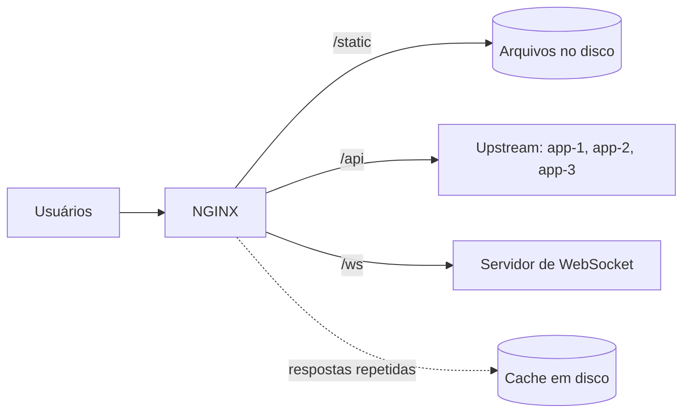
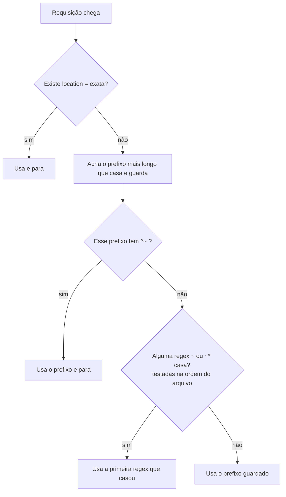

# Casos de Uso do NGINX

Muita gente conhece o NGINX como "o servidor web que fica na frente da aplicação". Mas em sistemas reais o mesmo processo costuma acumular vários papéis que você já viu nesta seção: [reverse proxy](/labs/web-dev/escalabilidade/06-reverse-proxy/), [load balancer](/labs/web-dev/escalabilidade/07-load-balancer/), camada de [cache](/labs/web-dev/escalabilidade/10-cache-e-redis/), [rate limiting](/labs/web-dev/escalabilidade/12-rate-limiting/) e roteamento. A teoria de cada um está nas notas próprias. Aqui o foco é outro: como cada papel aparece no arquivo de configuração do NGINX, e onde estão as pegadinhas.

## NGINX é mais que web server

O NGINX nasceu para servir muitas conexões simultâneas gastando pouca memória. Em vez de abrir uma thread por conexão, cada processo *worker* atende milhares de conexões num laço de eventos. Isso faz dele um bom candidato para ficar na borda, recebendo todo o tráfego antes de qualquer aplicação.



### Como a configuração é organizada

O arquivo principal (normalmente `/etc/nginx/nginx.conf`) é feito de blocos aninhados, chamados **contextos**. Cada diretiva vale no contexto onde foi escrita e é herdada pelos contextos de dentro.

| Contexto   | Para que serve                                                              |
| ---------- | --------------------------------------------------------------------------- |
| `http`     | Tudo que é tráfego HTTP. Zonas de cache e de rate limiting são criadas aqui |
| `server`   | Um "site virtual": uma porta + um ou mais nomes de domínio                  |
| `location` | Regras para um caminho específico dentro de um `server`                     |
| `upstream` | Um grupo de servidores de backend, usado pelo `proxy_pass`                  |

```nginx
http {
    upstream app {
        server 10.0.1.11:3000;
        server 10.0.1.12:3000;
    }

    server {
        listen 80;
        server_name loja.com;

        location / {
            proxy_pass http://app;
        }
    }
}
```

### Validar e recarregar sem derrubar ninguém

Antes de aplicar qualquer mudança, teste a sintaxe:

```bash
sudo nginx -t          # valida a configuração sem aplicar
sudo nginx -s reload   # aplica a nova configuração
```

O `reload` não reinicia o servidor. O processo *master* lê a configuração nova, sobe workers novos com ela e pede para os workers antigos terminarem as requisições em andamento antes de sair. Se a configuração nova tiver erro, o master continua com a antiga. Por isso dá para mexer no NGINX em produção sem derrubar conexões, desde que você rode o `nginx -t` antes 😅.

### Open source vs NGINX Plus

Existe o NGINX open source (o que você instala com `apt install nginx`) e o **NGINX Plus**, versão paga da F5. Tudo nesta nota funciona no open source. Os principais recursos que continuam exclusivos do Plus são health check ativo, painel de monitoramento e API para mudar os servidores de um `upstream` sem reload. A fronteira muda com o tempo: o algoritmo `least_time`, por exemplo, era só do Plus e virou open source na versão 1.31.0. Antes de concluir que "o NGINX não faz X", confira a documentação da versão que você usa.

## Servidor de arquivos estáticos

Esse é o uso mais antigo: entregar HTML, CSS, JavaScript, imagens e downloads direto do disco, sem passar por nenhuma aplicação. É bem mais barato do que deixar o Node ou o Spring lerem um arquivo e devolverem.

```nginx
server {
    listen 80;
    server_name loja.com;

    root /var/www/loja/dist;   # pasta base dos arquivos
    index index.html;          # arquivo servido quando a URL é um diretório

    sendfile on;               # o kernel copia o arquivo direto para o socket

    location / {
        try_files $uri $uri/ /index.html;
    }

    location /assets/ {
        expires 1y;
        add_header Cache-Control "public, immutable";
    }
}
```

O `root` diz onde procurar: uma requisição para `/assets/logo.png` vira o arquivo `/var/www/loja/dist/assets/logo.png`.

O `try_files` tenta cada opção na ordem e usa a primeira que existir. Em `try_files $uri $uri/ /index.html`, o NGINX procura o arquivo exato, depois um diretório com esse nome e, se nada existir, devolve o `/index.html`. Esse último passo é o **fallback de SPA**: numa aplicação React ou Vue, uma rota como `/produtos/42` não existe no disco, quem resolve é o roteador no navegador. Sem o fallback, quem acessasse esse link direto receberia 404. Se você quiser 404 de verdade para arquivo inexistente, troque o último parâmetro por `=404`.

O bloco `/assets/` cuida do cache no navegador. `expires 1y` e `Cache-Control: immutable` dizem ao navegador para nem perguntar ao servidor de novo. Isso só é seguro porque ferramentas como Vite colocam um hash no nome do arquivo (`app.3f9a1c.js`): quando o conteúdo muda, o nome muda junto. Não aplique cache longo no `index.html`, senão o usuário fica preso numa versão antiga.

O `sendfile` vem desligado por padrão. Ligado, o sistema operacional envia o arquivo do disco para a rede sem copiá-lo para a memória do NGINX.

Para tráfego global, esses mesmos arquivos costumam ir para uma [CDN](/labs/web-dev/escalabilidade/05-cdn/), com o NGINX como origem.

## Reverse proxy

O conceito e um exemplo mínimo estão na nota de [Reverse Proxy](/labs/web-dev/escalabilidade/06-reverse-proxy/). No NGINX, tudo gira em torno do `proxy_pass`:

```nginx
location /api/ {
    proxy_pass http://app;

    proxy_set_header Host              $host;
    proxy_set_header X-Real-IP         $remote_addr;
    proxy_set_header X-Forwarded-For   $proxy_add_x_forwarded_for;
    proxy_set_header X-Forwarded-Proto $scheme;
}
```

Os cabeçalhos são o que mais confunde quem está começando. A conexão com a aplicação é aberta pelo NGINX, então, sem eles, a aplicação perde informação sobre a requisição original:

| Cabeçalho           | O que a aplicação perderia sem ele                                                 |
| ------------------- | ---------------------------------------------------------------------------------- |
| `Host`              | O domínio pedido. Sem ele, o NGINX manda o nome do upstream (`app`)                |
| `X-Real-IP`         | O IP do cliente. A aplicação veria só o IP do NGINX                                |
| `X-Forwarded-For`   | A cadeia de IPs por onde a requisição passou (cliente, proxies intermediários)     |
| `X-Forwarded-Proto` | Se o cliente usou HTTPS. Sem ele, a aplicação gera links e redirects com `http://` |

Um detalhe do `proxy_pass` que pega muita gente: a barra final muda o comportamento. Com `location /api/` e `proxy_pass http://app;`, a aplicação recebe `/api/pedidos`. Com `proxy_pass http://app/;` (barra no fim), o NGINX troca o prefixo `/api/` por `/` e a aplicação recebe só `/pedidos`.

## TLS termination

Em [TLS termination](/labs/web-dev/escalabilidade/06-reverse-proxy/), o NGINX cuida da criptografia HTTPS e repassa o tráfego já decifrado para a aplicação. A configuração típica tem dois blocos `server`: um na porta 80, só para redirecionar, e outro na 443, com o certificado.

```nginx
server {
    listen 80;
    server_name loja.com;
    return 301 https://$host$request_uri;
}

server {
    listen 443 ssl;
    server_name loja.com;

    ssl_certificate     /etc/letsencrypt/live/loja.com/fullchain.pem;
    ssl_certificate_key /etc/letsencrypt/live/loja.com/privkey.pem;
    ssl_protocols       TLSv1.2 TLSv1.3;

    location / {
        proxy_pass http://app;
        proxy_set_header X-Forwarded-Proto $scheme;
    }
}
```

O `return 301` manda o navegador refazer a requisição em HTTPS, mantendo o domínio (`$host`) e o caminho com a query string (`$request_uri`).

E entre o NGINX e a aplicação? Em muitos sistemas, esse trecho é HTTP puro, porque fica dentro de uma rede privada. Isso simplifica a vida (um lugar só para renovar certificado), mas significa que quem tiver acesso à rede interna lê o tráfego. Ambientes com exigência maior de segurança, como saúde e pagamentos, costumam criptografar esse trecho também: o `proxy_pass` aponta para `https://` e o NGINX abre uma nova conexão TLS até o backend.

## Load balancer

Para distribuir carga, você declara um `upstream` com as réplicas e aponta o `proxy_pass` para ele. Os algoritmos são explicados na nota de [Load Balancer](/labs/web-dev/escalabilidade/07-load-balancer/). No NGINX, eles se escrevem assim:

```nginx
upstream app {
    least_conn;                                   # algoritmo (sem nada = round-robin)

    server 10.0.1.11:3000 weight=3;               # recebe 3x mais requisições
    server 10.0.1.12:3000;
    server 10.0.1.13:3000 max_fails=3 fail_timeout=30s;
    server 10.0.1.14:3000 backup;                 # só entra se os outros caírem
}
```

| Diretiva no `upstream`  | Algoritmo                                                                         |
| ----------------------- | --------------------------------------------------------------------------------- |
| (nenhuma)               | Round-robin, o padrão                                                             |
| `least_conn`            | Menos conexões ativas                                                             |
| `ip_hash`               | Hash do IP do cliente: o mesmo cliente cai sempre no mesmo servidor               |
| `hash $chave`           | Hash de qualquer variável (ex: `hash $request_uri consistent`)                    |
| `least_time`            | Menor tempo médio de resposta. Open source só a partir da 1.31.0                  |

O `weight` funciona junto com round-robin, `least_conn` e `ip_hash`, e serve para quando as máquinas não são iguais.

### Health check passivo

O NGINX open source faz health check **passivo**: ele não fica perguntando "você está vivo?" para os servidores. Em vez disso, observa as requisições reais. Se um servidor falhar `max_fails` vezes (padrão 1) dentro de `fail_timeout` (padrão 10 segundos), ele é marcado como indisponível por esse mesmo `fail_timeout`. Depois disso, o NGINX volta a mandar algumas requisições reais para testar.

O lado ruim é que algum usuário de verdade precisa receber o erro para o NGINX descobrir a falha. A diretiva `proxy_next_upstream` (ligada por padrão para erros de conexão e timeout) faz o NGINX tentar o próximo servidor nesses casos, então nem sempre o usuário vê o erro. Health check **ativo**, que consulta um endpoint como `/health` em intervalos fixos, é recurso do NGINX Plus. Se você precisa disso no open source, o caminho é um load balancer gerenciado na frente (como o da AWS) ou outra ferramenta, como HAProxy.

## Roteamento de requisições

Um único NGINX pode atender vários domínios e mandar cada caminho para um serviço diferente. Esse é o embrião do que um [API Gateway](/labs/web-dev/escalabilidade/09-api-gateway/) faz.

Por domínio, quem decide é o `server_name`:

```nginx
server {
    listen 443 ssl;
    server_name loja.com www.loja.com;
    location / { proxy_pass http://site; }
}

server {
    listen 443 ssl;
    server_name api.loja.com;
    location / { proxy_pass http://api; }
}
```

Por caminho, quem decide é o `location`:

```nginx
server {
    listen 443 ssl;
    server_name loja.com;

    location = /health        { return 200 "ok"; }            # exato
    location ^~ /static/      { root /var/www; }              # prefixo prioritário
    location ~* \.(png|jpg)$  { expires 30d; }                # regex, sem diferenciar maiúsculas
    location /api/pedidos/    { proxy_pass http://pedidos; }  # prefixo
    location /api/            { proxy_pass http://api; }      # prefixo
    location /                { proxy_pass http://site; }     # pega o resto
}
```

### Como o NGINX escolhe a `location`

A ordem em que os blocos aparecem no arquivo **não** é a ordem de prioridade (com exceção das regex). O algoritmo é:



No exemplo acima, `/api/pedidos/42` vai para `pedidos` (prefixo mais longo ganha de `/api/`), e `/static/logo.png` fica no bloco `/static/` mesmo terminando em `.png`, porque o `^~` impede que a regex seja testada. Sem o `^~`, a regex ganharia.

## Camada de cache

O NGINX pode guardar em disco as respostas do backend e devolvê-las sem incomodar a aplicação. É o mesmo raciocínio da nota de [Cache e Redis](/labs/web-dev/escalabilidade/10-cache-e-redis/), só que na borda, guardando a resposta HTTP inteira em vez de um objeto.

```nginx
http {
    proxy_cache_path /var/cache/nginx levels=1:2 keys_zone=api_cache:10m
                     max_size=1g inactive=60m use_temp_path=off;

    server {
        location /api/produtos/ {
            proxy_pass http://api;

            proxy_cache       api_cache;
            proxy_cache_valid 200 301 10m;   # respostas 200 e 301 valem 10 minutos
            proxy_cache_valid 404 1m;

            proxy_cache_use_stale error timeout updating http_500 http_502 http_503 http_504;
            proxy_cache_background_update on;
            proxy_cache_lock on;

            add_header X-Cache-Status $upstream_cache_status;
        }
    }
}
```

O `proxy_cache_path` cria o cache: a pasta no disco, uma zona de memória de 10 MB para as chaves (`keys_zone`), o tamanho máximo em disco e o tempo (`inactive`) depois do qual uma entrada não acessada é apagada. O `proxy_cache_valid` define por quanto tempo cada status fica guardado.

As três diretivas seguintes resolvem problemas que você já conhece:

- `proxy_cache_use_stale` deixa o NGINX servir a resposta antiga (vencida) quando o backend está com erro ou fora do ar. Para o usuário, o site continua de pé, só com um dado um pouco desatualizado.
- `proxy_cache_background_update` atualiza a entrada vencida em segundo plano, enquanto entrega a versão antiga para quem pediu.
- `proxy_cache_lock` é a defesa contra [cache stampede](/labs/web-dev/escalabilidade/10-cache-e-redis/): quando muitas requisições pedem a mesma URL que não está no cache, só a primeira vai até o backend e as outras esperam a resposta dela.

O cabeçalho `X-Cache-Status` ajuda na depuração: ele mostra `HIT`, `MISS`, `EXPIRED`, `STALE` ou `UPDATING` em cada resposta. Se a resposta tiver `Set-Cookie` ou `Cache-Control: private`, o NGINX não guarda. Isso evita que a página de um usuário logado vá parar no cache e seja entregue para outro.

## Rate limiting

A teoria (algoritmos, onde aplicar, backpressure) está em [Rate Limiting](/labs/web-dev/escalabilidade/12-rate-limiting/). O NGINX implementa o limite por taxa com o algoritmo **leaky bucket**, em duas partes: a zona, criada no contexto `http`, e a aplicação dela numa `location`.

```nginx
http {
    limit_req_zone $binary_remote_addr zone=por_ip:10m rate=10r/s;
    limit_req_status 429;

    server {
        location /api/login {
            limit_req zone=por_ip burst=20 nodelay;
            proxy_pass http://api;
        }
    }
}
```

`$binary_remote_addr` é a chave (o IP do cliente em formato compacto), `10m` é a memória para guardar os contadores (cerca de 160 mil IPs) e `rate=10r/s` é a vazão permitida.

O `burst` é o que mais confunde, então vale um exemplo com `rate=10r/s` e `burst=20`:

| Configuração                | O que acontece com 30 requisições de uma vez                                                              |
| --------------------------- | --------------------------------------------------------------------------------------------------------- |
| sem `burst`                 | 1 passa, o resto é rejeitado (o NGINX espera 1 requisição a cada 100 ms)                                  |
| `burst=20`                  | 1 passa, 20 entram numa fila e saem a 10 por segundo (a última espera 2 s), 9 são rejeitadas              |
| `burst=20 nodelay`          | 21 passam na hora, 9 são rejeitadas. As vagas do burst voltam aos poucos, na taxa configurada             |
| `burst=20 delay=8`          | 9 passam na hora, as 12 seguintes esperam na fila, 9 são rejeitadas                                       |

Resumindo o comportamento: sem `nodelay`, o NGINX atrasa o excesso até o limite do burst e rejeita o que passar disso.

Uma pegadinha: por padrão, a requisição rejeitada recebe **503 Service Unavailable**, e não 429. O 503 diz ao cliente que o servidor está com problema, o que confunde monitoramento e retries. Por isso o `limit_req_status 429` no exemplo, que devolve o [status correto](/labs/web-dev/apis/02-status-codes-e-tratamento-de-erros/) para "você mandou requisições demais".

Outra pegadinha: se houver um load balancer na frente do NGINX, `$binary_remote_addr` será o IP do load balancer, e todo mundo vai dividir o mesmo limite. Nesse caso é preciso configurar o módulo `real_ip` (`set_real_ip_from` + `real_ip_header X-Forwarded-For`) para o NGINX enxergar o IP real do cliente.

Além da taxa, dá para limitar **conexões simultâneas** com `limit_conn`. É útil para downloads grandes ou WebSocket, em que o problema não é a quantidade de requisições por segundo, e sim quantas conexões abertas cada cliente segura:

```nginx
http {
    limit_conn_zone $binary_remote_addr zone=conexoes_por_ip:10m;

    server {
        location /downloads/ {
            limit_conn conexoes_por_ip 5;
        }
    }
}
```

## Proxy de WebSocket

Um [WebSocket](/labs/web-dev/apis/04-estilos-de-comunicacao/) começa como uma requisição HTTP comum com o cabeçalho `Upgrade: websocket`, pedindo para transformar aquela conexão num canal bidirecional que fica aberto. O problema é que `Upgrade` e `Connection` são cabeçalhos **hop-by-hop**: valem só para um trecho da conexão (cliente até NGINX) e, pela especificação do HTTP, o proxy não os repassa para o próximo trecho. Sem configuração extra, o backend nunca fica sabendo que o cliente pediu um WebSocket, e a conexão não se estabelece.

A solução é repassar esses cabeçalhos manualmente:

```nginx
http {
    map $http_upgrade $connection_upgrade {
        default upgrade;
        ''      close;
    }

    server {
        location /ws/ {
            proxy_pass http://chat;
            proxy_http_version 1.1;                       # necessário em versões antes da 1.29.7

            proxy_set_header Upgrade    $http_upgrade;
            proxy_set_header Connection $connection_upgrade;
            proxy_set_header Host       $host;

            proxy_read_timeout 1h;
        }
    }
}
```

O `map` cria a variável `$connection_upgrade`: se o cliente mandou `Upgrade`, ela vale `upgrade`; se não mandou, vale `close`. Assim a mesma `location` atende tanto o handshake do WebSocket quanto requisições HTTP normais.

O `proxy_http_version 1.1` aparece em quase todo tutorial porque, até a versão 1.29.7, o NGINX falava HTTP/1.0 com o backend por padrão, e o upgrade de protocolo só existe no HTTP/1.1. Nas versões mais novas, ele não é mais obrigatório, mas não atrapalha deixar.

O `proxy_read_timeout` é o que derruba mais conexões em produção. Por padrão, o NGINX fecha a conexão se o backend passar **60 segundos** sem mandar nada. Num chat parado, isso acontece o tempo todo. Há duas saídas: aumentar o timeout, como no exemplo, ou fazer o servidor mandar frames de *ping* periódicos, o que reinicia o contador e ainda detecta conexões mortas. Na prática, faça as duas coisas.

Se o WebSocket estiver atrás de um `upstream` com várias réplicas, cada conexão fica presa ao servidor onde nasceu. Se a aplicação guarda estado por conexão, use `ip_hash` ou `hash` para que reconexões do mesmo cliente voltem ao mesmo lugar, ou, melhor, compartilhe o estado entre réplicas (ex: com o [Pub/Sub do Redis](/labs/web-dev/escalabilidade/11-casos-de-uso-do-redis/)).

## Juntando tudo num arquivo só

É assim que um NGINX "faz-tudo" de um sistema pequeno costuma ficar. Todos os papéis da nota estão aqui:

```nginx
http {
    upstream api {
        least_conn;
        server 10.0.1.11:3000 max_fails=3 fail_timeout=30s;
        server 10.0.1.12:3000 max_fails=3 fail_timeout=30s;
    }

    upstream chat {
        ip_hash;
        server 10.0.2.11:4000;
        server 10.0.2.12:4000;
    }

    proxy_cache_path /var/cache/nginx keys_zone=api_cache:10m max_size=1g inactive=60m;
    limit_req_zone   $binary_remote_addr zone=por_ip:10m rate=10r/s;
    limit_req_status 429;

    map $http_upgrade $connection_upgrade {
        default upgrade;
        ''      close;
    }

    server {
        listen 80;
        server_name loja.com;
        return 301 https://$host$request_uri;                 # redireciona para HTTPS
    }

    server {
        listen 443 ssl;                                       # TLS termination
        server_name loja.com;
        ssl_certificate     /etc/letsencrypt/live/loja.com/fullchain.pem;
        ssl_certificate_key /etc/letsencrypt/live/loja.com/privkey.pem;

        root /var/www/loja/dist;                              # arquivos estáticos

        location / {
            try_files $uri $uri/ /index.html;
        }

        location /api/ {                                      # reverse proxy + load balancer
            limit_req zone=por_ip burst=20 nodelay;           # rate limiting
            proxy_cache api_cache;                            # cache
            proxy_cache_valid 200 1m;
            proxy_cache_lock on;

            proxy_pass http://api;
            proxy_set_header Host              $host;
            proxy_set_header X-Forwarded-For   $proxy_add_x_forwarded_for;
            proxy_set_header X-Forwarded-Proto $scheme;
        }

        location /ws/ {                                       # WebSocket
            proxy_pass http://chat;
            proxy_http_version 1.1;
            proxy_set_header Upgrade    $http_upgrade;
            proxy_set_header Connection $connection_upgrade;
            proxy_read_timeout 1h;
        }
    }
}
```

Cerca de 60 linhas e um processo só. Para muita aplicação, isso basta por bastante tempo.

### Quando separar os papéis

A nota de [API Gateway](/labs/web-dev/escalabilidade/09-api-gateway/) discute a fronteira entre reverse proxy, load balancer e gateway. Do ponto de vista do NGINX, alguns sinais de que chegou a hora de tirar responsabilidades dele:

- Os arquivos estáticos têm usuários no mundo todo e a latência de longe incomoda. Eles vão para uma CDN, e o NGINX vira só a origem.
- As regras de API (autenticação, chaves, cotas por cliente, transformação de payload) mudam toda semana e são de outro time. Um API Gateway dedicado dá painel, plugins e deploy separado para isso.
- O número de réplicas sobe e desce sozinho (autoscaling) e editar a lista do `upstream` à mão virou gargalo. Um load balancer gerenciado da nuvem, ou o [service discovery](/labs/web-dev/escalabilidade/08-service-discovery/) do orquestrador, resolve isso.
- Você precisa de health check ativo e não quer pagar o NGINX Plus.
- O próprio NGINX virou ponto único de falha. A saída clássica é ter duas instâncias com um IP flutuante entre elas, ou colocar um load balancer gerenciado na frente.

## NGINX no Kubernetes

No [Kubernetes](/labs/web-dev/entrega-continua/03-kubernetes/), o recurso **Ingress** descreve regras de roteamento de entrada, mas não faz nada sozinho: precisa de um *Ingress controller* que leia essas regras e configure um proxy de verdade. Por muitos anos, o controller mais usado foi o **ingress-nginx**, mantido pela comunidade Kubernetes, que gera automaticamente um `nginx.conf` a partir dos objetos Ingress do cluster.

É aqui que muita gente confunde as coisas. O ingress-nginx é **um projeto que usa o NGINX**, não o NGINX. E ele foi aposentado: o anúncio saiu em novembro de 2025 e, a partir de março de 2026, o projeto parou de receber releases, correções de bugs e patches de segurança. Os motivos foram falta de mantenedores e o risco de segurança das *annotations* de snippets, que permitiam injetar trechos arbitrários de configuração.

O NGINX continua sendo mantido normalmente, e existe outro controller, mantido pela própria F5 (NGINX Ingress Controller), que é um projeto separado. A recomendação oficial do Kubernetes para quem usava o ingress-nginx é migrar para a **Gateway API**, sucessora do Ingress, que separa melhor quem cuida da infraestrutura (o `Gateway`) de quem define as rotas de cada aplicação (o `HTTPRoute`). Se você encontrar um cluster ainda rodando o ingress-nginx, trate como dívida técnica com risco de segurança.

## Referências

- [NGINX: servidor web, proxy reverso e API gateway](https://www.alura.com.br/conteudo/nginx-servidor-web-proxy-reverso-api-gateway) - Alura, pt-BR
- [Beginner's Guide](https://nginx.org/en/docs/beginners_guide.html) - nginx.org, en
- [Using nginx as HTTP load balancer](https://nginx.org/en/docs/http/load_balancing.html) - nginx.org, en
- [NGINX Content Caching](https://docs.nginx.com/nginx/admin-guide/content-cache/content-caching/) - NGINX Docs, en
- [Rate Limiting with NGINX](https://blog.nginx.org/blog/rate-limiting-nginx) - NGINX Blog, en
- [WebSocket proxying](https://nginx.org/en/docs/http/websocket.html) - nginx.org, en
- [Ingress NGINX Retirement: What You Need to Know](https://kubernetes.io/blog/2025/11/11/ingress-nginx-retirement/) - Kubernetes Blog, en
