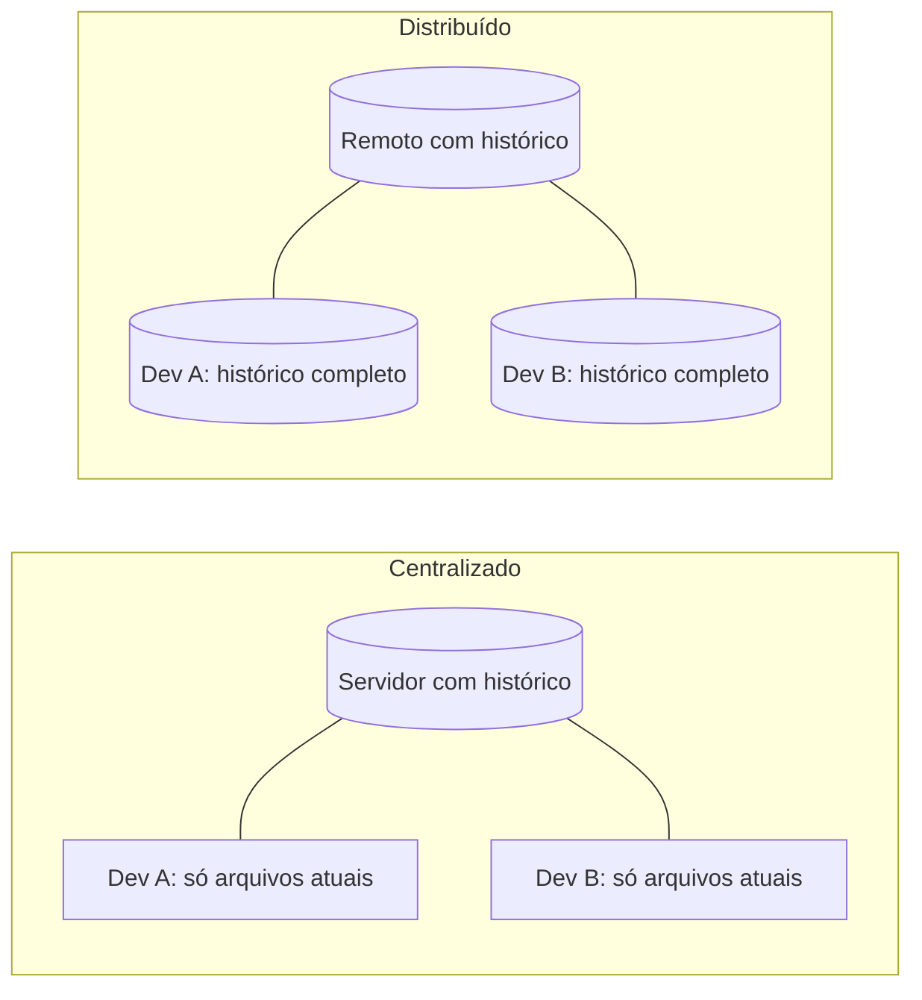

# Git: Fundamentos

Git é um sistema de controle de versão distribuído que rastreia mudanças no código ao longo do tempo. GitHub é uma plataforma que hospeda repositórios Git e adiciona ferramentas de colaboração como pull requests e code review.

## O que é controle de versão

Quem nunca teve uma pasta com `trabalho-final.zip`, `trabalho-final-v2.zip` e `trabalho-final-agora-vai.zip`? Controle de versão é a solução organizada para esse problema: um sistema que guarda o histórico de cada mudança nos arquivos, com quem mudou, quando e por quê, e que deixa voltar a qualquer ponto desse histórico.

Na prática, o Git resolve várias dores de uma vez:

- Rastreia o que mudou em cada arquivo, linha por linha
- Deixa várias pessoas trabalharem no mesmo projeto sem uma sobrescrever o trabalho da outra
- Mantém versões diferentes do projeto ao mesmo tempo (a estável e a que está em desenvolvimento, por exemplo)
- Permite voltar a um estado anterior quando algo quebra
- Funciona como backup, já que cada cópia do repositório carrega o histórico inteiro

### Centralizado x distribuído

Sistemas mais antigos, como o SVN, são **centralizados**: existe um servidor com o histórico, e cada pessoa só tem na máquina a versão atual dos arquivos. Sem acesso ao servidor, não dá para ver o histórico nem registrar mudanças.

O Git é **distribuído**: cada clone é uma cópia completa do repositório, com todo o histórico. Dá para commitar, criar branches e consultar o log sem internet, e a comunicação com o servidor só acontece quando você decide enviar ou buscar alterações.



Outras características que aparecem no dia a dia: o Git é rápido (quase tudo acontece localmente), criar branches é barato, e cada commit guarda um retrato (snapshot) do projeto inteiro, não só uma lista de diferenças.

### Git x GitHub

Git é a ferramenta de versionamento que roda na sua máquina. GitHub é um serviço na nuvem que hospeda repositórios Git e adiciona colaboração por cima (pull requests, issues, automação). A diferença é detalhada em [GitHub](/labs/web-dev/ferramentas/05-github/).

## Conceitos fundamentais

### Repositório

Um repositório (ou repo) é o diretório do projeto com toda a história de versões armazenada. O histórico fica em uma pasta oculta `.git` na raiz do projeto.

Há dois tipos:

- **Local:** na sua máquina
- **Remoto:** em um servidor (GitHub, GitLab, etc.)

### A pasta .git

O `git init` cria uma pasta oculta `.git` na raiz do projeto. É ali que o Git guarda tudo: os objetos (o conteúdo dos arquivos e dos commits), as referências (branches e tags), o arquivo `HEAD` e a configuração local do repositório (`.git/config`).

```
.git/
├── HEAD        # para onde você está apontando agora
├── config      # configurações só deste repositório
├── objects/    # conteúdo de commits e arquivos
└── refs/       # branches e tags
```

Duas consequências práticas: apagar a `.git` apaga o histórico inteiro (a pasta volta a ser uma pasta comum), e mexer nos arquivos dela à mão é pedir para corromper o repositório. Use sempre os comandos do Git.

### Commit

Um commit é um retrato salvo do projeto num momento específico. Além do conteúdo, ele guarda autor, data, mensagem e uma referência ao commit anterior (o "pai"), e é essa corrente de pais que forma o histórico.

Cada commit é identificado por um hash SHA-1 de 40 caracteres, normalmente exibido abreviado (`a1b2c3d`). O hash é calculado a partir de tudo que o commit contém, inclusive o pai. Se qualquer coisa mudar (uma vírgula na mensagem, por exemplo), o hash muda junto. Por isso comandos que reescrevem histórico, como rebase e `--amend`, geram commits novos em vez de editar os antigos.

### Branches

Uma branch é uma linha independente de desenvolvimento. O trabalho em uma branch não afeta outras até ser mesclado (merge).

```
main           ──●──●──●──────────●──
                       \          /
feature/login   ────────●──●──●──
```

A branch principal costuma se chamar `main` (antes era `master`).

### HEAD

HEAD é o marcador de "você está aqui". Normalmente ele aponta para a branch atual, e a branch aponta para o último commit dela. Quando você faz um commit novo, a branch avança e o HEAD vai junto.

```bash
cat .git/HEAD
# ref: refs/heads/main
```

Muitos comandos aceitam posições relativas ao HEAD: `HEAD~1` é o commit anterior, `HEAD~3` é três commits para trás. Você vai ver essa notação em `git diff HEAD~1`, `git reset HEAD~1` e `git rebase -i HEAD~3`.

Criar, mesclar e rebasear branches (e o caso do "detached HEAD") ficam em [Branches, Merge e Rebase](/labs/web-dev/ferramentas/02-branches-merge-e-rebase/).

### Staging Area

Git tem três áreas:

1. **Working directory** - arquivos que você edita
2. **Staging area (index)** - alterações preparadas para o próximo commit
3. **Repository** - histórico de commits

```
Editar arquivo → git add → git commit
(working dir)  (staging)  (repository)
```

## Configuração inicial

```bash
git config --global user.name "Seu Nome"
git config --global user.email "seu@email.com"
git config --global core.editor "code --wait"  # VS Code como editor padrão
```

### Níveis de configuração

O `git config` grava configurações em três níveis, e o mais específico vence:

| Nível       | Flag       | Vale para                             | Onde fica                         |
| ----------- | ---------- | ------------------------------------- | --------------------------------- |
| Sistema     | `--system` | Todos os usuários da máquina          | arquivo `gitconfig` da instalação |
| Global      | `--global` | Seu usuário, em todos os repositórios | `~/.gitconfig`                    |
| Repositório | `--local`  | Só o repositório atual (é o padrão)   | `.git/config`                     |

Um uso comum do nível local: usar o e-mail do trabalho só no repositório da empresa, sem mexer no global.

```bash
git config --local user.email "voce@empresa.com"
git config --list --show-origin   # mostra cada configuração e de qual arquivo ela veio
```

Vale configurar também o nome da branch inicial. O GitHub usa `main` desde 2020, mas o `git init` ainda cria `master` por padrão (a documentação do Git avisa que isso muda para `main` no Git 3.0):

```bash
git config --global init.defaultBranch main
```

No Windows, o instalador Git for Windows traz o **Git Bash**, um terminal com os comandos Unix mais comuns (`ls`, `cat`, `grep`). Os exemplos desta seção funcionam nele sem adaptação.

### Versão e ajuda

```bash
git --version          # confirma que o Git está instalado e qual versão
git help commit        # abre o manual completo do comando
git commit --help      # mesma coisa
git commit -h          # resumo curto das opções, direto no terminal
```

O `-h` costuma bastar para lembrar uma flag; o manual completo é para quando você quer entender o comportamento.

## Comandos essenciais

### Começar um projeto

```bash
# Iniciar repositório em um diretório existente
git init

# Clonar repositório remoto
git clone https://github.com/usuario/repositorio.git

# Clonar em um diretório específico
git clone https://github.com/usuario/repositorio.git meu-projeto
```

### Verificar estado

```bash
git status              # mostra arquivos modificados, staged, untracked
git log                 # histórico de commits
git log --oneline       # uma linha por commit
git log --oneline --graph --all  # visualizar branches
git diff                # alterações não staged
git diff --staged       # alterações staged (prontas para commit)
```

### Registrar alterações

```bash
git add arquivo.java          # adiciona arquivo específico
git add src/                  # adiciona diretório
git add .                     # adiciona tudo no diretório atual

git commit -m "feat: adicionar validação de email"

# Adicionar e commitar em um comando (só arquivos rastreados)
git commit -am "fix: corrigir cálculo de imposto"
```

Convenção de mensagens de commit (Conventional Commits):

| Prefixo     | Quando usar                               |
| ----------- | ----------------------------------------- |
| `feat:`     | Nova funcionalidade                       |
| `fix:`      | Correção de bug                           |
| `docs:`     | Documentação                              |
| `refactor:` | Refatoração sem mudança de funcionalidade |
| `test:`     | Adição ou correção de testes              |
| `chore:`    | Tarefas de manutenção (build, deps)       |

### Inspecionar um commit

O `git log` mostra a lista de commits; o `git show` abre um commit específico, com autor, data, mensagem e o diff do que ele mudou:

```bash
git show a1b2c3d     # um commit pelo hash
git show HEAD        # o último commit da branch atual
git show HEAD~2      # dois commits atrás
```

Algumas variações do `git log` ajudam a achar o commit certo antes de abrir:

```bash
git log -p                       # histórico com o diff de cada commit
git log --author="Maria"         # só commits de uma pessoa
git log -- src/carrinho.js       # só commits que mexeram nesse arquivo
git log --since="2 weeks ago"    # só commits recentes
```

### Remover e renomear arquivos

Apagar ou renomear um arquivo pelo explorador funciona, mas deixa para você o trabalho de avisar o Git (`git add` da remoção). Os comandos próprios já fazem as duas coisas:

```bash
git rm arquivo-velho.js           # apaga do disco e coloca a remoção no staging
git rm --cached config.local.json # para de rastrear, mas mantém o arquivo no disco
git mv utils.js helpers.js        # renomeia e coloca a mudança no staging
```

O `--cached` é o caminho para quando um arquivo entrou no repositório por engano e deveria estar no `.gitignore` (ver abaixo). Sobre o `git mv`: o Git não guarda "renomeações" de verdade, ele compara o conteúdo e deduz que `helpers.js` é o antigo `utils.js` quando os arquivos são parecidos o suficiente. Por isso, se você renomear e reescrever o arquivo no mesmo commit, o histórico pode mostrar um arquivo apagado e outro criado. `git log --follow helpers.js` segue o arquivo através das renomeações.

### Os próximos passos no terminal

Com os comandos acima dá para trabalhar sozinho num repositório local. Os assuntos seguintes têm notas próprias:

- Branches, merge, rebase e conflitos: [Branches, Merge e Rebase](/labs/web-dev/ferramentas/02-branches-merge-e-rebase/)
- Stash, restore, reset e revert: [Desfazendo Alterações](/labs/web-dev/ferramentas/03-desfazendo-alteracoes/)
- Remotos, push, pull e fetch: [Repositórios Remotos](/labs/web-dev/ferramentas/04-repositorios-remotos/)

## .gitignore

O arquivo `.gitignore` lista padrões de arquivos que o Git deve ignorar:

```gitignore
# Compilados Java
*.class
*.jar
target/

# Ambientes
.env
*.local

# IDEs
.idea/
.vscode/
*.iml

# SO
.DS_Store
Thumbs.db
```

Arquivos já rastreados não são afetados pelo `.gitignore`. Para parar de rastrear um arquivo:

```bash
git rm --cached arquivo-sensivel.env
```

### Padrões úteis

O exemplo acima é de um projeto Java. Em outras stacks, o que costuma ficar de fora são dependências baixadas, saídas de build e arquivos de log:

```gitignore
# Node
node_modules/
dist/

# Python
__pycache__/
.venv/

# Qualquer stack
*.log
.env
!.env.example   # exceção: este arquivo de exemplo deve ser versionado
```

A sintaxe é curta: `*` casa qualquer sequência de caracteres, uma `/` no fim indica pasta, `!` cria uma exceção a uma regra anterior e `#` começa um comentário.

Não precisa escrever do zero: o GitHub mantém o repositório [github/gitignore](https://github.com/github/gitignore) com modelos por linguagem, e a tela de criação de repositório oferece esses modelos. Para arquivos que são do seu computador e não do projeto (`.DS_Store`, configurações do editor), um `.gitignore` global evita repetir as mesmas linhas em todo repositório:

```bash
git config --global core.excludesFile ~/.gitignore_global
```

O `.env` aparece em quase todo exemplo por um motivo: ele costuma guardar senhas e chaves de API, e isso nunca deve ir para o repositório. O que fazer se um segredo vazar está em [GitHub](/labs/web-dev/ferramentas/05-github/).

## Boas práticas de commit

Um histórico útil é feito de commits pequenos, cada um com uma mudança lógica. "Corrige validação de e-mail" num commit e "renomeia pasta de testes" em outro, em vez de um commitão com tudo do dia. Commit pequeno é mais fácil de revisar, de entender meses depois e de reverter sem levar junto o que estava certo.

A mensagem deve dizer o que muda de forma direta: `fix: corrigir validação de e-mail no cadastro` diz muito mais que `ajustes`. O formato completo está em [Conventional Commits e SemVer](/labs/web-dev/ferramentas/06-conventional-commits/).

Antes de commitar, confira o que vai entrar:

```bash
git status            # quais arquivos estão no staging
git diff --staged     # o conteúdo exato que vai para o commit
```

Esse hábito pega o `console.log` esquecido, o arquivo de build que escapou do `.gitignore` e, principalmente, o segredo que nunca deveria ser commitado.

## Referências

- [Pro Git - Sobre Controle de Versão](https://git-scm.com/book/pt-br/v2/Primeiros-Passos-Sobre-Controle-de-Vers%c3%a3o) - Scott Chacon e Ben Straub, pt-BR
- [Pro Git - Configuração inicial do Git](https://git-scm.com/book/pt-br/v2/Primeiros-Passos-Configura%c3%a7%c3%a3o-inicial-do-Git) - Scott Chacon e Ben Straub, pt-BR
- [Pro Git - Gravando Alterações no Repositório](https://git-scm.com/book/pt-br/v2/Fundamentos-do-Git-Gravando-Altera%c3%a7%c3%b5es-no-Reposit%c3%b3rio) - Scott Chacon e Ben Straub, pt-BR
- [Ignorando arquivos](https://docs.github.com/pt/get-started/git-basics/ignoring-files) - GitHub Docs, pt-BR
- [git-init - Git Documentation](https://git-scm.com/docs/git-init) - Git, en
