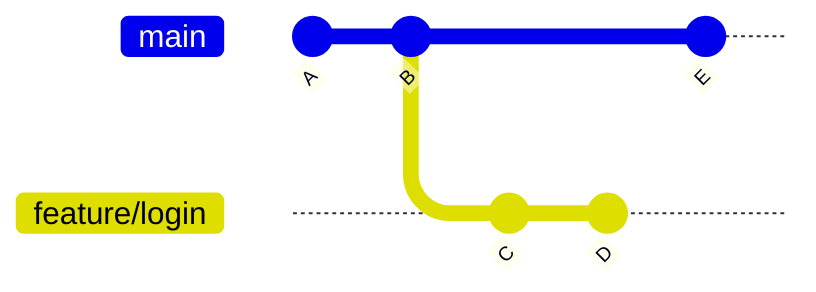

# Branches, Merge e Rebase

Uma branch é uma linha independente de desenvolvimento dentro do mesmo repositório. É ela que deixa você testar uma ideia, corrigir um bug ou construir uma feature sem mexer no código que já funciona. Esta nota parte dos conceitos de [Git: Fundamentos](/labs/web-dev/ferramentas/01-git-fundamentos/) e passa por criar branches, juntar o trabalho de volta (merge e rebase) e resolver os conflitos que aparecem no caminho.

## Por que usar branches

Pense na branch principal como a versão "que funciona" do projeto. Se você desenvolve uma feature direto nela, qualquer coisa pela metade fica misturada com o código estável, e um bug urgente vai ter que esperar você terminar ou desfazer o que estava fazendo. Com uma branch separada, o trabalho em andamento fica isolado até estar pronto.

Em equipe isso fica ainda mais claro: cada pessoa trabalha na própria branch, no próprio ritmo, e as mudanças só se encontram na hora de integrar, normalmente por um [Pull Request](/labs/web-dev/ferramentas/07-pull-requests/), onde alguém revisa antes do merge.

Uma **feature branch** é exatamente isso: uma branch criada para uma funcionalidade específica (`feature/login`, `fix/calculo-frete`), que vive só até ser mesclada.

A branch principal costuma se chamar `main`. O GitHub adotou esse nome como padrão para repositórios novos em outubro de 2020; antes era `master`. O Git em si ainda cria `master` no `git init` (a mudança para `main` está prevista para o Git 3.0), então vale configurar uma vez:

```bash
git config --global init.defaultBranch main
```

## O que é uma branch por dentro

Por baixo dos panos, uma branch é só um ponteiro: um arquivo pequeno em `.git/refs/heads/` contendo o hash de um commit. Criar uma branch não copia nenhum arquivo, por isso é instantâneo mesmo num projeto enorme.

O HEAD aponta para a branch em que você está. Ao fazer um commit, o Git cria o commit novo, move a branch atual para ele, e o HEAD acompanha porque aponta para a branch.



No diagrama, `main` aponta para `E` e `feature/login` aponta para `D`. As duas compartilham `A` e `B`, e cada uma seguiu seu caminho a partir daí.

### Detached HEAD

Às vezes o HEAD aponta direto para um commit, sem branch no meio. Isso acontece quando você vai inspecionar uma versão antiga:

```bash
git switch --detach a1b2c3d   # ou: git checkout a1b2c3d
```

O Git avisa que você está em "detached HEAD". Dá para olhar o código, compilar e até commitar, mas esses commits não pertencem a nenhuma branch: ao trocar de branch, ficam soltos e eventualmente são descartados pelo Git. Se quiser guardar o que fez ali, crie uma branch antes de sair:

```bash
git switch -c experimento-antigo
```

## Criando e trocando de branches

```bash
git branch                    # listar branches locais
git branch -a                 # listar locais e remotas

git branch feature/login      # criar branch
git checkout feature/login    # mudar para branch
git checkout -b feature/login # criar e mudar em um comando

# Forma moderna (Git 2.23+)
git switch feature/login      # mudar para branch
git switch -c feature/login   # criar e mudar

git branch -d feature/login   # deletar branch (segura - bloqueia se não mesclada)
git branch -D feature/login   # deletar branch (forçado)
```

### checkout ou switch?

Durante muito tempo o `git checkout` fez duas coisas bem diferentes: trocar de branch (`git checkout main`) e descartar alterações de um arquivo (`git checkout -- arquivo.js`). Um comando que ora muda de contexto, ora apaga seu trabalho, é receita para acidente.

O Git 2.23 (2019) separou essas responsabilidades: `git switch` cuida de branches e `git restore` cuida de arquivos (este último aparece em [Desfazendo Alterações](/labs/web-dev/ferramentas/03-desfazendo-alteracoes/)). O `git checkout` continua funcionando e vai aparecer em muito tutorial e script antigo, inclusive nos exemplos de [Fluxos de Trabalho](/labs/web-dev/ferramentas/08-fluxos-de-trabalho/), mas em comando novo prefira `switch` e `restore`.

| Antes                     | Hoje                    |
| ------------------------- | ----------------------- |
| `git checkout main`       | `git switch main`       |
| `git checkout -b feature` | `git switch -c feature` |
| `git checkout -- arquivo` | `git restore arquivo`   |

## Merge

Merge combina o histórico de duas branches.

```bash
git switch main
git merge feature/login
```

Git tenta fazer o merge automaticamente. Se houver alterações no mesmo trecho de código em ambas as branches, ocorre um conflito.

### Fast-forward merge

Quando `main` não teve commits desde que a branch foi criada, Git apenas avança o ponteiro:

```
Antes:  main ──●──●
                    \
        feature       ●──●

Depois: main ──●──●──●──●
```

### Three-way merge

Quando ambas avançaram, Git cria um commit de merge:

```
        main    ──●──●──●──────●
                       \      /
        feature  ────────●──●
```

## Rebase

O merge junta o histórico de duas branches criando um commit de junção. O rebase faz outra coisa: pega os commits da sua branch e reaplica eles, um por um, como se você tivesse escrito cada um a partir de um ponto de partida diferente.

```
Antes:
              A───B───C  feature
             /
main   ──D───E───F───G

Depois de "git rebase main" em feature:
                      A'──B'──C'  feature
                     /
main   ──D───E───F───G
```

Reparou no apóstrofo? `A'`, `B'` e `C'` não são os commits `A`, `B` e `C` movidos de lugar, são commits **novos**, com conteúdo parecido mas hash diferente, porque o hash de um commit depende do commit pai. Rebase reescreve o histórico.

```bash
git switch feature/login
git rebase main
```

Isso importa na hora de decidir quando usar rebase:

- **Seguro**: rebase numa branch local, que só existe na sua máquina, antes de abrir o PR. Ninguém mais tem esse histórico, então reescrevê-lo não afeta ninguém além de você.
- **Arriscado**: rebase numa branch que já foi enviada com `push` e que outra pessoa já baixou. Como os commits mudam de hash, seu histórico local e o histórico remoto divergem completamente aos olhos do Git. Você precisaria forçar o push (`git push --force`), e quem já tinha puxado aquela branch fica com um histórico que não bate mais com o remoto, precisando corrigir a própria árvore na mão para continuar trabalhando.

Na prática, a regra costuma ser: rebase a vontade na sua própria branch de feature antes do PR existir. Depois que o PR está aberto e outras pessoas podem ter puxado a branch para revisar ou continuar o trabalho, prefira merge.

### Rebase interativo

O `git rebase -i` abre um editor com a lista de commits e deixa você reescrever a história antes de aplicá-la de novo:

```bash
git rebase -i HEAD~3
```

```
pick a1b2c3d adicionar validação de email
pick e4f5g6h corrigir typo na mensagem de erro
pick i7j8k9l ajustar teste que quebrou
```

Trocando a palavra no começo da linha, você decide o que fazer com cada commit:

| Comando  | O que faz                                                 |
| -------- | --------------------------------------------------------- |
| `pick`   | Aplica o commit como está                                 |
| `reword` | Aplica, mas deixa editar a mensagem                       |
| `edit`   | Para nesse commit para você alterar o conteúdo            |
| `squash` | Junta com o commit anterior, mantendo as duas mensagens   |
| `fixup`  | Junta com o commit anterior, descartando a mensagem deste |
| `drop`   | Remove o commit                                           |

Um uso comum: três commits de "correção de typo" que só poluem o histórico virando um só, antes do PR:

```
pick a1b2c3d adicionar validação de email
fixup e4f5g6h corrigir typo na mensagem de erro
fixup i7j8k9l ajustar teste que quebrou
```

Depois de salvar, os três viram um commit único com a mensagem "adicionar validação de email".

Se der conflito no meio do rebase (seja ele interativo ou não), o Git para no commit problemático:

```bash
# resolve o conflito no arquivo, depois:
git add arquivo.java
git rebase --continue   # segue para o próximo commit da lista

git rebase --skip       # pula esse commit específico
git rebase --abort      # cancela tudo, volta pro estado de antes do rebase
```

## Merge ou rebase?

Os dois resolvem o mesmo problema (trazer o trabalho de uma branch para outra), com efeitos diferentes no histórico:

|                                | Merge                                                     | Rebase                                              |
| ------------------------------ | --------------------------------------------------------- | --------------------------------------------------- |
| Histórico resultante           | Mostra a bifurcação e o commit de merge                   | Linear, como se tudo tivesse sido feito em fila     |
| Reescreve commits existentes?  | Não                                                       | Sim, os commits ganham hashes novos                 |
| Seguro em branch compartilhada | Sim                                                       | Não, exige force push e confunde quem já puxou      |
| Quando usar                    | Integrar trabalho em `main` ou outra branch compartilhada | Atualizar ou arrumar a sua branch local antes do PR |

A regra prática que resolve a maioria dos casos: rebase na sua própria branch, antes de ela ser compartilhada; merge para integrar em branches que outras pessoas usam. No GitHub, a escolha também aparece no botão de merge do PR, explicada em [Pull Requests e Code Review](/labs/web-dev/ferramentas/07-pull-requests/).

## Resolução de conflitos

Quando duas branches modificam o mesmo trecho de código, Git marca o conflito no arquivo:

```
<<<<<<< HEAD
    return saldo - taxa;
=======
    return saldo * (1 - taxa);
>>>>>>> feature/calculo-taxa
```

Para resolver:

1. Abra o arquivo e edite manualmente para manter o código correto
2. Remova os marcadores `<<<<<<<`, `=======` e `>>>>>>>`
3. Adicione ao staging e faça commit:

```bash
git add arquivo.java
git commit -m "merge: resolver conflito no cálculo de taxa"
```

IDEs como IntelliJ e VS Code têm interfaces visuais para resolução de conflitos que facilitam bastante.

### Por que conflitos acontecem

Na maior parte das vezes o Git mescla sozinho. Se uma branch mexeu no começo de um arquivo e a outra no final, ele junta as duas mudanças sem perguntar nada. O conflito aparece quando as duas branches alteraram as mesmas linhas, ou quando uma apagou um arquivo que a outra editou. Aí não existe resposta automática certa: só quem conhece o código sabe qual versão (ou qual combinação) vale.

O `git status` mostra exatamente quais arquivos precisam de atenção:

```bash
$ git status
On branch main
You have unmerged paths.
  (fix conflicts and run "git commit")
  (use "git merge --abort" to abort the merge)

Unmerged paths:
  both modified:   src/calculo.java
```

### Abortando e concluindo

Se o conflito ficou maior do que você esperava, ou você quer conversar com quem escreveu a outra parte antes, dá para desistir e voltar ao estado de antes do merge:

```bash
git merge --abort
```

Depois de resolver todos os arquivos, marque cada um como resolvido com `git add` e conclua com `git commit` (ou `git merge --continue`, que faz a mesma coisa).

E antes de comemorar: rode o projeto e os testes. Um merge pode não ter nenhum conflito textual e ainda assim quebrar a lógica, por exemplo quando uma branch renomeou uma função e a outra adicionou uma chamada nova usando o nome antigo. O Git compara texto, não entende o programa.

### Como reduzir conflitos

Conflito não dá para eliminar, mas dá para deixar raro e pequeno:

- Traga a `main` para a sua branch com frequência (merge ou rebase). Resolver um conflito de dois dias é bem mais fácil que um de duas semanas.
- Mantenha branches de vida curta e PRs pequenos; quanto menos tempo a branch fica separada, menos ela diverge.
- Combine com o time antes de mexer em arquivos que todo mundo toca, como um arquivo de rotas ou de configuração central.
- Não misture reformatação com mudança de lógica. Rodar o formatador no arquivo inteiro gera conflito em todas as linhas que outra pessoa também editou.

## Referências

- [Pro Git - Branches em Poucas Palavras](https://git-scm.com/book/pt-br/v2/Ramifica%c3%a7%c3%a3o-Branching-no-Git-Branches-em-Poucas-Palavras) - Scott Chacon e Ben Straub, pt-BR
- [Pro Git - Ramificação e Mesclagem Básicas](https://git-scm.com/book/pt-br/v2/Ramifica%c3%a7%c3%a3o-Branching-no-Git-Ramifica%c3%a7%c3%a3o-Branching-e-Mesclagem-Merging-B%c3%a1sicas) - Scott Chacon e Ben Straub, pt-BR
- [Pro Git - Rebase](https://git-scm.com/book/pt-br/v2/Ramifica%c3%a7%c3%a3o-Branching-no-Git-Rebase-Rebasing) - Scott Chacon e Ben Straub, pt-BR
- [git-switch - Git Documentation](https://git-scm.com/docs/git-switch) - Git, en
- [git-rebase - Git Documentation](https://git-scm.com/docs/git-rebase) - Git, en
