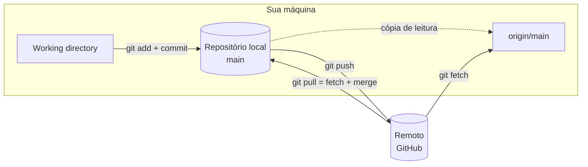

# Repositórios Remotos

Tudo o que aparece em [Git: Fundamentos](/labs/web-dev/ferramentas/01-git-fundamentos/) acontece na sua máquina. Para colaborar (ou só para ter o código guardado fora do seu notebook), você precisa de um remoto: outra cópia do repositório, normalmente num servidor como GitHub ou GitLab, com a qual você troca commits.

Como o Git é distribuído, o remoto não é especial do ponto de vista técnico. Ele tem o mesmo tipo de histórico que o seu clone; é "o oficial" só porque o time combinou assim.

## O que é um remoto

Um remoto é um apelido para a URL de outro repositório. Em vez de digitar `https://github.com/usuario/projeto.git` toda vez, você usa um nome curto.

- `origin` é o nome que o Git dá automaticamente ao remoto de onde você clonou. É só convenção; dá para renomear.
- `upstream` é o nome que a comunidade costuma usar para o repositório original quando você trabalha num fork (o fluxo de fork está em [GitHub](/labs/web-dev/ferramentas/05-github/)).

Para cada branch do remoto, o Git mantém uma **branch remota** local, como `origin/main`. Ela é uma fotografia, somente leitura, de como a `main` do remoto estava na última vez que você conversou com ele. Você não commita nela; ela só é atualizada quando você roda `fetch` ou `pull`.



## Clonando um repositório

O `git clone` faz várias coisas de uma vez: baixa o histórico completo, cria o remoto `origin` apontando para a URL usada e cria a branch local principal já vinculada a `origin/main`. Depois de clonar, `git pull` e `git push` funcionam sem argumentos.

```bash
git clone https://github.com/usuario/projeto.git    # via HTTPS
git clone git@github.com:usuario/projeto.git        # via SSH
```

As duas URLs levam ao mesmo repositório; a diferença é como você se autentica, assunto da próxima seção.

## Autenticação no GitHub: token ou SSH

Muito tutorial antigo diz "digite seu usuário e senha do GitHub" no primeiro push. Isso não funciona desde 13 de agosto de 2021: o GitHub deixou de aceitar a senha da conta em operações Git. Hoje existem dois caminhos.

### HTTPS com token

Quando o Git pedir senha numa URL HTTPS, você informa um **personal access token** (PAT) no lugar. O token é criado em Settings > Developer settings > Personal access tokens. Prefira os tokens _fine-grained_, que podem ser limitados a repositórios e permissões específicos e ter data de validade.

Ninguém quer colar token a cada push. O **Git Credential Manager**, que já vem com o Git for Windows, guarda a credencial e, na maioria dos casos, faz o login pelo navegador sem você nem ver o token.

### SSH

Com SSH, você gera um par de chaves, registra a chave pública no GitHub e a chave privada fica na sua máquina provando quem você é:

```bash
ssh-keygen -t ed25519 -C "seu@email.com"   # gera o par em ~/.ssh/id_ed25519(.pub)
cat ~/.ssh/id_ed25519.pub                  # copie e cole em Settings > SSH and GPG keys
ssh -T git@github.com                      # testa: "Hi usuario! You've successfully authenticated"
```

A lógica de chave pública e privada é a mesma da [assinatura de commits com GPG](/labs/web-dev/ferramentas/11-assinatura-gpg/), mas aqui ela autentica a conexão, não o commit.

### Qual escolher

HTTPS com Credential Manager é o caminho mais simples para começar e funciona atrás de firewall corporativo, que às vezes bloqueia a porta do SSH. SSH dá menos trabalho no longo prazo (configura uma vez por máquina e esquece) e é o padrão em muitos times. Os dois são seguros; o que não dá é usar a senha da conta.

## Conectando um projeto local a um repositório no GitHub

O caminho inverso do clone: o projeto já existe na sua máquina e você quer publicá-lo.

```bash
# 1. Crie um repositório VAZIO no GitHub (sem README, sem .gitignore)
# 2. No projeto local:
git remote add origin https://github.com/usuario/projeto.git
git branch -M main             # garante que a branch se chama main
git push -u origin main        # envia e vincula a branch local à remota
```

Se você criou o repositório no GitHub já com um README, o remoto tem um commit que o seu histórico local não conhece, e os dois históricos não têm nenhum commit em comum. O push é rejeitado, e um pull simples recusa juntar históricos "sem parentesco". A saída é autorizar explicitamente:

```bash
git pull origin main --allow-unrelated-histories
git push -u origin main
```

Criar o repositório vazio evita esse passo. Para administrar os remotos depois:

```bash
git remote -v                                   # lista remotos e URLs
git remote rename origin github                 # renomeia
git remote set-url origin git@github.com:usuario/projeto.git   # troca a URL (ex: HTTPS -> SSH)
git remote remove github                        # remove
```

## Comandos de sincronização

```bash
git remote -v                              # listar remotos configurados
git remote add origin https://github.com/usuario/repo.git

git push origin feature/login             # enviar branch para remoto
git push -u origin feature/login          # enviar e configurar upstream (primeira vez)
git push                                  # enviar para upstream configurado

git pull origin main                      # buscar e mesclar do remoto
git fetch origin                          # buscar sem mesclar
git merge origin/main                     # mesclar após fetch
```

## Upstream tracking e o -u

O upstream de uma branch é a branch remota que ela acompanha. Com esse vínculo configurado, `git push` e `git pull` sem argumentos já sabem para onde ir, e o `git status` passa a dizer se você está à frente ou atrás do remoto:

```bash
$ git status
On branch feature/login
Your branch is ahead of 'origin/feature/login' by 2 commits.
```

Uma branch criada localmente não tem upstream. O `-u` (abreviação de `--set-upstream`) no primeiro push cria o vínculo, e daí em diante basta `git push`:

```bash
git push -u origin feature/login
```

Para conferir o upstream de cada branch:

```bash
$ git branch -vv
* feature/login a1b2c3d [origin/feature/login: ahead 2] feat: tela de login
  main          9f8e7d6 [origin/main] docs: atualizar README
```

## fetch x pull

O `git fetch` baixa os commits novos do remoto e atualiza as branches remotas (`origin/main`), sem tocar na sua branch nem nos seus arquivos. É o comando seguro para ver o que chegou antes de decidir o que fazer:

```bash
git fetch origin
git log main..origin/main --oneline   # commits que estão no remoto e ainda não estão na sua main
```

O `git pull` é um `fetch` seguido da integração na sua branch atual. Por padrão a integração é um merge; com `--rebase`, seus commits locais são reaplicados em cima do que chegou, sem commit de merge (a diferença entre os dois está em [Branches, Merge e Rebase](/labs/web-dev/ferramentas/02-branches-merge-e-rebase/)).

|                         | `git fetch`                   | `git pull`                    |
| ----------------------- | ----------------------------- | ----------------------------- |
| Baixa commits do remoto | Sim                           | Sim                           |
| Altera sua branch       | Não                           | Sim (merge ou rebase)         |
| Pode gerar conflito     | Não                           | Sim                           |
| Quando usar             | Inspecionar antes de integrar | Atualizar a branch de uma vez |

Versões recentes do Git reclamam quando você faz pull numa branch que divergiu do remoto sem ter dito qual estratégia prefere. Configure uma vez e o aviso some:

```bash
git config --global pull.rebase false   # merge (comportamento clássico)
# ou
git config --global pull.rebase true    # rebase
```

## Quando o push é rejeitado

O motivo mais comum é alguém ter enviado commits para a mesma branch depois do seu último pull:

```bash
$ git push
 ! [rejected]        main -> main (fetch first)
error: failed to push some refs to 'github.com:usuario/projeto.git'
hint: Updates were rejected because the remote contains work that you do not have locally.
```

O Git se recusa a sobrescrever o trabalho de outra pessoa. A solução é integrar primeiro e enviar depois:

```bash
git pull            # traz os commits novos (resolva conflitos se aparecerem)
git push
```

A outra família de rejeições vem de regras do servidor. Branches protegidas, por exemplo, podem exigir que toda mudança chegue por Pull Request (configuração em [Pull Requests e Code Review](/labs/web-dev/ferramentas/07-pull-requests/)), e a proteção contra segredos do GitHub bloqueia um push que contenha uma chave de API conhecida (detalhes em [GitHub](/labs/web-dev/ferramentas/05-github/)). Nesses casos, pull não resolve: é preciso seguir a regra.

## Force push: quando e como

Depois de um rebase ou de um `--amend` num commit já enviado, o push normal é rejeitado, porque o seu histórico local não é mais continuação do remoto. O `--force` resolve fazendo o remoto ficar igual ao seu local, custe o que custar. Se um colega tiver enviado um commit nesse meio-tempo, esse commit some do remoto.

O `--force-with-lease` é a versão com cinto de segurança: ele só força se o remoto ainda estiver exatamente como estava no seu último fetch. Se alguém enviou algo novo, o push é recusado e você tem a chance de olhar antes.

```bash
git rebase main
git push --force-with-lease
```

A regra prática: nunca force push em branch compartilhada como `main` (e branches protegidas normalmente nem permitem). Na sua própria branch de feature, depois de um rebase, `--force-with-lease` é normal e esperado.

## Referências

- [Pro Git - Trabalhando com Repositórios Remotos](https://git-scm.com/book/pt-br/v2/Fundamentos-do-Git-Trabalhando-com-Reposit%c3%b3rios-Remotos) - Scott Chacon e Ben Straub, pt-BR
- [Pro Git - Branches Remotos](https://git-scm.com/book/pt-br/v2/Ramifica%c3%a7%c3%a3o-Branching-no-Git-Branches-Remotos-Remote-Branches) - Scott Chacon e Ben Straub, pt-BR
- [Sobre repositórios remotos](https://docs.github.com/pt/get-started/git-basics/about-remote-repositories) - GitHub Docs, pt-BR
- [Gerar nova chave SSH e adicioná-la ao ssh-agent](https://docs.github.com/pt/authentication/connecting-to-github-with-ssh/generating-a-new-ssh-key-and-adding-it-to-the-ssh-agent) - GitHub Docs, pt-BR
- [Gerenciar tokens de acesso pessoal](https://docs.github.com/pt/authentication/keeping-your-account-and-data-secure/managing-your-personal-access-tokens) - GitHub Docs, pt-BR
