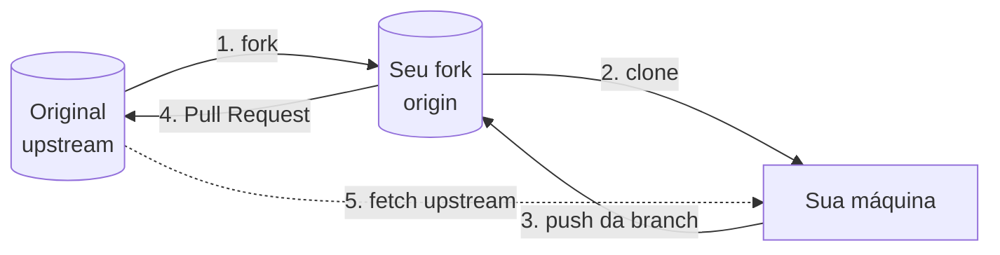

# GitHub

Git é a ferramenta de versionamento que roda na sua máquina. GitHub é uma plataforma na nuvem que hospeda repositórios Git e adiciona por cima tudo o que um time precisa para trabalhar junto: pull requests, code review, issues, automação. GitLab e Bitbucket ocupam o mesmo espaço, com recursos parecidos; os conceitos daqui valem para eles com outros nomes nos botões.

## Git x GitHub

|               | Git                                                     | GitHub                                               |
| ------------- | ------------------------------------------------------- | ---------------------------------------------------- |
| O que é       | Programa de controle de versão                          | Serviço web que hospeda repositórios Git             |
| Onde roda     | Na sua máquina, pelo terminal ou pela IDE               | Na nuvem, acessado pelo navegador, CLI (`gh`) ou API |
| Quem mantém   | Projeto open source (criado por Linus Torvalds em 2005) | Empresa (Microsoft)                                  |
| O que oferece | Commits, branches, merge, histórico                     | Hospedagem, PRs, issues, Actions, Pages, perfil      |

Dá para usar Git a vida inteira sem GitHub, guardando o repositório só no seu computador ou num servidor próprio. O contrário não existe: tudo que o GitHub faz é em cima de repositórios Git.

## Criando um repositório no GitHub

No canto superior direito, **+ > New repository**. A tela pede:

- **Nome** e **descrição** do projeto
- **Visibilidade**: público ou privado
- Opções de iniciar com README, `.gitignore` (a partir de modelos por linguagem) e licença

Se você vai enviar um projeto que já existe na sua máquina, deixe essas três últimas opções desmarcadas e crie o repositório vazio. Assim o primeiro push funciona sem conflito de histórico (o passo a passo está em [Repositórios Remotos](/labs/web-dev/ferramentas/04-repositorios-remotos/)).

### Público, privado e interno

Um repositório **público** pode ser visto (e clonado) por qualquer pessoa na internet, mas só quem tem permissão consegue enviar alterações. Um **privado** só aparece para você e para quem você convidar. Em organizações existe ainda o **interno**, visível para todos os membros da empresa e para mais ninguém.

O seu **username** aparece na URL de tudo: o perfil fica em `github.com/seu-usuario` e cada repositório em `github.com/seu-usuario/nome-do-repo`. Vale escolher algo que você não tenha vergonha de colocar num currículo.

## README e Markdown

O `README.md` é a porta de entrada do projeto: o GitHub renderiza esse arquivo logo abaixo da lista de arquivos do repositório. Um bom README responde, sem a pessoa precisar abrir o código: o que o projeto faz, como instalar, como rodar e como contribuir.

Ele é escrito em **Markdown**, uma sintaxe leve de formatação em texto puro:

````markdown
# Nome do Projeto

API de agendamento de consultas em **Node.js**.

## Como rodar

1. Instale as dependências: `npm install`
2. Copie `.env.example` para `.env`
3. Rode `npm run dev`

Veja a [documentação da API](docs/api.md).

```bash
npm test
```
````

`#` cria títulos, `**texto**` deixa em negrito, listas começam com `-` ou `1.`, crases marcam código e `[texto](link)` cria links. É a mesma sintaxe usada nas notas deste lab, em issues e em descrições de PR.

### README de perfil

O GitHub tem um README especial que aparece no topo da sua página de perfil. Para ativá-lo, crie um repositório **público** com **exatamente o mesmo nome do seu usuário** (o repositório `maria-dev` da usuária `maria-dev`) e coloque um `README.md` com conteúdo na raiz. É um bom lugar para uma apresentação curta, as tecnologias com que você trabalha e links para os projetos de que mais se orgulha.

## Fork x clone

Os dois copiam um repositório, em lugares diferentes:

|                   | Fork                                                | Clone                          |
| ----------------- | --------------------------------------------------- | ------------------------------ |
| Onde fica a cópia | Na sua conta do GitHub (servidor)                   | Na sua máquina                 |
| Para que serve    | Contribuir com projetos onde você não pode dar push | Trabalhar localmente no código |
| É recurso de      | GitHub                                              | Git                            |

Em projetos open source você não tem permissão de escrita no repositório original. O fork resolve isso: você ganha uma cópia sua, onde pode enviar o que quiser, e propõe as mudanças ao original por Pull Request.



```bash
git clone git@github.com:seu-usuario/projeto.git      # clona o SEU fork
cd projeto
git remote add upstream https://github.com/dono/projeto.git
git switch -c fix/erro-de-digitacao
# ... commits ...
git push -u origin fix/erro-de-digitacao             # envia para o fork
# abre o PR no GitHub, do fork para o original
```

Enquanto você trabalha, o original continua recebendo commits. Para manter o fork em dia, traga as novidades do `upstream`:

```bash
git fetch upstream
git switch main
git merge upstream/main
git push origin main
```

Ou use o botão **Sync fork** na página do fork, que faz o mesmo pelo navegador. Os detalhes do lado do PR estão em [Pull Requests e Code Review](/labs/web-dev/ferramentas/07-pull-requests/).

## Issues, Discussions, Projects e Milestones

Além do código, o GitHub organiza o trabalho em volta dele.

**Issues** registram bugs, tarefas e ideias. Cada issue tem um número (`#42`), descrição em Markdown, comentários e metadados: **labels** para classificar (`bug`, `enhancement`, `good first issue`) e **assignees**, as pessoas responsáveis por resolver. Quando um PR traz `Closes #42` na descrição ou num commit, a issue fecha sozinha no merge.

**Discussions** são para conversa que não é tarefa: dúvidas de uso, propostas ainda vagas, anúncios. Separar isso das issues evita uma lista de bugs cheia de "como eu instalo isso?".

**Milestones** agrupam issues e PRs em direção a uma meta, normalmente uma versão ou data ("v1.2", "entrega de março"). A página da milestone mostra o percentual concluído.

**Projects** são quadros e tabelas de planejamento (no estilo kanban) alimentados por issues e PRs, com colunas como "A fazer", "Em andamento" e "Feito", campos personalizados e visões diferentes para cada time.

## Segredos e dados sensíveis

Senha, chave de API, token, string de conexão de banco: nada disso entra no repositório, nem em repositório privado. Privado hoje pode virar público amanhã, ser clonado por um prestador ou vazar junto com o notebook de alguém.

O padrão é ler esses valores de **variáveis de ambiente**. Em desenvolvimento, eles ficam num `.env` listado no [`.gitignore`](/labs/web-dev/ferramentas/01-git-fundamentos/), com um `.env.example` versionado mostrando quais variáveis existem (sem os valores). Em produção, ficam num gerenciador de segredos (o do provedor de nuvem, ou os secrets do próprio GitHub para o CI).

Se um segredo foi commitado, apagar o arquivo no commit seguinte não resolve: ele continua no histórico, e qualquer clone tem uma cópia. O passo obrigatório é **revogar e gerar outra credencial** imediatamente. Reescrever o histórico para remover o arquivo é um passo extra, não substitui a troca.

O GitHub ajuda a evitar o acidente. O **secret scanning** procura padrões de credenciais conhecidas (chaves da AWS, tokens do GitHub, do Stripe, etc.) nos repositórios, e o **push protection** bloqueia o push que contém uma delas antes que ela chegue ao servidor, mostrando o arquivo e a linha.

## GitHub como portfólio

Para quem está começando, o perfil do GitHub funciona como portfólio técnico. Recrutadores e pessoas que vão te entrevistar abrem os repositórios, e o que conta é menos a quantidade e mais o cuidado:

- Poucos projetos com README claro (o que é, como rodar, prints da tela) valem mais que vinte repositórios de tutorial sem descrição
- Um histórico de commits com mensagens que dizem o que mudou mostra como você trabalha
- O README de perfil apresenta você e aponta para os projetos principais

Para projetos de front-end, o **GitHub Pages** publica um site estático direto de um repositório, de graça, num endereço como `seu-usuario.github.io/nome-do-repo`. Ter o projeto rodando num link facilita muito para quem vai avaliar.

## Referências

- [Pro Git - GitHub: Contribuindo para um Projeto](https://git-scm.com/book/pt-br/v2/GitHub-Contribuindo-para-um-Projeto) - Scott Chacon e Ben Straub, pt-BR
- [Sobre forks](https://docs.github.com/pt/pull-requests/collaborating-with-pull-requests/working-with-forks/about-forks) - GitHub Docs, pt-BR
- [Gerenciar o README do seu perfil](https://docs.github.com/pt/account-and-profile/how-tos/profile-customization/managing-your-profile-readme) - GitHub Docs, pt-BR
- [Sobre issues](https://docs.github.com/pt/issues/tracking-your-work-with-issues/learning-about-issues/about-issues) - GitHub Docs, pt-BR
- [Sobre a proteção de push](https://docs.github.com/pt/code-security/secret-scanning/introduction/about-push-protection) - GitHub Docs, pt-BR
