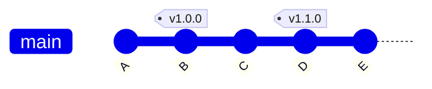

# Tags e Releases

Uma tag marca um ponto específico do histórico, quase sempre uma versão lançada: `v1.0.0`, `v2.3.1`. Uma release do GitHub pega uma tag e acrescenta o que quem usa o projeto precisa ver: título, notas do que mudou e arquivos para download. O número da versão em si segue o SemVer, explicado em [Conventional Commits e SemVer](/labs/web-dev/ferramentas/06-conventional-commits/).

## O que é uma tag

Assim como uma branch, uma tag é um nome que aponta para um commit. A diferença é que a branch anda (a cada commit novo ela aponta para o mais recente) e a tag fica parada para sempre no mesmo commit. É isso que a torna útil para versões: daqui a um ano, `v1.0.0` continua apontando exatamente para o código que foi lançado como 1.0.0.



No exemplo, `main` está em `E`, mas `v1.0.0` e `v1.1.0` continuam marcando onde cada versão saiu. O [Git Flow](/labs/web-dev/ferramentas/08-fluxos-de-trabalho/) usa exatamente isso: todo `release finish` e `hotfix finish` cria uma tag em `main`.

## Tags leves e anotadas

O Git tem dois tipos de tag.

A **leve** é só um nome apontando para o commit, sem mais nada:

```bash
git tag v1.0.0
```

A **anotada** é um objeto próprio no repositório, com autor, data e mensagem, e pode ser assinada com [GPG](/labs/web-dev/ferramentas/11-assinatura-gpg/):

```bash
git tag -a v1.0.0 -m "Versão 1.0.0: primeira versão estável"
```

|                     | Leve                         | Anotada                      |
| ------------------- | ---------------------------- | ---------------------------- |
| Comando             | `git tag v1.0.0`             | `git tag -a v1.0.0 -m "..."` |
| Guarda autor e data | Não                          | Sim                          |
| Tem mensagem        | Não                          | Sim                          |
| Pode ser assinada   | Não                          | Sim (`-s`)                   |
| Uso recomendado     | Marcação temporária, pessoal | Versões publicadas           |

Para versões que outras pessoas vão usar, prefira a anotada: ela registra quem lançou e quando, e várias ferramentas (como `git describe`) só consideram tags anotadas por padrão.

Esqueceu de criar a tag na hora do lançamento? Dá para marcar um commit antigo passando o hash:

```bash
git tag -a v0.9.0 9f8e7d6 -m "Versão 0.9.0"
```

## Listando e inspecionando tags

```bash
git tag                  # lista todas, em ordem alfabética
git tag -l "v1.*"        # filtra por padrão
git show v1.0.0          # mostra a tag (se anotada) e o commit para onde aponta
```

Para olhar o código exatamente como estava numa versão, por exemplo para reproduzir um bug relatado por quem usa a 1.0.0:

```bash
git switch --detach v1.0.0
```

Você fica em detached HEAD (explicado em [Branches, Merge e Rebase](/labs/web-dev/ferramentas/02-branches-merge-e-rebase/)). Para corrigir algo a partir dali, crie uma branch com `git switch -c hotfix/1.0.1`.

## Enviando e apagando tags

Uma pegadinha comum: `git push` **não envia tags**. Criou a tag, deu push, e ela não aparece no GitHub. É preciso enviar explicitamente:

```bash
git push origin v1.0.0       # envia uma tag específica
git push --tags              # envia todas as tags locais
git push --follow-tags       # envia commits e, junto, as tags anotadas que apontam para eles
```

O `--follow-tags` é o mais seguro no dia a dia, porque não manda aquela tag leve de teste que você criou e esqueceu. Dá para torná-lo padrão com `git config --global push.followTags true`.

Para apagar uma tag, é preciso fazer nos dois lugares:

```bash
git tag -d v1.0.0                  # apaga localmente
git push origin --delete v1.0.0    # apaga no remoto
```

Evite mover ou recriar uma tag que já foi publicada. Quem já baixou a tag antiga não recebe a nova automaticamente, e passam a existir duas "v1.0.0" diferentes circulando. Se a versão saiu com problema, lance uma `v1.0.1`.

## Releases no GitHub

Uma release é uma camada do GitHub em cima de uma tag. Ela adiciona título, notas de versão em Markdown e **assets**, os arquivos para download (binários compilados, instaladores, pacotes). O GitHub também anexa automaticamente o código-fonte daquela tag em `.zip` e `.tar.gz`.

Para criar pela interface, vá em **Releases > Draft a new release**, escolha uma tag existente (ou digite uma nova, que o GitHub cria no commit que você indicar), escreva as notas e publique. O botão **Generate release notes** monta uma lista dos PRs mesclados desde a release anterior, com autores, o que funciona muito bem quando os PRs têm títulos claros.

Pela CLI do GitHub:

```bash
gh release create v1.2.0 --title "v1.2.0" --generate-notes ./dist/app.zip
```

Versões ainda não prontas para todo mundo, como `1.2.0-beta.1` ou `1.2.0-rc.1`, podem ser marcadas como **pre-release**. Assim elas aparecem na lista, mas não são exibidas como a versão mais recente (a "Latest") para quem chega no repositório.

## Referências

- [Pro Git - Criando Tags](https://git-scm.com/book/pt-br/v2/Fundamentos-do-Git-Criando-Tags) - Scott Chacon e Ben Straub, pt-BR
- [Sobre versões](https://docs.github.com/pt/repositories/releasing-projects-on-github/about-releases) - GitHub Docs, pt-BR
- [git-tag - Git Documentation](https://git-scm.com/docs/git-tag) - Git, en
