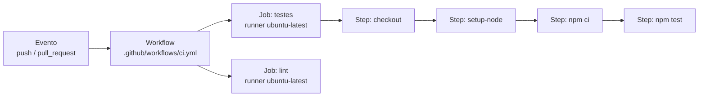

# GitHub Actions

GitHub Actions é a plataforma de automação embutida no GitHub. Você descreve, num arquivo YAML dentro do repositório, o que deve rodar e quando: a cada push, a cada pull request, toda madrugada, ou quando alguém clicar num botão. O uso mais comum é CI/CD, rodar build e testes em toda mudança e publicar a aplicação. O pipeline completo, com empacotamento, scan de segurança e deploy, está em [CI/CD para Microsserviços](/labs/web-dev/entrega-continua/04-ci-cd-para-microsservicos/); aqui o foco é a ferramenta.

## CI e CD em uma frase

**CI (integração contínua)**: toda mudança enviada ao repositório é compilada e testada automaticamente, e o resultado aparece para o time em minutos.

**CD** tem dois significados próximos. **Entrega contínua** (_continuous delivery_) é manter o código sempre num estado em que pode ir para produção, com o deploy disparado por uma pessoa. **Deploy contínuo** (_continuous deployment_) vai um passo além: o que passou em todas as verificações vai para produção sozinho.

Automatizar os testes compensa por um motivo simples: o bug encontrado no PR, dois minutos depois do push, custa muito menos que o encontrado em produção por um cliente. E ninguém precisa lembrar de rodar a suíte inteira antes de cada merge, nem confiar que o colega rodou.

## Conceitos: workflow, evento, job, step, runner

Um **workflow** é um processo automatizado definido num arquivo YAML em `.github/workflows/`. Um repositório pode ter vários (um para testes, outro para deploy, outro para fechar issues antigas).

O **evento** (ou _trigger_) é o que dispara o workflow. Os mais usados:

| Evento              | Quando dispara                           |
| ------------------- | ---------------------------------------- |
| `push`              | Commits enviados para uma branch         |
| `pull_request`      | PR aberto, atualizado ou reaberto        |
| `schedule`          | Horário definido em sintaxe cron         |
| `workflow_dispatch` | Manualmente, por um botão na aba Actions |

Um workflow tem um ou mais **jobs**. Cada job roda numa máquina própria, e por padrão os jobs rodam em paralelo; quando um depende do outro (só fazer deploy se os testes passarem), usa-se `needs`.

Cada job é uma sequência de **steps**. Um step pode ser um comando de terminal (`run: npm test`) ou uma **action**, um bloco reutilizável publicado por alguém (`uses: actions/checkout@v7`). O [Marketplace](https://github.com/marketplace?type=actions) tem milhares delas: fazer checkout do código, instalar Node, Java ou Python, publicar no Docker Hub, avisar no Slack.

O **runner** é a máquina que executa o job. O GitHub oferece runners hospedados com Ubuntu, Windows e macOS; empresas também podem registrar runners próprios (_self-hosted_), por exemplo para acessar uma rede interna.



## Um primeiro workflow

Um workflow que roda os testes de um projeto Node a cada push na `main` e a cada pull request. Salve como `.github/workflows/ci.yml`:

```yaml
name: CI

on:
  push:
    branches: [main]
  pull_request:

jobs:
  testes:
    runs-on: ubuntu-latest
    steps:
      - name: Baixar o código
        uses: actions/checkout@v7

      - name: Instalar Node
        uses: actions/setup-node@v7
        with:
          node-version: 22
          cache: npm

      - name: Instalar dependências
        run: npm ci

      - name: Rodar testes
        run: npm test
```

Lendo de cima para baixo: o `on` diz quando roda, `runs-on` escolhe o runner, e os steps baixam o código (o runner começa vazio), instalam o Node com cache das dependências, instalam os pacotes e rodam os testes. Se qualquer step terminar com erro, o job falha.

Depois do push, o resultado aparece na aba **Actions** do repositório, com o log de cada step. Em pull requests, ele aparece também como _check_ no rodapé do PR, com um ✅ ou ❌. Combinando com a regra **Require status checks to pass** da proteção de branch (em [Pull Requests e Code Review](/labs/web-dev/ferramentas/07-pull-requests/)), um PR com testes quebrados nem consegue ser mesclado.

## Segredos e boas práticas

Credenciais que o workflow precisa (token de deploy, chave de API) nunca ficam escritas no YAML, que é versionado e visível para quem lê o repositório. Cadastre-as em **Settings > Secrets and variables > Actions** e use no workflow por referência:

```yaml
- name: Deploy
  run: ./deploy.sh
  env:
    DEPLOY_TOKEN: ${{ secrets.DEPLOY_TOKEN }}
```

O GitHub mascara o valor nos logs (aparece como `***`).

Alguns cuidados que evitam dor de cabeça:

- Fixe a versão das actions de terceiros. `@v7` aceita correções dentro da versão 7; fixar pelo SHA completo do commit é ainda mais seguro, porque uma tag pode ser movida por quem mantém a action.
- Dê ao `GITHUB_TOKEN` (o token que o próprio GitHub injeta em cada execução) só as permissões que o workflow usa, declarando um bloco `permissions:` (por exemplo, `contents: read` para um workflow que só testa).
- Fique de olho no consumo. Repositórios públicos usam os runners padrão de graça; repositórios privados têm uma cota mensal de minutos que depende do plano da conta.

## Referências

- [Entender o GitHub Actions](https://docs.github.com/pt/actions/get-started/understand-github-actions) - GitHub Docs, pt-BR
- [Início rápido do GitHub Actions](https://docs.github.com/pt/actions/get-started/quickstart) - GitHub Docs, pt-BR
