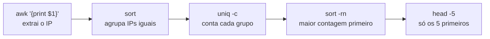

# Análise de Logs no Terminal

## Por que investigar sem a plataforma

Num sistema bem montado, os logs vão para uma plataforma central (como o [ELK Stack](/labs/web-dev/observabilidade/02-ferramentas-de-observabilidade/)) e você investiga com busca, filtros e gráficos. Só que tem dia em que isso não está disponível:

- o servidor é uma VM sem interface gráfica e você só tem acesso por SSH;
- a ferramenta central está fora do ar, ou atrasada alguns minutos na ingestão, bem no meio do incidente;
- o serviço novo ainda nem foi plugado na plataforma de logs;
- você precisa olhar o tráfego de rede em si, não só o que a aplicação decidiu registrar.

Nessas horas, quem sabe se virar com meia dúzia de comandos no terminal resolve em minutos o que levaria uma hora de espera. A boa notícia: as ferramentas são as mesmas em qualquer Linux, e várias já vêm instaladas.

Os exemplos usam um access log no formato padrão do Nginx/Apache (o *combined log format*), em que cada linha é uma requisição:

```text
203.0.113.7 - - [19/Oct/2026:14:32:01 +0000] "POST /login HTTP/1.1" 401 512 "-" "curl/8.5.0"
198.51.100.23 - - [19/Oct/2026:14:32:02 +0000] "GET /produtos HTTP/1.1" 200 4096 "-" "Mozilla/5.0"
```

Separando por espaço, o 1º campo é o IP do cliente, o 7º é o caminho e o 9º é o status HTTP. Guarde isso, porque o `awk` vai usar esses números.

## grep e expressões regulares

O `grep` lê o arquivo linha por linha e mostra só as que batem com um padrão. Mesmo com milhões de linhas, a resposta costuma sair em segundos.

```bash
# Todas as requisições de um IP suspeito
grep '203.0.113.7' /var/log/nginx/access.log

# Quantas vezes ele aparece (-c conta em vez de listar)
grep -c '203.0.113.7' /var/log/nginx/access.log

# Ignorando maiúsculas/minúsculas (-i)
grep -i 'sqlmap' /var/log/nginx/access.log

# Tudo que NÃO é health check (-v inverte o filtro)
grep -v '/health' /var/log/nginx/access.log
```

Com `-E` você liga as expressões regulares estendidas e pode buscar padrões, não só textos fixos:

```bash
# Respostas 401 ou 403 (tentativas de acesso negadas)
grep -E '" (401|403) ' /var/log/nginx/access.log

# Tentativas de path traversal ou de ler arquivos sensíveis
grep -E '\.\./|/etc/passwd|\.env' /var/log/nginx/access.log
```

Um detalhe no primeiro padrão: no `grep` sem `-F`, o ponto em `203.0.113.7` significa "qualquer caractere", então ele também casaria com `203x0y113z7`. Na prática raramente atrapalha, mas para busca exata use `grep -F`.

Quando acha a linha do erro, quase sempre você quer ver o que veio antes e depois. É para isso que servem `-B` (before) e `-A` (after):

```bash
# 5 linhas antes e 10 depois de cada stack trace
grep -B 5 -A 10 'NullPointerException' /var/log/app/app.log
```

E para acompanhar o log enquanto as coisas acontecem, `tail -f` mostra as linhas novas em tempo real. Combinado com `grep`, vira um filtro ao vivo:

```bash
tail -f /var/log/nginx/access.log | grep --line-buffered '" 5[0-9][0-9] '
```

O `--line-buffered` faz o `grep` soltar cada linha assim que encontra, em vez de juntar um bloco antes de mostrar.

## awk

O `grep` acha linhas; o `awk` entende **colunas**. Ele quebra cada linha em campos (por padrão, separados por espaço) e chama cada um de `$1`, `$2`, `$3`... Com isso dá para extrair só o pedaço que interessa:

```bash
# Só o IP de cada requisição
awk '{print $1}' /var/log/nginx/access.log

# IP, status e caminho, nessa ordem
awk '{print $1, $9, $7}' /var/log/nginx/access.log
```

O `awk` também filtra por campo, o que é bem mais preciso que um `grep` no texto todo. Um `grep ' 500 '` pegaria também uma resposta que, por acaso, tem 500 bytes; o `awk` olha só a coluna de status:

```bash
# Só os erros de servidor (status 5xx)
awk '$9 >= 500 && $9 < 600' /var/log/nginx/access.log

# Caminhos que deram 404, sem repetir
awk '$9 == 404 {print $7}' /var/log/nginx/access.log | sort -u
```

O `awk` é, na verdade, uma linguagem de programação completa, com variáveis, laços e funções. Para análise de log, esses dois usos (imprimir colunas e filtrar por coluna) já cobrem a maior parte do dia a dia.

## Top N IPs com sort e uniq

Juntando as peças com o pipe (`|`), cada comando faz uma coisa pequena e passa o resultado adiante. A pergunta clássica "quais IPs mais acessaram o site?" sai assim:

```bash
awk '{print $1}' /var/log/nginx/access.log | sort | uniq -c | sort -rn | head -5
```



O primeiro `sort` existe porque o `uniq` só junta linhas iguais que estejam **coladas**; sem ordenar antes, o mesmo IP espalhado pelo arquivo seria contado várias vezes. O resultado:

```text
  48213 203.0.113.7
   1520 198.51.100.23
    987 192.0.2.44
    455 198.51.100.8
    301 192.0.2.10
```

Um IP com 30 vezes mais requisições que o segundo colocado merece um olhar. Pode ser um ataque de força bruta, um scraper ou só um health check mal configurado. O passo seguinte é ver **o que** ele pediu:

```bash
grep -F '203.0.113.7' /var/log/nginx/access.log | awk '{print $9, $7}' | sort | uniq -c | sort -rn | head
```

Se a resposta for milhares de `401 /login`, é força bruta, e um [rate limiting](/labs/web-dev/escalabilidade/11-rate-limiting/) na borda teria segurado boa parte disso.

## jq para logs em JSON

Quando o log é [estruturado](/labs/web-dev/observabilidade/01-logs-metrics-e-traces/) (uma linha JSON por evento, comum em aplicações modernas, serviços de nuvem e APIs), `awk` e `grep` ficam desajeitados. O `jq` entende JSON de verdade: navega pelos campos, filtra e formata.

Com um log assim:

```json
{"timestamp":"2026-10-19T14:32:01Z","level":"error","service":"orders-api","user_id":991,"message":"falha ao processar pedido"}
```

```bash
# Formata e colore cada evento (útil só para ler)
jq '.' app.log

# Só os eventos de erro
jq 'select(.level == "error")' app.log

# Só a mensagem dos erros, sem aspas (-r = raw)
jq -r 'select(.level == "error") | .message' app.log

# Montar uma linha resumida por evento
jq -r '[.timestamp, .service, .message] | @tsv' app.log
```

E dá para combinar com o pipeline da seção anterior. Quais usuários mais tiveram erro?

```bash
jq -r 'select(.level == "error") | .user_id' app.log | sort | uniq -c | sort -rn | head -5
```

Cuidado com linhas que não são JSON válido (um stack trace cru no meio do arquivo, por exemplo): o `jq` para com erro ao encontrá-las. Nesse caso, filtre antes com `grep '^{'` ou use `jq -R 'fromjson? // empty'`, que pula o que não consegue ler.

## Tráfego de rede: TShark e ngrep

Logs mostram o que a aplicação decidiu registrar. Às vezes você precisa ver o que passou de fato pela placa de rede: uma conexão que nem chegou a virar requisição, um serviço falando com um IP estranho, um protocolo que não é HTTP. Para isso existem as ferramentas de captura de pacotes.

### TShark

O **TShark** é a versão de linha de comando do Wireshark. Ele captura e decodifica centenas de protocolos, então serve para analisar tráfego em servidores sem interface gráfica.

```bash
# Captura na interface eth0, só tráfego da porta 443
sudo tshark -i eth0 -f "tcp port 443"

# Salva a captura em arquivo para analisar depois (ou abrir no Wireshark)
sudo tshark -i eth0 -w captura.pcap

# Lê o arquivo e mostra só as requisições HTTP, com host e caminho
tshark -r captura.pcap -Y "http.request" -T fields -e ip.src -e http.host -e http.request.uri
```

Há dois tipos de filtro e é fácil confundir: o `-f` é o filtro de **captura** (decide o que é gravado, sintaxe do tcpdump), e o `-Y` é o filtro de **exibição** (decide o que é mostrado, sintaxe do Wireshark). Uma prática comum é capturar com pouco filtro num arquivo e depois explorar à vontade com `-Y`, que pode ser repetido sem perder nada.

### ngrep

O **ngrep** ("network grep") aplica a ideia do `grep` aos pacotes: você passa uma expressão regular e ele mostra, em tempo real, os pacotes cujo conteúdo bate com ela.

```bash
# Pacotes na porta 80 que contenham "password"
sudo ngrep -d eth0 -q -i 'password' 'tcp port 80'

# Requisições HTTP GET ou POST passando na interface
sudo ngrep -d eth0 -q -W byline '^(GET|POST) ' 'tcp port 80'
```

É ótimo para perguntas rápidas do tipo "essa credencial está trafegando em texto puro em algum lugar?", sem montar uma captura completa.

### Limitações

Antes de sair capturando pacotes, três cuidados:

- **TLS esconde o conteúdo.** Quase todo tráfego hoje é HTTPS, e tanto o TShark quanto o ngrep veem esse payload cifrado. O exemplo do ngrep procurando `password` só funciona em tráfego sem criptografia (HTTP puro, comunicação interna sem TLS). O TShark consegue decifrar se receber as chaves de sessão (via `SSLKEYLOGFILE`), mas isso só é possível em sistemas que você controla. Os metadados (IPs, portas, tamanho, horário, o nome do host no SNI) continuam visíveis.
- **Exige privilégio.** Capturar pacotes precisa de root ou da capability `CAP_NET_RAW`. Em servidor de produção, isso normalmente passa por aprovação.
- **Captura pode conter dados sensíveis.** Um `.pcap` de tráfego sem TLS pode ter senha, token e dado pessoal. Trate o arquivo como informação sensível: capture só o necessário, guarde pelo menor tempo possível e não mande para qualquer lugar.

## Referências

- [Expressões Regulares - Guia de Consulta Rápida](https://aurelio.net/regex/guia/) - Aurélio Marinho Jargas, pt-BR
- [GNU Awk User's Guide](https://www.gnu.org/software/gawk/manual/gawk.html) - GNU, en
- [jq Manual](https://jqlang.org/manual/) - jqlang, en
- [tshark man page](https://www.wireshark.org/docs/man-pages/tshark.html) - Wireshark, en
- [ngrep](https://github.com/jpr5/ngrep) - Jordan Ritter, en
