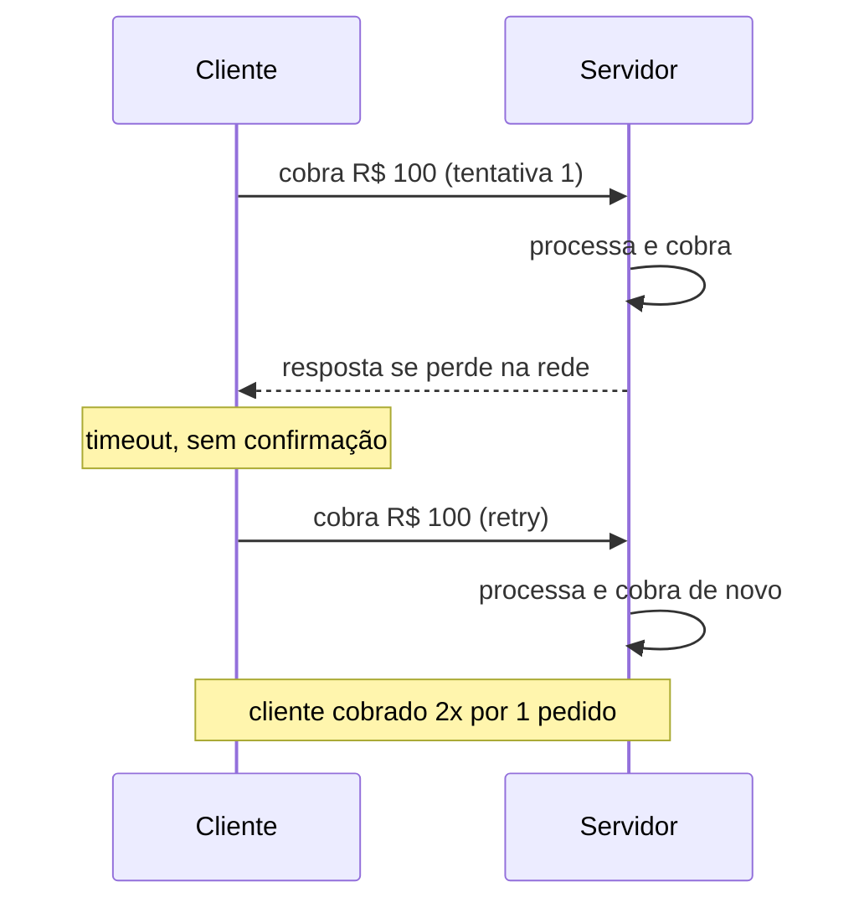
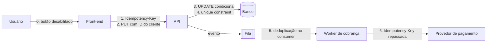
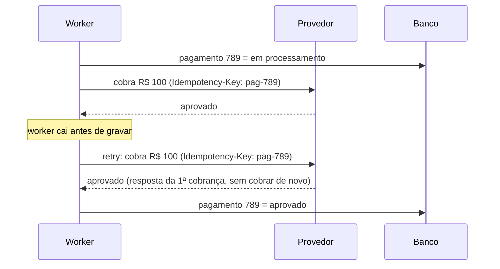

# Idempotência

A nota anterior, [Timeout, Retry, Circuit Breaker e Bulkhead](/labs/web-dev/resiliencia/01-timeout-retry-circuit-breaker-e-bulkhead/), deixou um problema em aberto: retry só é seguro se repetir a operação não causar dano. Essa nota resolve exatamente esse problema.

## Conceito

Uma operação é **idempotente** quando executá-la uma vez ou executá-la várias vezes produz o mesmo resultado final. O termo vem da matemática: multiplicar um número por 1 é idempotente (fazer isso 5 vezes seguidas não muda nada além da primeira vez).

Em APIs, o exemplo clássico é `PUT /usuarios/123 { nome: "Ana" }`. Chamar esse endpoint uma vez ou dez vezes deixa o usuário 123 com o nome "Ana" no final, o estado não muda entre a primeira e a décima chamada. Já `POST /pedidos { produto: "X", quantidade: 1 }` normalmente não é idempotente: cada chamada cria um pedido novo, então dez chamadas geram dez pedidos.

Por que isso importa em sistemas distribuídos? Porque a rede não é confiável. Uma requisição pode chegar ao servidor, ser processada com sucesso, e a resposta se perder no caminho de volta. Do ponto de vista de quem fez a chamada, isso é indistinguível de a requisição nunca ter chegado, então a reação natural é tentar de novo (veja [Retry](/labs/web-dev/resiliencia/01-timeout-retry-circuit-breaker-e-bulkhead/)). Sem idempotência, esse retry duplica o efeito de uma operação que, na verdade, já tinha funcionado.

## Retry seguro

O cenário de falha é sempre parecido: o cliente envia uma requisição, o servidor processa e confirma a operação internamente, mas algo falha entre esse ponto e o cliente receber a resposta (a conexão cai, um timeout dispara do lado do cliente, um proxy no meio do caminho reinicia). O cliente só sabe que não recebeu resposta, não sabe se a operação foi ou não executada do outro lado.



Dois problemas concretos nascem daí:

- **Double payment**: o exemplo mais citado. Um cliente tenta pagar, a confirmação se perde, o cliente (ou o app, automaticamente) tenta de novo, e agora duas cobranças foram feitas para uma única compra.
- **Mensagens duplicadas**: o mesmo problema aparece em filas (veja [Filas e Mensageria](/labs/web-dev/mensageria/01-filas-e-mensageria/)) sempre que a entrega é "pelo menos uma vez" (at-least-once). Se o consumer processa a mensagem mas falha antes de confirmar o processamento ao broker, o broker reenvia a mesma mensagem, e o consumer processa de novo.

## Idempotency Key

A solução prática é o cliente gerar um identificador único para a _intenção_ da operação, não para a requisição HTTP em si, e enviar esse identificador em todas as tentativas daquela mesma operação.

```
POST /pagamentos
Idempotency-Key: 7f3a9c1e-4b2d-4e91-9c3a-1d8f6b2a5e10

{ "valor": 100, "pedidoId": 456 }
```

O fluxo funciona assim:

1. O cliente gera a chave uma única vez, geralmente um UUID, no momento em que a ação do usuário acontece (o clique no botão "pagar"), não a cada tentativa de rede.
2. Toda tentativa daquela mesma operação (a original e qualquer retry) envia a mesma chave.
3. O servidor guarda, junto com a chave, o resultado da primeira execução.
4. Se a mesma chave chegar de novo, o servidor não executa a operação uma segunda vez, ele devolve o resultado que já tinha guardado da primeira vez.

Como detectar a duplicata? Antes de processar, o servidor consulta se aquela chave já foi vista. Se sim, retorna a resposta salva sem tocar de novo na lógica de negócio (sem cobrar de novo, sem criar outro pedido). Se não, processa normalmente e salva o resultado associado à chave, para o caso de ela reaparecer.

## Idempotency Store

A chave e o resultado da operação precisam ficar em algum lugar rápido de consultar, esse lugar é a idempotency store. As opções mais comuns:

- **Redis**: é a escolha mais comum quando a duplicata só é um risco por uma janela curta de tempo (minutos a poucas horas), justamente o cenário de retries de rede. É rápido de consultar, e o dado pode expirar sozinho.
- **Banco de dados**: quando a garantia precisa durar mais tempo (dias) ou precisar sobreviver a uma reinicialização sem risco de perda, uma tabela `idempotency_keys` no mesmo banco transacional da operação garante que a checagem da chave e a execução da operação aconteçam na mesma transação, evitando uma janela de corrida entre "checar se já existe" e "gravar o resultado".

Independente de onde a chave é guardada, dois detalhes são importantes:

- **TTL**: a chave não precisa (nem deve) ficar guardada para sempre. Um TTL de 24h a alguns dias costuma ser suficiente, cobrindo qualquer retry razoável sem acumular dado indefinidamente.
- **Estado da operação**: vale guardar não só "essa chave já foi vista", mas em que estado a operação ficou (`em processamento`, `concluída`, `falhou`). Isso evita um problema sutil: se uma segunda requisição com a mesma chave chega _enquanto_ a primeira ainda está sendo processada, o servidor precisa saber que deve esperar ou rejeitar, não processar a operação em paralelo duas vezes.

## Defesa em camadas contra cobrança duplicada

A idempotency key resolve o caso mais comum, mas o caminho de um pagamento passa por vários pontos onde a duplicata pode nascer: o clique duplo no navegador, o retry do app, a mensagem reentregue pela fila, a chamada repetida ao provedor do cartão. Nenhuma proteção sozinha cobre todos esses pontos, então sistemas de pagamento costumam empilhar camadas. Se uma falhar ou for esquecida por alguém do time, a próxima segura.



### Camada zero: o botão

Desabilitar o botão "Pagar" logo depois do primeiro clique evita o duplo clique do usuário ansioso. É barato e vale fazer, mas não protege quase nada: não impede o retry automático do app, não impede alguém de chamar a API direto, e some se a página recarregar. Trate como gentileza de UX, não como garantia. O trabalho de verdade fica no servidor.

### 1. Idempotency key na borda

É a técnica da seção [Idempotency Key](#idempotency-key), aplicada na entrada da API (ou no API gateway). O detalhe que mais quebra essa camada na prática é **quem gera a chave e quando**. Se o cliente gera uma chave nova a cada retry, cada tentativa parece uma operação diferente para o servidor e a proteção vira enfeite. A chave nasce uma vez, quando a intenção nasce (o clique), e acompanha todas as tentativas daquela intenção.

### 2. ID gerado pelo cliente + `PUT`

Outra forma de chegar no mesmo lugar: em vez de `POST /pagamentos` (o servidor escolhe o ID e cada chamada cria um recurso novo), o cliente gera o ID e usa `PUT`, que é idempotente por definição (veja os métodos em [HTTP, APIs e REST](/labs/web-dev/apis/01-http-rest/)).

```http
PUT /pagamentos/7f3a9c1e-4b2d-4e91-9c3a-1d8f6b2a5e10
Content-Type: application/json

{ "valor": 100, "pedidoId": 456 }
```

O recurso nasce num endereço que o cliente já conhece. Repetir a chamada escreve de novo no mesmo endereço, sem criar um segundo pagamento. O ID faz o papel da idempotency key, só que embutido na URL.

### 3. Atualização condicional

Quando a operação muda o estado de algo que já existe (marcar o pedido como pago, por exemplo), dá para condicionar a escrita ao estado que o cliente viu. No banco, é o lock otimista com coluna de versão, explicado em [Controle de Concorrência](/labs/web-dev/banco-de-dados/08-controle-de-concorrencia/):

```sql
UPDATE pedido
SET status = 'PAGO', versao = 8
WHERE id = 456 AND versao = 7;
-- 0 linhas afetadas = alguém já mudou o pedido, não cobre de novo
```

No HTTP, o equivalente é o header `If-Match` com a ETag (uma "impressão digital" da versão do recurso) que o cliente recebeu na leitura. Se o recurso mudou desde então, o servidor não executa a operação e responde `412 Precondition Failed`, comportamento definido na RFC 9110.

```http
PATCH /pedidos/456
If-Match: "v7"

{ "status": "PAGO" }
```

### 4. Unique constraint no banco

A última barreira fica no próprio banco: uma restrição de unicidade que torna fisicamente impossível gravar o segundo registro. Por exemplo, um pedido só pode ter um pagamento aprovado:

```sql
CREATE UNIQUE INDEX um_pagamento_aprovado_por_pedido
ON pagamento (pedido_id)
WHERE status = 'APROVADO';
```

Se algum bug, algum endpoint esquecido ou alguma corrida passar pelas camadas anteriores, o `INSERT` duplicado falha com erro de violação de unicidade, e a aplicação trata isso como "já foi feito". É a camada que não depende de ninguém lembrar de nada.

### 5. Deduplicação no consumer

Quando a cobrança passa por uma fila, a entrega at-least-once pode entregar o mesmo evento duas vezes ao worker. O consumer guarda os IDs de eventos já processados e descarta os repetidos, com as técnicas de [Deduplicação de Mensagens](/labs/web-dev/mensageria/07-deduplicacao-de-mensagens/) (inbox pattern, janela de tempo).

### 6. Idempotency key no provedor de pagamento

Seu sistema pode estar perfeito e mesmo assim cobrar duas vezes, se o worker chamar o provedor do cartão duas vezes. Por isso os provedores aceitam uma chave de idempotência própria: o Stripe usa o header `Idempotency-Key`, o Mercado Pago tornou obrigatório o `X-Idempotency-Key` nas APIs de pagamento e reembolso, e o Pagar.me também aceita um `Idempotency-key`. A regra é a mesma da camada 1: uma chave estável por intenção de cobrança (o ID do pagamento interno funciona bem), reenviada em todo retry.

### Retries concorrentes

Até aqui o retry chega depois da primeira tentativa terminar. O caso traiçoeiro é quando as duas tentativas chegam **ao mesmo tempo**, por exemplo um timeout curto no cliente que dispara o retry enquanto a primeira ainda está processando no servidor. Aí qualquer lógica do tipo "consultar e depois gravar" feita no código da aplicação tem uma janela de corrida:

```text
1. Tentativa A consulta: chave 7f3a já existe? Não.
2. Tentativa B consulta: chave 7f3a já existe? Não.
3. A cobra o cartão e grava a chave
4. B cobra o cartão e grava a chave   -> cobrança dupla
```

As duas consultas aconteceram antes de qualquer gravação, então as duas acharam que eram a primeira. O que fecha essa janela é deixar a decisão para uma **operação atômica no banco**, que só uma das tentativas consegue vencer:

- Inserir a chave **antes** de processar, numa tabela com índice único. A tentativa que perder a corrida recebe erro de unicidade e não segue adiante.
- Usar o `UPDATE ... WHERE versao = ?` da camada 3: só uma das duas encontra a versão esperada.

E se a mesma chave chega enquanto a primeira tentativa ainda está `em processamento` (o estado guardado na [Idempotency Store](#idempotency-store))? O servidor não processa e também não tem resposta pronta para devolver. O comportamento usado pelo Stripe, e recomendado no draft do IETF que padroniza o header `Idempotency-Key`, é responder `409 Conflict`, sinalizando para o cliente tentar de novo um pouco depois.

É comum ver a afirmação de que "só a unique constraint protege contra retries concorrentes". A ideia certa por trás disso é que checagem feita só no código não segura a corrida. Mas a atualização condicional também é atômica, e a idempotency key bem implementada também segura, justamente porque a chave é gravada sob um índice único. A unique constraint costuma ser o mecanismo que deixa as outras camadas seguras, não a única que funciona.

### Sucesso no provedor, crash antes de gravar o status

O último buraco é o mais chato. O worker chama o provedor, o provedor cobra o cartão e responde "aprovado", e a aplicação cai antes de gravar esse resultado no banco. Para o seu sistema, o pagamento continua `em processamento`. Quando alguém tentar de novo, o sistema não sabe que o cliente já foi cobrado.



Três cuidados resolvem esse cenário:

- **Mesma chave no retry ao provedor.** É a camada 6 fazendo o trabalho dela: o provedor reconhece a chave e devolve o resultado da primeira cobrança, sem cobrar de novo. Por isso a chave precisa ser derivada de algo que já está gravado (o ID do pagamento), e não gerada na hora da chamada.
- **Não cancelar a chamada ao provedor junto com a requisição do cliente.** Muitos frameworks propagam um sinal de cancelamento quando o cliente HTTP desiste da requisição. Se esse sinal chega na chamada ao provedor no meio da cobrança, você pode abortar o lado da aplicação depois que o dinheiro já saiu. Uma cobrança que começou deve terminar e ter o resultado gravado. Se o cliente quiser desfazer, isso é um estorno, feito por um fluxo separado.
- **Reconciliação.** Um job periódico procura pagamentos parados em `em processamento` há mais tempo que o normal e pergunta ao provedor qual foi o resultado de verdade, atualizando o banco. É a rede de segurança para quando nem o retry acontece.

## Exemplos

- **Pagamento**: o caso mais citado. Uma chave de idempotência por tentativa de cobrança garante que retries de rede não gerem cobranças duplicadas no cartão do cliente.
- **Criação de pedido**: um app de delivery que reenvia a criação de um pedido por causa de uma conexão instável não deve gerar dois pedidos idênticos na cozinha do restaurante.
- **Envio de e-mail**: um worker que processa a fila de e-mails de confirmação e é reiniciado no meio do processamento não deve mandar o mesmo e-mail de novo para o cliente ao reprocessar a mensagem.
- **Processamento de eventos**: um consumer Kafka que recebe a mesma mensagem duas vezes (garantia at-least-once, ver [Garantias de Entrega](/labs/web-dev/mensageria/05-garantias-de-entrega/)) usa o ID do evento como chave de idempotência para não aplicar o mesmo efeito colateral (debitar estoque, por exemplo) duas vezes.

No contexto de mensageria, checar o ID do evento antes de processar tem nome próprio, deduplicação, e um conjunto de técnicas específicas (inbox pattern, janela de tempo, bloom filter) descritas em [Deduplicação de Mensagens](/labs/web-dev/mensageria/07-deduplicacao-de-mensagens/). A deduplicação descarta a mensagem repetida; a idempotência garante que, se uma passar, o efeito acontece uma vez só.

## Referências

- [Uso da chave de Idempotência será obrigatório](https://www.mercadopago.com.br/developers/pt/news/2023/01/04/Idempotency-key-usage-will-be-mandatory) - Mercado Pago Developers, pt-BR
- [Implementing Stripe-like Idempotency Keys in Postgres](https://brandur.org/idempotency-keys) - Brandur Leach, en
- [Idempotent requests](https://docs.stripe.com/api/idempotent_requests) - Stripe Docs, en
- [RFC 9110 - HTTP Semantics, If-Match](https://www.rfc-editor.org/rfc/rfc9110#name-if-match) - IETF, en
- [The Idempotency-Key HTTP Header Field (draft)](https://datatracker.ietf.org/doc/draft-ietf-httpapi-idempotency-key-header/) - IETF HTTPAPI WG, en
