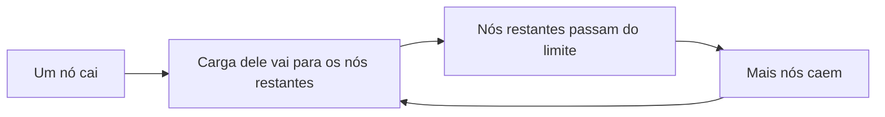
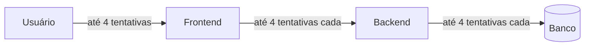

# Modos de Falha Comuns

## Por que estudar como sistemas quebram

Sistemas em produção raramente quebram de um jeito original. Os mesmos padrões de falha se repetem em empresas, linguagens e arquiteturas diferentes, e cada um deixa um rastro bem característico nos gráficos: a latência que sobe em todos os serviços ao mesmo tempo, a memória que só cresce, o banco que recebe mil vezes a carga normal num único segundo.

Esses padrões recorrentes se chamam **modos de falha** (failure modes). Conhecer cada um pelo nome ajuda em dois momentos:

- **No design**, você pergunta "o que acontece aqui se o cache expirar sob carga?" antes de o problema existir.
- **No incidente**, você reconhece o sintoma e vai direto para a causa provável em vez de investigar no escuro 🔍

Esta nota é um catálogo. Para cada modo de falha: o que é, o que causa, como aparece e como prevenir. Vários deles já têm uma nota própria no lab, e nesses casos a seção aqui fica curta e aponta para onde o assunto é tratado a fundo.

## Cascading failure

**Cascading failure** (falha em cascata) é quando a falha de um componente derruba outros que, sozinhos, estavam saudáveis. O serviço A cai, os serviços que dependem dele começam a falhar, e os dependentes desses vão atrás, até uma parte grande do sistema estar fora do ar.

O livro de SRE do Google aponta a **sobrecarga** como a causa mais comum. O mecanismo costuma ser um laço de realimentação:



Imagine três réplicas de um serviço, cada uma aguentando 1.000 requisições por segundo, recebendo 2.400 no total (800 cada). Uma réplica cai. As outras duas passam a receber 1.200 cada, acima do limite, ficam lentas e começam a falhar health checks. O load balancer tira mais uma do ar e a última recebe 2.400 sozinha. Em poucos minutos não sobra nada, e uma queda que começou com 33% da capacidade virou 100%.

A propagação entre serviços diferentes segue a mesma lógica: sem timeout, as threads de quem chama ficam presas esperando a dependência travada, o pool esgota e o chamador também para de responder.

**Prevenção:**

- **Timeout curto** em toda chamada remota, para não prender recursos esperando quem não vai responder.
- **Circuit breaker**, para parar de chamar uma dependência que já está falhando.
- **Bulkhead**, isolando pools de recursos por dependência para que uma dependência lenta não consuma os recursos das outras.
- **Load shedding** (descarte de carga): quando o servidor percebe que está no limite, ele rejeita o excesso logo na entrada com uma resposta rápida (um `503`, por exemplo) em vez de aceitar tudo e ficar lento para todo mundo. Atender bem 80% é melhor do que atender mal 100%.

Os três primeiros estão detalhados em [Timeout, Retry, Circuit Breaker e Bulkhead](/labs/web-dev/resiliencia/01-timeout-retry-circuit-breaker-e-bulkhead/). O controle de carga na entrada do sistema aparece também em [Rate Limiting](/labs/web-dev/escalabilidade/12-rate-limiting/).

## Thundering herd

**Thundering herd** ("manada trovejante") é quando muitos clientes batem no mesmo recurso no mesmo instante porque algo os sincronizou. Os cenários clássicos:

- Uma chave de cache muito acessada expira e todas as requisições vão ao banco ao mesmo tempo (o caso específico de cache recebe o nome de **cache stampede**).
- Um serviço volta depois de uma queda e todos os clientes que estavam esperando reconectam juntos.
- Um job em lote termina e dispara milhares de notificações ou recálculos no mesmo segundo.

A defesa é quebrar a sincronia: deixar uma única requisição buscar o dado enquanto as outras esperam (lock ou **request coalescing**), espalhar as expirações com **TTL com jitter** ou renovar a chave antes de ela vencer. Tudo isso está explicado com diagramas em [Cache e Redis](/labs/web-dev/escalabilidade/10-cache-e-redis/), nas seções sobre cache stampede.

## Retry storm

**Retry storm** (tempestade de retries) é quando um serviço que está tentando se recuperar recebe uma enxurrada de novas tentativas de todos os clientes ao mesmo tempo, e essa carga extra impede a recuperação. É um primo do thundering herd: o gatilho é a própria falha.

O Google SRE Book mostra como a conta piora rápido. Um backend aguenta 10.000 requisições por segundo e recebe 10.100: 100 falham. Essas 100 são repetidas no segundo seguinte, junto com o tráfego normal, e agora são 10.200 chegando e 200 falhando. Depois 300, 400... cada vez menos requisições têm sucesso na primeira tentativa.

E existe um agravante: **retries em várias camadas se multiplicam**.



Se frontend, backend e a camada de acesso ao banco fazem cada um até 4 tentativas (a original mais 3 retries), uma única ação do usuário pode virar 4 × 4 × 4 = **64 chamadas** no banco que já estava sobrecarregado.

**Prevenção:**

- **Exponential backoff com teto**: o intervalo entre tentativas dobra a cada falha, mas tem um limite máximo (sem teto, a décima tentativa esperaria mais de 17 minutos).
- **Jitter**: uma variação aleatória no tempo de espera, para os clientes não tentarem de novo todos no mesmo milissegundo.
- **Retry em um único ponto da pilha**: escolha uma camada para fazer retry e deixe as outras falharem direto.
- **Retry budget** (orçamento de retries): um limite de quantas novas tentativas o processo pode fazer num intervalo, por exemplo, retries até 10% do volume de requisições. Estourou o orçamento, a requisição falha em vez de ser repetida.
- **Circuit breaker**, para parar as tentativas quando a falha já está confirmada.

Backoff, jitter e circuit breaker estão detalhados em [Timeout, Retry, Circuit Breaker e Bulkhead](/labs/web-dev/resiliencia/01-timeout-retry-circuit-breaker-e-bulkhead/).

## Deadlock

**Deadlock** é quando duas (ou mais) transações ou threads esperam uma pela outra: A segura o lock X e quer o Y, B segura o Y e quer o X. Nenhuma das duas consegue seguir.

A causa típica é adquirir vários locks em **ordens diferentes** em caminhos de código diferentes, como duas transferências bancárias em sentidos opostos que travam as mesmas duas contas.

O que acontece depois depende de onde o lock vive:

- **No banco de dados** (PostgreSQL, MySQL/InnoDB), o próprio banco detecta o ciclo de espera e aborta uma das transações com erro, liberando a outra. Não trava para sempre, mas a aplicação recebe um erro que precisa tratar.
- **Na aplicação** (um mutex, um lock distribuído sem expiração), ninguém detecta nada e as threads podem ficar presas indefinidamente.

**Prevenção:** adquirir locks sempre na mesma ordem global, usar lock timeout, manter transações curtas, repetir a transação abortada pelo banco e preferir lock otimista quando conflitos são raros. O passo a passo com exemplo em SQL está em [Controle de Concorrência e Race Conditions](/labs/web-dev/banco-de-dados/08-controle-de-concorrencia/), na seção sobre deadlock.

## Memory leak

**Memory leak** (vazamento de memória) é memória que o programa não usa mais, mas que nunca volta a ficar disponível. O processo vai crescendo até ser morto pelo sistema operacional ou pelo orquestrador.

Em linguagens com **garbage collector** (JavaScript, Java, Go, Python, C#), o GC libera sozinho tudo que não é mais alcançável. Então o vazamento acontece quando algo continua **referenciado** sem necessidade: o GC vê a referência, conclui que o objeto ainda está em uso e não pode liberá-lo. A guia de gerenciamento de memória do MDN resume bem a dificuldade: o difícil é saber quando a memória "não é mais necessária".

As causas mais comuns em serviços backend:

- **Cache sem limite**: um `Map` em memória que só recebe entradas novas e nunca remove nenhuma.
- **Listeners nunca removidos**: cada requisição registra um listener num objeto de vida longa e nunca chama o `removeListener`.
- **Conexões e recursos nunca fechados**: conexão de banco, stream de arquivo, socket.
- **Timers esquecidos**: um `setInterval` que segura na closure uma referência a dados grandes.

Um exemplo em Node.js do primeiro caso:

```js
// Cresce a cada usuário novo e nunca encolhe
const cache = new Map();

function getProfile(userId) {
  if (!cache.has(userId)) {
    cache.set(userId, loadProfileFromDb(userId));
  }
  return cache.get(userId);
}
```

Com milhões de usuários diferentes passando por esse código, o `Map` vira um vazamento. A correção é limitar o tamanho com uma política de eviction (LRU, por exemplo) ou usar um cache externo com TTL.

**Como aparece:** o gráfico de memória do processo sobe em escada e não estabiliza nem com tráfego baixo, as pausas do GC ficam mais longas (e a latência sobe junto), e em container o processo é reiniciado com `OOMKilled` em intervalos parecidos.

**Prevenção e diagnóstico:**

- Caches com tamanho máximo e política de eviction (as políticas estão em [Cache e Redis](/labs/web-dev/escalabilidade/10-cache-e-redis/)).
- Limite máximo nos pools de conexão.
- Métrica de uso de memória por instância com alerta de tendência (ver [Observabilidade: Logs, Metrics e Traces](/labs/web-dev/observabilidade/01-logs-metrics-e-traces/)).
- **Heap snapshot**: tirar duas fotos do heap com um intervalo entre elas (pelo Chrome DevTools no Node.js, ou um heap dump na JVM) e comparar quais objetos só aumentaram. Vale fazer isso num teste de carga antes de ir para produção.

## Split-brain

**Split-brain** (cérebro dividido) é quando um cluster que deveria ter um único nó primário passa a ter dois. Uma partição de rede separa os nós em grupos que não se enxergam, cada grupo elege seu próprio líder, e os dois aceitam escritas. Os dados divergem, e na hora de juntar tudo de novo há escritas conflitantes que alguém vai precisar resolver (ou perder).

A prevenção combina duas ideias:

- **Quorum**: um nó só vira líder com o voto da maioria do cluster. Como só um lado da partição pode ter a maioria, só um líder é eleito. Ferramentas como ZooKeeper e etcd são usadas justamente para isso.
- **Fencing token e lease**: o quorum sozinho não resolve o líder antigo que travou (numa pausa longa de GC, por exemplo) e acorda achando que ainda manda. O lease dá prazo de validade à liderança, e o fencing token permite ao armazenamento recusar escritas de quem tem um token velho.

Tudo isso está explicado com diagramas em [Eleição de Líder](/labs/web-dev/sistemas-distribuidos/03-eleicao-de-lider/), e o mecanismo de votação por maioria em [Consenso: Paxos e Raft](/labs/web-dev/sistemas-distribuidos/02-consenso-paxos-e-raft/).

## Corrupção de dados por caso de borda

Este modo de falha é silencioso. Uma entrada fora do comum (um campo vazio, uma data `0000-00-00`, uma quantidade negativa, um texto com 10 mil caracteres, um emoji onde se esperava ASCII) passa pela validação, é gravada no banco e só causa estrago depois: um relatório que soma valores errados, um job em lote que quebra toda noite, um saldo negativo que nunca deveria existir.

O problema não aparece na requisição que trouxe o dado, ela retornou `200`. Aparece dias depois, em outro serviço, e a investigação começa pelo lugar errado.

**Causas:** validação incompleta na entrada da API, ausência de constraints no banco e a suposição de que "o frontend já valida".

**Prevenção em camadas:**

- **Validação na borda da API**: tipos, formatos, faixas de valor e tamanhos máximos verificados no servidor, sempre, mesmo que o frontend valide também.
- **Constraints no banco**: `NOT NULL`, `CHECK (quantidade > 0)`, `UNIQUE` e foreign keys. É a última barreira e vale para qualquer caminho de escrita, inclusive scripts e migrações que não passam pela API.

  ```sql
  ALTER TABLE pedidos
    ADD CONSTRAINT quantidade_positiva CHECK (quantidade > 0);
  ```

- **Testes de casos de borda**: valores limite, vazios, nulos, gigantes e com caracteres especiais nos testes automatizados.

Vale separar este problema de outro parecido: **escrita duplicada**. Quando um cliente repete uma requisição (por retry ou clique duplo) e a mesma operação é gravada duas vezes, os dados também ficam errados, mas a causa é outra e a prevenção também: **idempotency key**, tratada em [Idempotência](/labs/web-dev/resiliencia/02-idempotencia/). Idempotency key evita duplicata, mas não impede que um dado inválido entre na primeira vez.

## Tabela de consulta rápida

| Modo de falha               | Sintoma típico                                                      | Prevenção principal                                |
| --------------------------- | ------------------------------------------------------------------- | -------------------------------------------------- |
| Cascading failure           | Vários serviços degradam em sequência a partir de um ponto          | Timeout, circuit breaker, bulkhead, load shedding  |
| Thundering herd             | Pico súbito de carga no banco após expiração de cache ou restart    | Lock, request coalescing, TTL com jitter           |
| Retry storm                 | Serviço não se recupera, tráfego maior que o normal durante a queda | Backoff com teto, jitter, retry budget             |
| Deadlock                    | Erros de deadlock no banco ou threads presas sem uso de CPU         | Ordem global de locks, lock timeout, retry         |
| Memory leak                 | Memória sobe em escada, reinícios com `OOMKilled`                   | Cache com limite, heap snapshot, alerta de memória |
| Split-brain                 | Dois nós aceitando escrita como primário, dados divergentes         | Quorum, fencing token, lease                       |
| Corrupção por caso de borda | Dados inválidos descobertos dias depois, em outro serviço           | Validação na API, constraints no banco             |

## Referências

- [Addressing Cascading Failures](https://sre.google/sre-book/addressing-cascading-failures/) - Google SRE Book, en
- [Timeouts, retries, and backoff with jitter](https://aws.amazon.com/builders-library/timeouts-retries-and-backoff-with-jitter/) - Marc Brooker (Amazon Builders' Library), en
- [Gerenciamento de Memória](https://developer.mozilla.org/pt-BR/docs/Web/JavaScript/Guide/Memory_management) - MDN, pt-BR
- [Gerenciamento eficaz da memória na escala do Gmail](https://web.dev/articles/effectivemanagement?hl=pt-br) - web.dev (Google), pt-BR
- [How to do distributed locking](https://martin.kleppmann.com/2016/02/08/how-to-do-distributed-locking.html) - Martin Kleppmann, en
