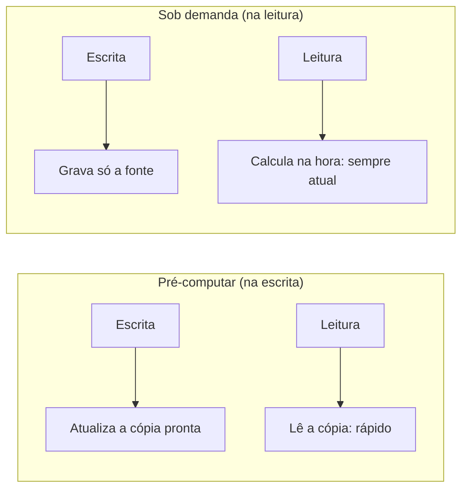
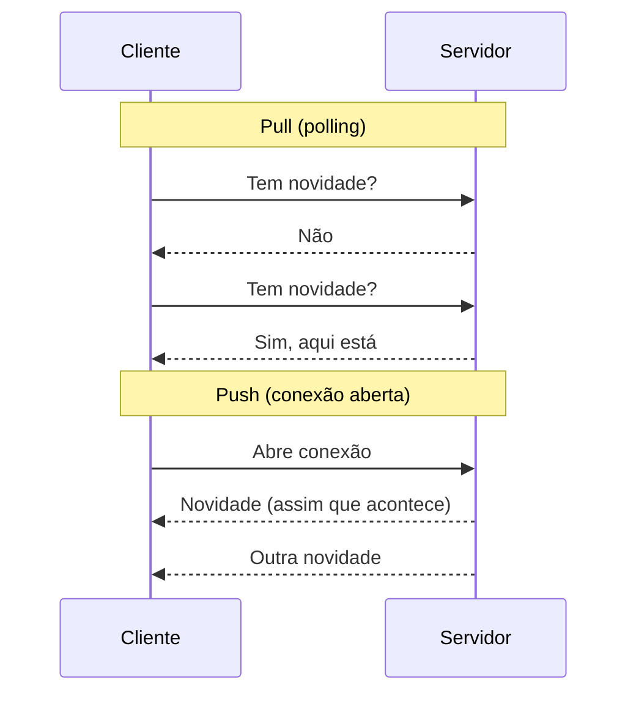

# Trade-offs Arquiteturais

Todo design de sistema é, no fundo, uma sequência de escolhas entre duas coisas boas que não cabem ao mesmo tempo. Não existe decisão "certa" isolada, cada trade-off só faz sentido olhando para os requisitos específicos do problema (veja [System Design: Fundamentos](/labs/web-dev/system-design/01-o-que-e-system-design/)). Esta nota reúne os trade-offs mais recorrentes, para servir como checklist rápido na hora de justificar uma decisão de arquitetura.

## Principais trade-offs para comparar

### Consistência vs disponibilidade

Coberto em detalhe no [Teorema de CAP](/labs/web-dev/banco-de-dados/05-teorema-de-cap/): durante uma partição de rede, o sistema escolhe entre responder com um dado possivelmente desatualizado (disponibilidade) ou recusar a resposta até garantir o dado mais recente (consistência). Sistemas financeiros tendem a priorizar consistência; feeds e contadores sociais tendem a priorizar disponibilidade.

### Latência vs consistência

Coberto pelo [PACELC](/labs/web-dev/banco-de-dados/06-teorema-de-pacelc/): mesmo sem partição de rede, esperar a confirmação de mais réplicas antes de responder (mais consistência) custa mais tempo de resposta (mais latência). Um checkout de e-commerce pode aceitar uns milissegundos a mais de latência para garantir que o estoque não vendeu em dobro; um sistema de busca pode preferir responder rápido com resultado ligeiramente desatualizado.

### Custo vs disponibilidade

Cada nove adicional de disponibilidade (veja [Disponibilidade](/labs/web-dev/resiliencia/03-disponibilidade/)) custa desproporcionalmente mais: redundância geográfica, times de plantão, infraestrutura redundante em múltiplas zonas. Sair de 99,9% para 99,99% não é 10% mais caro, costuma ser várias vezes mais caro. Vale perguntar se o produto realmente precisa daquele último nove antes de pagar por ele.

### Simplicidade vs escalabilidade

Arquiteturas que escalam bem (sharding, múltiplos serviços, filas, cache distribuído) quase sempre são mais difíceis de entender, operar e debugar do que um monolito simples com um banco só. Construir para uma escala que o produto ainda não tem é pagar esse custo de complexidade antes da hora, e é um erro tão comum quanto o oposto (não conseguir escalar quando a escala chega).

### Monólito vs microsserviços

Um monólito é mais simples de desenvolver, testar e implantar no começo, mas fica difícil de escalar times independentes conforme o produto cresce (veja [Escalabilidade Organizacional](/labs/web-dev/escalabilidade/01-escalabilidade/)). Microsserviços resolvem o problema organizacional, mas introduzem toda a complexidade de sistemas distribuídos: rede não confiável, consistência entre serviços, deploy independente. Não é incomum começar monólito e migrar para microsserviços só quando a dor organizacional aparece de verdade, não antes.

### SQL vs NoSQL

Detalhado em [NoSQL](/labs/web-dev/banco-de-dados/11-nosql/). Relacional dá consistência forte e um modelo de dados rígido e previsível; NoSQL dá flexibilidade de esquema e escala horizontal mais natural, ao custo de garantias mais fracas.

### Cache vs consistência

Todo cache é, por definição, uma cópia que pode ficar desatualizada em relação à fonte de verdade. Cachear mais agressivamente (TTL mais longo, invalidação mais preguiçosa) melhora performance e reduz carga no banco, mas aumenta a chance de servir dado velho. Ajustar TTL e estratégia de invalidação (veja [Cache e Redis](/labs/web-dev/escalabilidade/09-cache-e-redis/)) é literalmente negociar esse trade-off.

### Armazenamento vs computação

Toda resposta que o sistema devolve precisa ser calculada em algum momento. A pergunta é *quando*: na hora em que o dado é escrito, guardando o resultado pronto, ou na hora em que alguém pede, calculando do zero.

Pré-computar desloca o trabalho para a escrita. Um contador de curtidas que é incrementado a cada like, uma [materialized view](/labs/web-dev/banco-de-dados/03-views-e-triggers/) com o resumo de vendas do mês, uma timeline já montada para cada usuário: na leitura é só buscar e devolver, sem `JOIN`, sem `COUNT(*)` varrendo milhões de linhas. O preço aparece em três lugares. Ocupa espaço (o mesmo dado agora existe na fonte e na cópia derivada), dá mais trabalho na escrita (cada mudança precisa atualizar a cópia) e abre uma janela em que a cópia ainda não refletiu a última mudança.

Computar sob demanda faz o caminho inverso. Nada fica guardado além da fonte de verdade, e o resultado é sempre o mais atual possível, porque é calculado em cima do dado do momento. Em troca, cada leitura paga CPU e latência, e se a mesma consulta pesada roda mil vezes por minuto, o banco faz o mesmo cálculo mil vezes.

Duas perguntas costumam decidir:

- **Quantas leituras existem para cada escrita?** Se um dado é escrito uma vez e lido milhares de vezes (o perfil de um produto, o número de seguidores), pré-computar compensa fácil. Se é escrito o tempo todo e lido raramente, você vai gastar recurso atualizando uma cópia que quase ninguém consulta.
- **Quanto atraso o dado tolera?** Um dashboard que mostra as vendas de ontem aceita um `REFRESH` por hora sem problema. O saldo de uma conta bancária na hora do saque, não.

Na prática o meio-termo é muito comum: calcular sob demanda e guardar o resultado num cache com TTL (veja [Cache e Redis](/labs/web-dev/escalabilidade/09-cache-e-redis/)). A primeira leitura paga o cálculo, as seguintes reaproveitam, e o TTL define o atraso máximo aceito. É por isso que esse trade-off anda junto com o de cache vs consistência logo acima: no fundo, toda cópia pré-calculada é um tipo de cache.

### Síncrono vs assíncrono

Chamadas síncronas são mais simples de raciocinar (peça, espere, receba), mas acoplam serviços no tempo: se um está fora do ar, quem chama trava ou falha junto. Comunicação assíncrona via filas (veja [Filas e Mensageria](/labs/web-dev/mensageria/01-filas-e-mensageria/)) desacopla esse tempo, ao custo de mais complexidade operacional e de uma resposta que não é imediata.

### Push vs pull

Quando um dado muda, alguém precisa ficar sabendo. Ou o servidor avisa (push), ou o cliente pergunta de tempos em tempos (pull).

No **pull**, o cliente faz polling: a cada X segundos manda um "tem novidade?". É o modelo mais simples que existe, funciona com HTTP comum, o servidor não precisa lembrar de ninguém entre uma requisição e outra, e um cliente que caiu simplesmente para de perguntar. O problema é o desperdício. Se o dado muda uma vez por hora e o cliente pergunta a cada 5 segundos, são 719 respostas "nada mudou" para cada uma útil, multiplicadas pelo número de clientes. E a novidade só chega na próxima pergunta, então o atraso pode ser de até um intervalo inteiro de polling.

No **push**, o servidor manda a atualização assim que ela existe, por [WebSocket, Server-Sent Events ou webhooks](/labs/web-dev/apis/03-estilos-de-comunicacao/). Nenhuma requisição é jogada fora e a entrega é praticamente imediata. A conta vem do outro lado: WebSocket e SSE mantêm uma conexão aberta por cliente, então 100 mil usuários online são 100 mil conexões vivas que o servidor (e o load balancer) precisam segurar, reconectar quando caem e distribuir entre instâncias. Webhook não segura conexão, mas exige que quem recebe tenha um endpoint público e trate reenvios.

Push brilha quando a atualização precisa chegar em segundos e acontece com frequência: chat, notificações, dashboard ao vivo, placar de jogo. Pull é a escolha sensata quando o dado muda pouco, o atraso não incomoda ou o cliente nem precisa estar online o tempo todo, como um job de analytics que puxa os dados do dia uma vez de madrugada.

O exemplo mais clássico desse trade-off em entrevista de system design é o **feed de uma rede social**:

- **Fan-out on write (push):** quando alguém posta, o sistema já insere o post na timeline pré-montada de cada seguidor. Abrir o app fica barato, a timeline está pronta. Só que um post de uma conta com 50 milhões de seguidores vira 50 milhões de escritas.
- **Fan-out on read (pull):** nada é montado antecipadamente. Quando o usuário abre o app, o sistema busca os posts recentes de todo mundo que ele segue e junta tudo. Postar é barato, mas cada leitura fica mais pesada conforme a pessoa segue mais contas.
- **Híbrido:** a resposta que a maioria das plataformas grandes adota. Push para contas comuns, pull para as contas com muitos seguidores, e na leitura o sistema junta a timeline pré-montada com os posts dessas contas buscados na hora.

Repare que o fan-out on write é também um caso de pré-computar (armazenamento vs computação, logo acima): os dois trade-offs costumam aparecer juntos.

### Throughput vs latência

Como visto em [Latência, Throughput e Performance](/labs/web-dev/system-design/04-latencia-e-performance/), técnicas que aumentam o throughput total do sistema (batching, filas, processamento em lote) costumam aumentar a latência de cada operação individual. Um sistema pode otimizar para "processar o máximo de operações por segundo" ou para "responder cada operação o mais rápido possível", raramente consegue maximizar os dois ao mesmo tempo.

### Processamento em lote vs streaming

Batch coleta os dados e processa um bloco grande de uma vez, num horário agendado, o que é simples e barato quando o resultado pode esperar (um relatório que só precisa estar pronto de manhã). Streaming processa cada evento continuamente, assim que ele chega, aprofundado em [Processamento de streams](/labs/web-dev/mensageria/08-casos-de-uso-do-kafka/), o que entrega resultado sempre atualizado ao custo de mais peças em movimento para operar. A pergunta que decide entre os dois não é técnica, é sobre a necessidade real de atualização do dado: se esperar algumas horas não muda nenhuma decisão, batch resolve mais barato; se a informação só tem valor nos próximos segundos, como numa detecção de fraude, streaming se paga. Na prática boa parte dos sistemas usa os dois ao mesmo tempo, streaming cuidando do fluxo ao vivo e um job batch rodando por trás para reprocessar o que falhou ou ficou pendente.

### Strong consistency vs eventual consistency

Aprofundado em [Consistência e Replicação](/labs/web-dev/sistemas-distribuidos/01-consistencia-e-replicacao/). Consistência forte simplifica o raciocínio sobre o sistema (o dado é sempre o mais recente), mas custa latência e disponibilidade. Consistência eventual é mais rápida e resiliente, mas exige que a aplicação (e quem a usa) tolere uma janela de divergência temporária.

### Scale up vs scale out

Como visto em [Escalabilidade](/labs/web-dev/escalabilidade/01-escalabilidade/), escalar verticalmente é mais simples (nenhuma mudança de arquitetura) mas tem teto físico e continua sendo um ponto único de falha. Escalar horizontalmente remove esse teto, mas exige que a aplicação seja projetada para rodar em várias instâncias (stateless, dados compartilhados), um custo de engenharia pago desde o início.

## Referências

- [Padrão de exibição materializada](https://learn.microsoft.com/pt-br/azure/architecture/patterns/materialized-view) - Microsoft Azure Architecture Center, pt-BR
- [Usando eventos enviados pelo servidor](https://developer.mozilla.org/pt-BR/docs/Web/API/Server-sent_events/Using_server-sent_events) - MDN Web Docs, pt-BR
- [Designing Data-Intensive Applications](https://dataintensive.net/) - Martin Kleppmann (cap. 1, exemplo da timeline do Twitter), en
