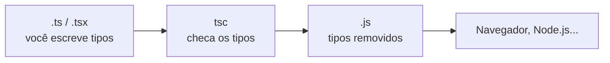

# Introdução e configuração

## O que é TypeScript

TypeScript é JavaScript com um sistema de tipos estático por cima. Todo código JavaScript válido também é TypeScript válido (por isso se diz que ele é um _superset_ do JavaScript), e o que o TypeScript acrescenta é a possibilidade de dizer, no próprio código, que tipo de valor cada variável, parâmetro e retorno deve ter.

```ts
function saudacao(nome: string): string {
  return `Olá, ${nome}!`;
}

saudacao("Ana"); // ok
saudacao(42); // erro: Argument of type 'number' is not assignable to parameter of type 'string'.
```

O fluxo de trabalho tem três passos: você escreve o código com as anotações de tipo, o compilador (`tsc`) confere se tudo bate, e no fim sai JavaScript comum, que roda em qualquer lugar onde JavaScript roda (navegador, Node.js, Deno, Bun).



O detalhe mais importante para quem está começando: **os tipos não existem em tempo de execução**. Na hora de gerar o JavaScript, o compilador simplesmente apaga as anotações (isso se chama _type erasure_). O código acima vira:

```js
function saudacao(nome) {
  return `Olá, ${nome}!`;
}
```

Ou seja, o TypeScript protege você enquanto escreve e compila o código. Se um dado chegar de fora em runtime com o formato errado (uma resposta de API, um JSON lido de arquivo), o TypeScript não tem como saber - por isso existem técnicas de validação que aparecem em [Programação assíncrona](/labs/web-dev/typescript/12-programacao-assincrona/) e [Padrões que escalam](/labs/web-dev/typescript/15-padroes-que-escalam/).

## Por que usar depois do JavaScript

Em JavaScript puro, um erro como chamar `usuario.nmoe` (com erro de digitação) só aparece quando aquela linha roda, às vezes em produção. Com TypeScript, o editor sublinha o erro enquanto você digita. Os ganhos mais concretos no dia a dia:

- O autocomplete passa a entender o seu código: digitou `usuario.` e o editor lista exatamente as propriedades que existem.
- Refatorar fica seguro. Renomeou um campo? O compilador aponta cada lugar que precisa mudar.
- As assinaturas de funções viram documentação que não fica desatualizada, porque o compilador a confere.
- Uma classe inteira de bugs some: `undefined is not a function`, `cannot read properties of null` e companhia.

|                                  | JavaScript                         | TypeScript                                  |
| -------------------------------- | ---------------------------------- | ------------------------------------------- |
| Tipagem                          | Dinâmica                           | Estática, opcional e gradual                |
| Quando os erros de tipo aparecem | Em execução                        | Ao escrever/compilar                        |
| Etapa extra                      | Nenhuma                            | Checagem de tipos (e às vezes transpilação) |
| Modelo de execução               | O mesmo: no fim, tudo é JavaScript |                                             |

"Gradual" quer dizer que você pode adotar o TypeScript aos poucos: renomear um arquivo `.js` para `.ts` e ir adicionando tipos conforme avança.

Nem tudo é vantagem. Há uma curva de aprendizado, o código fica um pouco mais verboso no começo, e o projeto ganha uma etapa de checagem. E existe um jeito fácil de jogar tudo fora: usar `any` (o tipo que desliga a checagem, visto em [Tipos básicos](/labs/web-dev/typescript/02-tipos-basicos/)) em todo lugar. Um projeto TypeScript cheio de `any` tem o custo do TypeScript sem o benefício.

## Instalando e compilando com tsc

O TypeScript é instalado como dependência de desenvolvimento do projeto, para que cada projeto fixe a sua versão:

```bash
npm init -y
npm i -D typescript
npx tsc --init        # cria o tsconfig.json
```

Com o `tsconfig.json` criado, compilar é rodar `tsc` sem argumentos (ele lê a configuração e compila o projeto inteiro). Em desenvolvimento, o modo watch recompila a cada arquivo salvo:

```bash
npx tsc           # compila uma vez
npx tsc --watch   # recompila a cada alteração (atalho: -w)
```

É comum deixar isso em scripts no `package.json`:

```json
{
  "scripts": {
    "build": "tsc",
    "dev": "tsc --watch",
    "typecheck": "tsc --noEmit"
  }
}
```

O `--noEmit` faz só a checagem de tipos, sem gerar arquivos - útil quando outra ferramenta (Vite, esbuild, o próprio Node) cuida de transformar o código.

Uma estrutura típica separa o código-fonte da saída compilada:

```text
meu-app/
├── src/
│   ├── index.ts
│   └── usuario.ts
├── dist/            ← gerado pelo tsc
│   ├── index.js
│   └── usuario.js
├── package.json
└── tsconfig.json
```

Por padrão, o compilador emite arquivos `.js` espelhando a estrutura de `src/` dentro da pasta de saída. Ele também pode gerar arquivos de declaração `.d.ts` (só os tipos, usados por quem consome uma biblioteca - veja [Módulos e declarações](/labs/web-dev/typescript/11-modulos-e-declaracoes/)) e _source maps_, que permitem depurar o `.ts` original mesmo rodando o `.js`.

## O tsconfig.json essencial

O `tsconfig.json` diz ao compilador quais arquivos pertencem ao projeto e como tratá-los. As opções mais básicas:

| Opção     | Para que serve                | Exemplo                  |
| --------- | ----------------------------- | ------------------------ |
| `target`  | Versão do JavaScript gerado   | `"es2022"`, `"esnext"`   |
| `module`  | Sistema de módulos da saída   | `"nodenext"`, `"esnext"` |
| `rootDir` | Onde estão os fontes          | `"src"`                  |
| `outDir`  | Onde o JS compilado é gravado | `"dist"`                 |

Um ponto de partida para um projeto Node.js simples:

```json
{
  "compilerOptions": {
    "target": "es2022",
    "module": "nodenext",
    "rootDir": "src",
    "outDir": "dist",
    "strict": true,
    "skipLibCheck": true
  },
  "include": ["src"]
}
```

Desde o TypeScript 5.9, o `tsc --init` não gera mais aquele arquivo gigante com centenas de opções comentadas. Ele cria um tsconfig enxuto e já opinativo, com `module: "nodenext"`, `target: "esnext"`, `strict: true`, `verbatimModuleSyntax`, `isolatedModules`, `noUncheckedIndexedAccess`, `exactOptionalPropertyTypes`, `skipLibCheck`, além de `declaration` e `sourceMap`. É um bom padrão para começar - o significado de cada uma dessas opções está em [tsconfig e qualidade de projeto](/labs/web-dev/typescript/14-tsconfig-e-qualidade/).

O TypeScript 6.0 (março de 2026) mudou vários valores padrão, e muito material antigo ainda ensina o contrário:

- `strict` agora é `true` por padrão. Para desligar, é preciso escrever `"strict": false`.
- `module` passou a ser `esnext` e `target` passou a ser a versão mais recente do ECMAScript.
- `types` passou a ser `[]`: os pacotes `@types/*` não são mais carregados automaticamente, você lista os que quer (por exemplo, `"types": ["node"]`).
- `esModuleInterop` não pode mais ser desligado. Tutoriais que mandam "ligar o `esModuleInterop`" estão descrevendo algo que hoje já é sempre assim.

## Modo strict

`strict` é uma chave mestra que liga um conjunto de checagens mais rigorosas. As mais importantes:

| Flag                           | O que faz                                                              |
| ------------------------------ | ---------------------------------------------------------------------- |
| `noImplicitAny`                | Proíbe que o TS assuma `any` silenciosamente (ex.: parâmetro sem tipo) |
| `strictNullChecks`             | `null` e `undefined` deixam de caber em qualquer tipo                  |
| `strictFunctionTypes`          | Checa parâmetros de funções de forma mais correta                      |
| `strictBindCallApply`          | Tipa `bind`, `call` e `apply`                                          |
| `strictPropertyInitialization` | Exige que campos de classe sejam inicializados                         |
| `useUnknownInCatchVariables`   | A variável do `catch` passa a ser `unknown`                            |

O efeito do `strictNullChecks` é o mais sentido na prática:

```ts
function tamanho(texto: string | null) {
  return texto.length; // erro: 'texto' is possibly 'null'.
}
```

Sem `strict`, esse código compila e quebra em runtime quando `texto` for `null`.

Duas flags valiosas **não** fazem parte do `strict` e precisam ser ligadas à parte (o `tsc --init` atual já as inclui): `noUncheckedIndexedAccess`, que soma `| undefined` ao resultado de acessos por índice como `lista[0]`, e `exactOptionalPropertyTypes`, que diferencia "propriedade ausente" de "propriedade presente com valor `undefined`".

Comece o projeto em modo strict. Ligar o `strict` depois, num código grande, costuma revelar centenas ou milhares de erros de uma vez, e a migração vira um projeto à parte.

## Rodando TypeScript sem build

Por muito tempo, "TypeScript exige uma etapa de build" foi verdade absoluta. Hoje não é mais:

- O **Node.js** executa arquivos `.ts` diretamente com _type stripping_: ele apaga as anotações de tipo e roda o resto. O recurso vem ligado por padrão desde o Node 23.6 (e 22.18 na linha LTS) e é considerado estável desde as versões 25.2 e 24.12.
- **Deno** e **Bun** também rodam TypeScript direto.

```bash
node src/index.ts
```

Dois cuidados. Primeiro, o Node **não checa tipos**: ele só remove as anotações. Quem continua garantindo que os tipos estão corretos é o `tsc`, normalmente com `tsc --noEmit` no editor e na CI. Segundo, o type stripping só funciona com sintaxe "apagável", aquela que some sem deixar rastro. Algumas construções do TypeScript geram código JavaScript de verdade e por isso não funcionam no modo padrão do Node:

- `enum` (veja [Tipos básicos](/labs/web-dev/typescript/02-tipos-basicos/))
- `namespace` com código dentro
- _parameter properties_ em construtores (veja [Classes e POO](/labs/web-dev/typescript/07-classes-e-poo/))

A opção `erasableSyntaxOnly` (TypeScript 5.8) faz o `tsc` acusar essas construções, garantindo que o código roda em qualquer ferramenta que só apaga tipos:

```json
{
  "compilerOptions": {
    "erasableSyntaxOnly": true,
    "noEmit": true
  }
}
```

Por fim, o TypeScript 7.0 (julho de 2026) trocou o compilador, até então escrito em TypeScript, por uma versão nativa escrita em Go. O comportamento de checagem é compatível com o 6.0; a diferença está na velocidade, com builds completos por volta de 10 vezes mais rápidos em projetos grandes.

## Referências

- [TypeScript para o Novo Programador](https://www.typescriptlang.org/pt/docs/handbook/typescript-from-scratch.html) - typescriptlang.org, pt-BR
- [TypeScript para programadores JavaScript](https://www.typescriptlang.org/pt/docs/handbook/typescript-in-5-minutes.html) - typescriptlang.org, pt-BR
- [Referência do TSConfig](https://www.typescriptlang.org/pt/tsconfig) - typescriptlang.org, pt-BR
- [Announcing TypeScript 6.0](https://devblogs.microsoft.com/typescript/announcing-typescript-6-0/) - TypeScript Blog, en
- [Modules: TypeScript](https://nodejs.org/api/typescript.html) - Node.js, en
