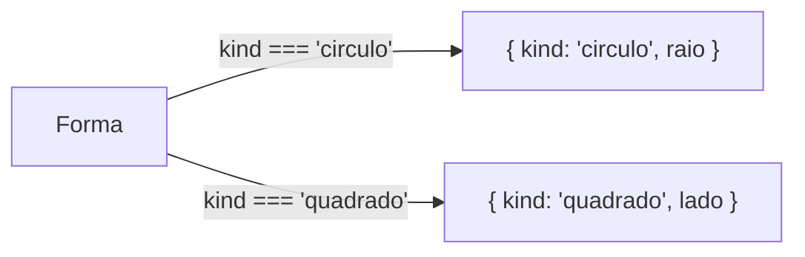

# Unions, intersections e literais

## Union types

Uma _union_ (`A | B`) descreve um valor que pode ser de um tipo **ou** de outro:

```ts
type ID = string | number;

function buscar(id: ID) {
  // ...
}

buscar(10); // ok
buscar("abc"); // ok
buscar(true); // erro
```

Enquanto o TypeScript não sabe qual dos tipos o valor é, ele só deixa você usar o que é comum a todos:

```ts
function imprimir(id: string | number) {
  id.toString(); // ok: existe em string e em number
  id.toUpperCase(); // erro: Property 'toUpperCase' does not exist on type 'number'.
}
```

Para usar o que é específico de um dos tipos, é preciso estreitar o tipo com uma checagem, como `typeof id === "string"`. Isso é _narrowing_, assunto de [Narrowing e type guards](/labs/web-dev/typescript/06-narrowing-e-type-guards/).

## Intersection types

Uma _intersection_ (`A & B`) descreve um valor que é dos dois tipos **ao mesmo tempo**, ou seja, tem todas as propriedades de ambos:

```ts
type ComId = { id: number };
type ComNome = { nome: string };

type Usuario = ComId & ComNome; // { id: number; nome: string }

const u: Usuario = { id: 1, nome: "Ana" };
```

Intersections são úteis para compor formatos a partir de peças menores, como "qualquer entidade + timestamps".

Quando as duas partes têm a mesma propriedade com tipos incompatíveis, o resultado não dá erro na declaração: a propriedade vira `never`, porque nenhum valor pode ser `string` e `number` ao mesmo tempo.

```ts
type A = { valor: string };
type B = { valor: number };
type C = A & B; // valor: never, nenhum objeto consegue satisfazer C
```

## Unions de literais

Juntando literal types (vistos em [Tipos básicos](/labs/web-dev/typescript/02-tipos-basicos/)) com union, você define um conjunto fechado de valores:

```ts
type Status = "idle" | "loading" | "error";
type Direcao = "cima" | "baixo" | "esquerda" | "direita";
```

Compare com a alternativa preguiçosa:

```ts
type Status = string; // largo demais
```

Com `string`, `"carregando"`, `"loadng"` e `"qualquer coisa"` passam sem aviso. Com a union de literais, o compilador barra erros de digitação, o editor autocompleta as opções, e um `switch` sobre o valor pode ser checado quanto a casos esquecidos (mais abaixo).

## Discriminated unions

Uma _discriminated union_ é uma union de objetos em que todos os membros têm uma propriedade em comum com um valor literal diferente em cada um. Essa propriedade, a discriminante (normalmente `kind`, `type`, `status` ou `ok`), diz qual variante você tem nas mãos:

```ts
type Forma =
  | { kind: "circulo"; raio: number }
  | { kind: "quadrado"; lado: number };

function area(forma: Forma): number {
  if (forma.kind === "circulo") {
    return Math.PI * forma.raio ** 2; // aqui forma é o círculo
  }
  return forma.lado ** 2; // aqui só pode ser o quadrado
}
```



O padrão é muito usado para modelar respostas de API, em que sucesso e falha têm formatos diferentes:

```ts
type ApiResult<T> = { ok: true; data: T } | { ok: false; error: string };

function tratar<T>(res: ApiResult<T>) {
  if (res.ok) {
    console.log(res.data); // res: { ok: true; data: T }
  } else {
    console.error(res.error); // res: { ok: false; error: string }
  }
}
```

Repare que é impossível acessar `res.data` sem antes conferir `res.ok`. O tipo obriga você a tratar o caso de erro. O `<T>` torna o tipo reutilizável para qualquer formato de dado (veja [Generics](/labs/web-dev/typescript/08-generics/)).

## Checagem de exaustividade com never

Com uma discriminated union ou uma union de literais, dá para pedir ao compilador que garanta que **todos** os casos foram tratados. O truque é atribuir o valor a uma variável `never` no `default`:

```ts
type Status = "idle" | "loading" | "success" | "error";

function rotulo(s: Status): string {
  switch (s) {
    case "idle":
      return "Parado";
    case "loading":
      return "Carregando...";
    case "success":
      return "Pronto!";
    case "error":
      return "Falhou";
    default: {
      const _exaustivo: never = s;
      return _exaustivo;
    }
  }
}
```

Por que funciona: a cada `case`, o TypeScript elimina uma possibilidade do tipo de `s`. Depois de todos os casos, não sobra nada, e o tipo de `s` no `default` é `never`, então a atribuição é válida.

Agora imagine que alguém adiciona `"cancelado"` ao `Status` e esquece de atualizar o `switch`. No `default`, `s` passa a ser `"cancelado"`, que não cabe em `never`, e a compilação falha:

```text
Type '"cancelado"' is not assignable to type 'never'.
```

O erro aponta exatamente o `switch` que precisa de atenção. Em vez de descobrir o caso esquecido em produção, você descobre ao compilar. Uma versão reutilizável desse truque, a função `assertNever`, aparece em [Padrões que escalam](/labs/web-dev/typescript/15-padroes-que-escalam/).

## Modelando estados impossíveis como impossíveis

Um jeito comum de modelar o estado de uma requisição é com várias flags soltas:

```ts
type Estado = {
  carregando: boolean;
  erro?: string;
  dados?: Usuario[];
};
```

O problema é que esse tipo permite combinações sem sentido: `carregando: true` com `dados` preenchido e `erro` preenchido ao mesmo tempo. Cada componente que usa esse estado precisa adivinhar qual combinação é válida.

Com uma discriminated union, só os estados reais existem:

```ts
type Estado =
  | { status: "idle" }
  | { status: "loading" }
  | { status: "success"; dados: Usuario[] }
  | { status: "error"; erro: string };
```

Agora `dados` só existe quando `status` é `"success"`, e o compilador garante isso. Essa ideia, "tornar estados inválidos impossíveis de representar", é uma das formas mais eficientes de eliminar bugs usando o sistema de tipos.

## Referências

- [Everyday Types - Union Types](https://www.typescriptlang.org/docs/handbook/2/everyday-types.html) - TypeScript Handbook, en
- [Narrowing - Discriminated unions](https://www.typescriptlang.org/docs/handbook/2/narrowing.html) - TypeScript Handbook, en
- [Object Types - Intersection Types](https://www.typescriptlang.org/docs/handbook/2/objects.html) - TypeScript Handbook, en
