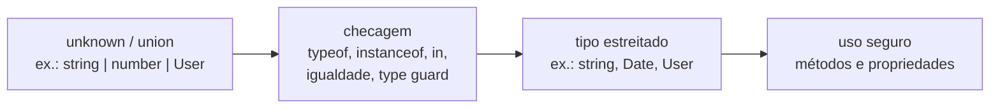

# Narrowing e type guards

## O que é narrowing

_Narrowing_ (estreitamento) é o processo pelo qual o TypeScript transforma um tipo amplo, como `string | number` ou `unknown`, num tipo mais específico dentro de um trecho do código. Você faz uma checagem comum de JavaScript, e o compilador entende o resultado:

```ts
function formatar(valor: string | number) {
  if (typeof valor === "string") {
    return valor.toUpperCase(); // aqui valor: string
  }
  return valor.toFixed(2); // aqui valor: number
}
```

Por trás disso está o _control flow analysis_: o compilador acompanha os caminhos do código (`if`/`else`, `return`, `throw`, `switch`, `&&`, `||`) e sabe qual tipo cada variável tem em cada ponto. Um efeito muito usado é o _early return_:

```ts
function saudar(usuario: { nome: string } | null) {
  if (!usuario) return; // caminho do null termina aqui
  console.log(usuario.nome); // daqui para baixo, usuario não é null
}
```



## Técnicas nativas

### typeof

Para primitivos. Os resultados possíveis são `"string"`, `"number"`, `"bigint"`, `"boolean"`, `"symbol"`, `"undefined"`, `"object"` e `"function"`:

```ts
function tamanho(x: string | string[]) {
  if (typeof x === "string") return x.length;
  return x.length; // string[]
}
```

Pegadinha herdada do JavaScript: `typeof null` é `"object"`. Por isso, checar `typeof x === "object"` não exclui `null`; é preciso somar `x !== null`.

### instanceof

Para instâncias de classes e construtores, como `Date`, `Error` ou suas próprias classes:

```ts
function exibir(data: Date | string) {
  if (data instanceof Date) {
    return data.toLocaleDateString("pt-BR"); // data: Date
  }
  return data;
}
```

`instanceof` não funciona com interfaces e type aliases, porque eles não existem em runtime.

### Operador in

Confere se uma propriedade existe no objeto. Útil para distinguir formatos sem discriminante:

```ts
type Gato = { miar(): void };
type Cachorro = { latir(): void };

function falar(animal: Gato | Cachorro) {
  if ("miar" in animal) {
    animal.miar(); // animal: Gato
  } else {
    animal.latir(); // animal: Cachorro
  }
}
```

Desde o TypeScript 4.9, o `in` também funciona com propriedades que o tipo não declara. Depois de `"id" in x`, o compilador passa a saber que `x.id` existe (com tipo `unknown`), o que facilita muito validar dados desconhecidos sem recorrer a `any`:

```ts
function temIdTexto(x: unknown): boolean {
  return (
    typeof x === "object" && x !== null && "id" in x && typeof x.id === "string"
  );
}
```

### Igualdade e truthiness

Comparações com `===`, `!==`, `==` e `!=` também estreitam. Um atalho conhecido é `!= null`, que elimina `null` e `undefined` de uma vez:

```ts
function exibir(nome: string | null | undefined) {
  if (nome != null) {
    console.log(nome.trim()); // nome: string
  }
}
```

Checar _truthiness_ (`if (nome)`) também funciona, mas com um risco: `0`, `""` e `NaN` são _falsy_ e também caem no `else`. Num campo como `quantidade: number | undefined`, `if (quantidade)` trata zero como "não informado", o que provavelmente é um bug. Para números e strings, prefira a comparação explícita com `undefined`/`null`.

### switch em discriminated union

Com uma propriedade discriminante, cada `case` estreita para a variante correspondente:

```ts
type Forma =
  | { kind: "circulo"; raio: number }
  | { kind: "quadrado"; lado: number };

function descrever(forma: Forma) {
  switch (forma.kind) {
    case "circulo":
      return `Círculo de raio ${forma.raio}`;
    case "quadrado":
      return `Quadrado de lado ${forma.lado}`;
  }
}
```

Discriminated unions e checagem de exaustividade estão em [Unions, intersections e literais](/labs/web-dev/typescript/05-unions-intersecoes-e-literais/).

## Type predicates

Quando a checagem é mais complexa ou se repete, dá para encapsulá-la numa função. Para o TypeScript entender o que a função prova, o retorno é anotado com um _type predicate_ (`parametro is Tipo`):

```ts
interface Usuario {
  id: string;
  nome: string;
}

function isUsuario(x: unknown): x is Usuario {
  return (
    typeof x === "object" &&
    x !== null &&
    "id" in x &&
    typeof x.id === "string" &&
    "nome" in x &&
    typeof x.nome === "string"
  );
}

function processar(dado: unknown) {
  if (isUsuario(dado)) {
    console.log(dado.nome); // dado: Usuario
  }
}
```

Essas funções se chamam _type guards_ definidos pelo usuário. Dois cuidados:

- Receba `unknown`, não `any`. Com `any`, o corpo da função não é checado e você pode escrever `return x.id` sem perceber que não verificou nada.
- O compilador confia no predicado. Se a função retorna `true` para algo que não é `Usuario`, o tipo mente. A responsabilidade de a lógica estar certa é sua.

Desde o TypeScript 5.5, o compilador infere type predicates sozinho em casos simples. O exemplo clássico é filtrar valores nulos de um array:

```ts
const valores = [1, null, 2, undefined, 3];
const numeros = valores.filter((v) => v != null); // number[] (antes do 5.5, era (number | null | undefined)[])
```

## Assertion functions

Uma _assertion function_ não retorna `true`/`false`: ela lança um erro se a condição falhar. Se a execução continua depois da chamada, o TypeScript assume que a condição é verdadeira:

```ts
function assertString(x: unknown, nome: string): asserts x is string {
  if (typeof x !== "string") {
    throw new Error(`${nome} deveria ser string`);
  }
}

function conectar(url: unknown) {
  assertString(url, "url");
  return url.startsWith("https"); // url: string daqui em diante
}
```

Quando usar cada uma? Type predicate quando você quer decidir o que fazer nos dois casos (um `if`/`else`). Assertion function quando o caso inválido é um erro e a execução deve parar ali, como na validação de configuração ao subir a aplicação.

## Type assertions (as) e non-null assertion (!)

Uma _type assertion_ (`valor as Tipo`) não converte nem verifica nada. Ela só diz ao compilador "confie em mim, isso é deste tipo":

```ts
const dados = JSON.parse(texto) as Usuario; // nenhuma checagem acontece
dados.nome.toUpperCase(); // se o JSON não tiver nome, quebra em runtime
```

Usar `as` para fazer um erro de compilação sumir é mentir para o compilador: o erro estava avisando de um problema real, e agora ele vai aparecer em produção. A diferença de mentalidade cabe numa frase: com narrowing você **prova** o tipo, com `as` você só **afirma**.

Há usos legítimos, quando você realmente sabe mais que o compilador (por exemplo, um elemento do DOM que você mesmo criou). Mesmo assim, prefira um type guard sempre que der.

A _non-null assertion_ (`!`) é um caso particular: `valor!` remove `null` e `undefined` do tipo sem checar nada.

```ts
const botao = document.getElementById("salvar")!;
botao.addEventListener("click", salvar); // se o id não existir, TypeError em runtime
```

Um `!` aqui e ali, onde a existência é garantida por outra lógica, é aceitável. Espalhado pelo código, ele desfaz o trabalho do `strictNullChecks`.

Por fim, existe um operador que parece uma assertion mas é seguro: `satisfies` (TypeScript 4.9). Ele **checa** se o valor é compatível com o tipo, sem trocar o tipo inferido. Ele aparece com detalhes em [Padrões que escalam](/labs/web-dev/typescript/15-padroes-que-escalam/).

## Referências

- [Narrowing](https://www.typescriptlang.org/docs/handbook/2/narrowing.html) - TypeScript Handbook, en
- [TypeScript 4.9 - narrowing com in e satisfies](https://www.typescriptlang.org/docs/handbook/release-notes/typescript-4-9.html) - TypeScript, en
- [typeof](https://developer.mozilla.org/pt-BR/docs/Web/JavaScript/Reference/Operators/typeof) - MDN, pt-BR
- [instanceof](https://developer.mozilla.org/pt-BR/docs/Web/JavaScript/Reference/Operators/instanceof) - MDN, pt-BR
- [in](https://developer.mozilla.org/pt-BR/docs/Web/JavaScript/Reference/Operators/in) - MDN, pt-BR
