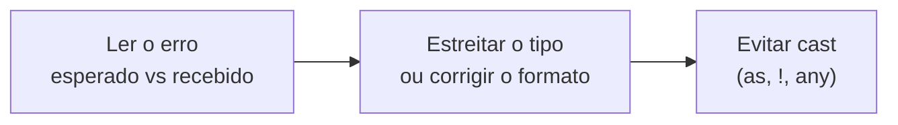

# Erros comuns e debugging

## Lendo mensagens de erro

Mensagens de erro do TypeScript assustam no começo, mas quase todas seguem o mesmo esquema: **o que era esperado** vs **o que foi recebido**. A primeira atitude é identificar esses dois lados.

Em erros com objetos aninhados, a mensagem vem em camadas, da mais geral para a mais específica:

```text
error TS2322: Type '{ id: number; endereco: { cep: number; }; }' is not assignable to type 'Usuario'.
  The types of 'endereco.cep' are incompatible between these types.
    Type 'number' is not assignable to type 'string'.
```

A linha mais útil costuma ser a **última**: ela diz exatamente onde está o desencontro (aqui, `cep` deveria ser `string`). Leia de baixo para cima.

Todo erro tem um código, como `TS2322`. Pesquisar pelo código costuma dar resultados mais certeiros do que pelo texto da mensagem.

## Os erros mais frequentes

### Type 'X' is not assignable to type 'Y' (TS2322)

O valor não tem o tipo que a variável, propriedade ou retorno exige.

```ts
let idade: number = "30"; // Type 'string' is not assignable to type 'number'.
```

Pergunte-se qual lado está errado: o valor (converta, `Number("30")`) ou o tipo (talvez ele devesse aceitar mais coisas).

### Object is possibly 'null' / 'undefined' (TS2531, TS2532, TS18047, TS18048)

Você está usando algo que pode não existir. É o `strictNullChecks` fazendo o trabalho dele.

```ts
const usuario = usuarios.find((u) => u.id === id); // Usuario | undefined
console.log(usuario.nome); // 'usuario' is possibly 'undefined'.
```

Trate o caso: `if (!usuario) return;`, `usuario?.nome`, ou um valor padrão com `??`.

### Property 'X' does not exist on type 'Y' (TS2339)

A propriedade não está no tipo. Pode ser erro de digitação, um tipo incompleto, ou uma union que ainda não foi estreitada:

```ts
function exibir(r: { ok: true; data: string } | { ok: false; error: string }) {
  console.log(r.data); // Property 'data' does not exist on type '{ ok: false; error: string; }'.
}
```

Nesse caso, a solução é estreitar antes (`if (r.ok)`), como em [Narrowing e type guards](/labs/web-dev/typescript/06-narrowing-e-type-guards/).

### Argument of type 'X' is not assignable to parameter of type 'Y' (TS2345)

O mesmo desencontro do TS2322, só que na chamada de uma função. Confira a assinatura da função (hover no nome dela) e compare com o que você está passando.

### Excess property checks (TS2353)

```ts
type Usuario = { id: number; nome: string };
const u: Usuario = { id: 1, nome: "A", idade: 20 };
// Object literal may only specify known properties, and 'idade' does not exist in type 'Usuario'.
```

Em object literals, o TypeScript barra propriedades desconhecidas, porque normalmente indicam erro de digitação ou um campo que você achou que existia. Ou o campo está errado, ou o tipo precisa dele. Detalhes em [Interfaces e type aliases](/labs/web-dev/typescript/04-interfaces-e-type-aliases/).

### Cannot find module (TS2307) / Could not find a declaration file (TS7016)

Dois erros parecidos, causas diferentes:

- **TS2307**: o TypeScript não encontrou o módulo. Pacote não instalado, caminho errado, extensão faltando (com `nodenext`, imports relativos precisam de `.js`), alias de `paths` mal configurado.
- **TS7016**: o módulo existe, mas não tem tipos. Instale o `@types/` correspondente ou escreva um `declare module` (veja [Módulos e declarações](/labs/web-dev/typescript/11-modulos-e-declaracoes/)).

Para globais como `process`, `Buffer` ou `describe` ("Cannot find name 'process'"), lembre que desde o TypeScript 6.0 a opção `types` vem vazia: adicione `"types": ["node"]` (ou o do seu test runner) no tsconfig.

## Fluxo de correção



1. **Leia** o esperado e o recebido, de baixo para cima.
2. **Corrija na origem**: estreite o tipo com uma checagem, ajuste o formato do dado, ou ajuste o tipo se ele estava errado.
3. **Evite casts** como primeira resposta. Eles fazem o erro sumir sem corrigir nada.

Correções rápidas que resolvem a maioria dos casos:

| Situação                                | Correção                                                          |
| --------------------------------------- | ----------------------------------------------------------------- |
| Valor pode ser `null`/`undefined`       | `usuario?.nome`, `if (!usuario) return`, `valor ?? padrao`        |
| Union ainda não estreitada              | `typeof`, `instanceof`, `"campo" in obj`, discriminante           |
| Função precisa só de parte de um objeto | `Pick<Usuario, "id">` no parâmetro                                |
| Objeto parcial (rascunho, PATCH)        | `Partial<Usuario>`                                                |
| Função que deveria aceitar vários tipos | Generics (`function f<T>(x: T)`)                                  |
| API do ambiente "não existe"            | Ajustar `lib` (ex.: `["es2023", "dom"]`) ou instalar `@types/...` |

## Anti-padrões para calar o compilador

Todos funcionam, no sentido de fazer o erro sumir. E todos trocam um erro de compilação, fácil de achar, por um bug em runtime, difícil de achar.

`as any` desliga a checagem daquele valor, e o `any` se espalha para tudo que toca nele:

```ts
const dados = api.get() as any;
dados.usuario.nome.toUpperCase(); // nenhuma checagem em toda a cadeia
```

`as unknown as T` é a versão "duplo salto" que força qualquer conversão. Se você precisou dela, provavelmente os tipos estão errados em algum outro lugar.

`@ts-ignore` silencia o erro da linha seguinte, qualquer que seja ele. Se for inevitável suprimir (um bug de tipos numa biblioteca, por exemplo), prefira `@ts-expect-error` (TypeScript 3.9): ele também silencia, mas **acusa erro quando o erro esperado deixa de existir**, então a supressão não fica esquecida no código para sempre. E deixe um comentário explicando o porquê:

```ts
// @ts-expect-error - tipos da lib-x 2.1 não incluem a opção "retry" (corrigido na 2.2)
cliente.configurar({ retry: 3 });
```

Os outros dois: `!` (non-null assertion) espalhado pelo código e `JSON.parse`/`res.json()` usados sem validação. Para ambos, a saída é a mesma: provar o tipo com uma checagem real em vez de afirmar (veja [Padrões que escalam](/labs/web-dev/typescript/15-padroes-que-escalam/)).

## Ferramentas de investigação

O editor é a principal ferramenta. Passe o mouse sobre uma variável para ver o tipo que o TypeScript inferiu; muitas vezes o problema é que ele inferiu algo diferente do que você imaginava (`string` em vez de `"admin"`, `any` vindo de uma biblioteca). "Go to Type Definition" leva direto à declaração do tipo, inclusive dentro de `node_modules`.

O **TypeScript Playground** (no site oficial) roda o compilador no navegador. É ótimo para isolar um problema num exemplo mínimo, testar como uma versão específica do TypeScript se comporta e compartilhar o código com alguém por link.

Na linha de comando:

```bash
npx tsc --noEmit              # checa o projeto inteiro, sem gerar arquivos
npx tsc --noEmit --pretty false   # saída em uma linha por erro, boa para scripts
npx tsc --explainFiles        # por que cada arquivo foi incluído na compilação
npx tsc --traceResolution     # passo a passo de como cada import foi resolvido
npx tsc --showConfig          # configuração final, já com o extends aplicado
```

`--traceResolution` é a arma para erros de "Cannot find module": mostra todos os caminhos que o compilador tentou. `--showConfig` resolve o mistério de "por que essa opção não está valendo?" quando há vários tsconfig encadeados com `extends`.

## Referências

- [Understanding Errors](https://www.typescriptlang.org/docs/handbook/2/understanding-errors.html) - TypeScript Handbook, en
- [TypeScript 3.9 - @ts-expect-error](https://www.typescriptlang.org/docs/handbook/release-notes/typescript-3-9.html) - TypeScript, en
- [Referência do TSConfig](https://www.typescriptlang.org/pt/tsconfig) - typescriptlang.org, pt-BR
- [Arquivos de declaração - Consumo](https://www.typescriptlang.org/pt/docs/handbook/declaration-files/consumption.html) - typescriptlang.org, pt-BR
